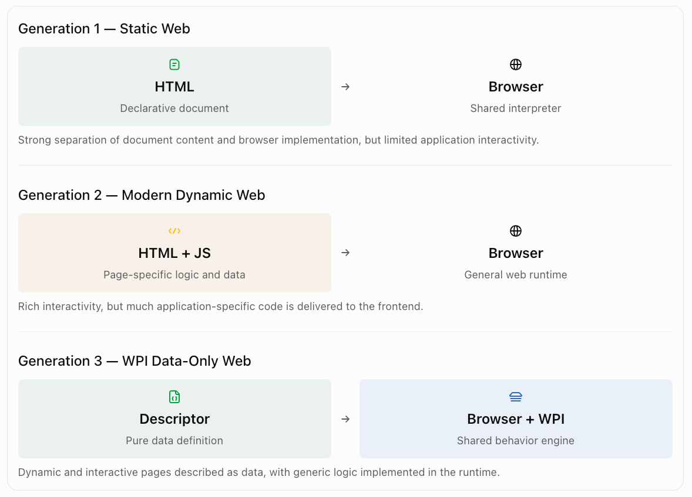

# 1. Overview

Web Page Interpreter (WPI) abstracts away logic from web pages so that pages are 'pure data'. This is 
exactly what Tim Bernar-Lee envisioned: browser (the interpreter, pure logical, independent of any 
page) + HTML (pure data, declarative), the static HTML era.

Then things got complicated. Static HTML has too many limitations, thus JavaScript (the code) appears. 
HTML (the data) is then mixed with code (the logic), an HTML page is no longer pure data but 
data + code. The moment code creeps in, it brings lots of surprises, good ones, but with a price 
tag: the browser is no longer enough. Additional application-specific code is needed and poured to 
the frontend.

Dynamic HTML is critical and should stay, but not in the way it is now. What WPI does is to keep 
what dynamic HTML is, but enhance the browsers with the WPI so that even dynamic pages can still 
stay being pure data.

The defining characteristic of WPI is not that pages are interpreted, descriptor-driven, or even declarative. Those are implementation mechanisms.

The defining characteristic is:

> A web page is pure data, even when it is dynamic and interactive.

That is a stronger architectural principle. WPI aims to restore the separation between 
document and interpreter that characterized the early Web, while preserving the 
capabilities of modern dynamic applications.

There is an important nuance: HTML has always been declarative, and modern frameworks such 
as React and Svelte also use declarative programming. But declarative programming does 
not necessarily mean code-free pages. The WPI goal is to eliminate page-specific executable 
logic from page definitions.

## 2. The conceptual difference

The evolution that WPI brings can be expressed as three generations of web architecture.


The architectural progression is not simply:

Static → Dynamic → More Dynamic

It is:

Data + Interpreter → Data + Application Code + Interpreter → Data + Enhanced Interpreter

That is the central innovation.

## 3. The names

| Candidate        | Emphasizes pure data | Emphasizes no page code | Sounds like an architectural category |
| ---------------- | -------------------- | ----------------------- | ------------------------------------- |
| Pure Data Page   | Excellent            | Excellent               | Good                                  |
| Data-Only Page   | Excellent            | Excellent               | Good                                  |
| Data-Native Page | Strong               | Moderate                | Excellent                             |
| CodeLess Page    | Moderate             | Excellent               | Good                                  |
| Logic-Free Page  | Moderate             | Excellent               | Moderate                              |
| Declarative Page | Moderate             | Weak                    | Good                                  |
| Descriptor Page  | Strong               | Moderate                | Good                                  |
| Interpreted Page | Moderate             | Moderate                | Excellent                             |

Pure Data Page (PDP) is the best technical name. It immediately expresses the fundamental separation of page data from application-specific executable code.

Data-Native Page (DNP) is the best architectural or branding name. It sounds like a new class of web technology rather than merely a different way of serializing page definitions.

## 4. One important conceptual distinction

I would be careful about saying that WPI removes all logic from a page.

Consider your action descriptor:

```
{
  "on": "change",
  "action": "openPage",
  "page": "show-metric-details",
  "target": "right-pane"
}
```

This is pure data in terms of its representation, but it still specifies behavior.

In programming language terminology, it has declarative behavioral semantics. The descriptor says what should happen, while the interpreter supplies the executable implementation.

Therefore, the strongest technical claim is not:

> A page contains no logic.

It is:

> A page contains no page-specific executable code. Its structure and behavior are expressed entirely as declarative data.

That distinction makes the architecture more defensible.

## Plugins and WPI Extendability
There is also an unavoidable boundary: genuinely new behavior still requires implementation somewhere, either in WPI, a reusable plugin, or a backend service. WPI eliminates repeated page-specific implementation; it does not eliminate the need to implement new capabilities.

# Web Page Interpreter (WPI)

The reusable engine that renders and executes Pure Data Pages.

This produces a natural statement:

> WPI brings the pure-data philosophy of the early Web to modern dynamic web applications.

And a concise architectural slogan:

Pure Data Pages. Dynamic Behavior. Zero Page-Specific Code.