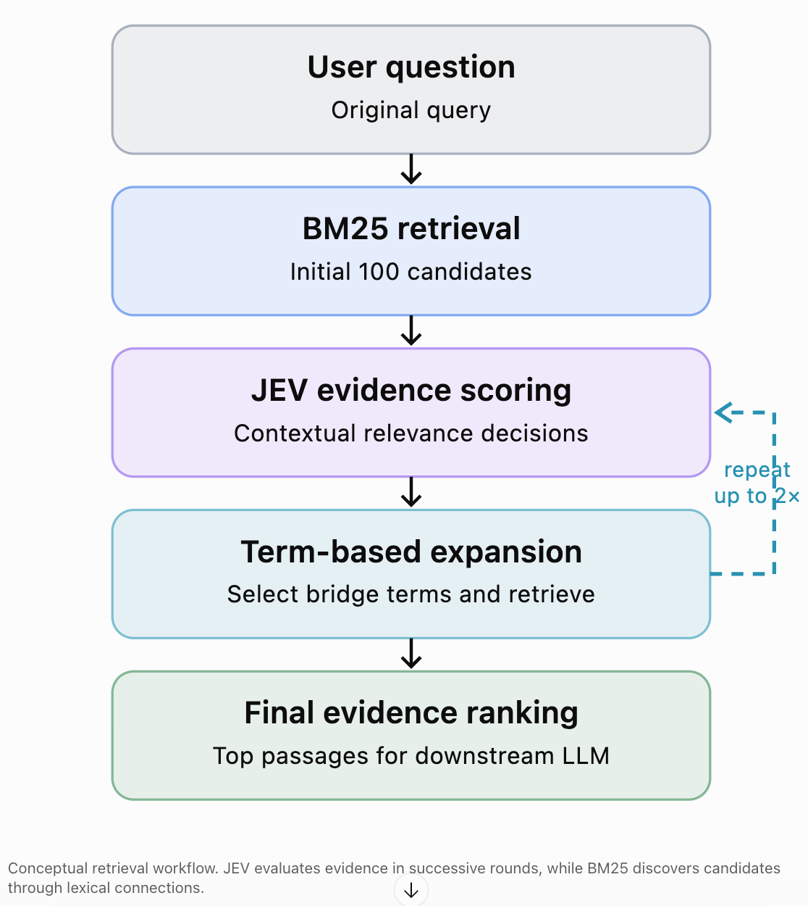
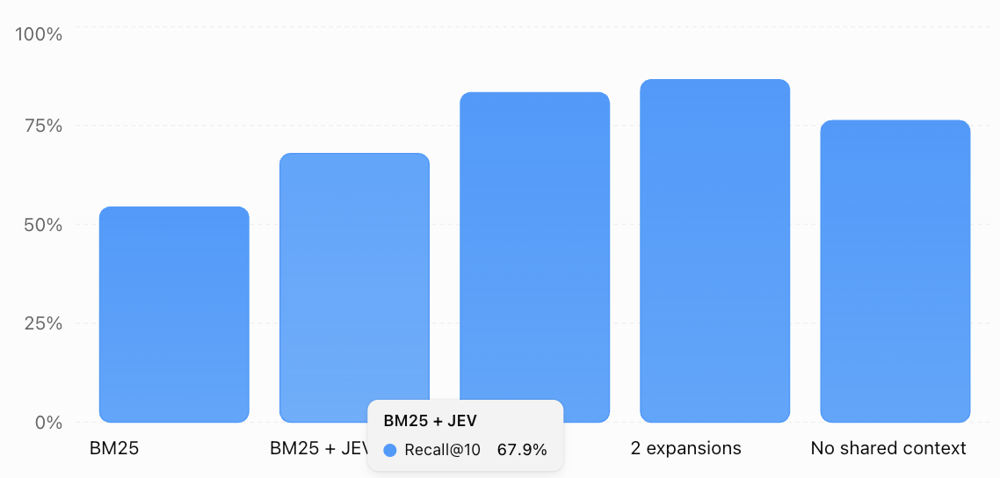

# Paper Summary: SAG2 — Embedding-Free Multi-Hop Retrieval with BM25 and JEV

Yuchao Wu · Zleap AI · October 15, 2026

Paper: [arXiv:2610.22588](https://arxiv.org/pdf/2610.22588?utm_source=chatgpt.com)\
Code: [SAG-Benchmark GitHub repository](https://github.com/Zleap-AI/SAG-Benchmark?utm_source=chatgpt.com)

## 1. Executive summary

SAG2 proposes a retrieval architecture that achieves strong multi-hop retrieval accuracy without embeddings, a vector database, a precomputed knowledge graph, or LLM-based knowledge extraction during ingestion.

Instead, it combines three components:

- SQLite + BM25: Provides lightweight lexical indexing and candidate retrieval.
- JEV: A specialized neural decision model that evaluates whether a passage contributes necessary evidence toward answering a question.
- Iterative retrieval expansion: Uses relevant passages to discover additional search terms, retrieve connected passages, and progressively assemble an evidence chain.

The loop is implemented inside the search engine, not from agents.

The central insight is that semantic understanding can be moved from document ingestion to query time.

Traditional RAG systems perform substantial preprocessing, including generating embeddings and potentially extracting entities, relationships, or knowledge graphs. SAG2 stores original text with a lexical index and performs semantic evidence evaluation only when answering a query.

Its ingestion is simply storing chunks to a database, with full-text search indexes (BM25). 
The author uses SQLight. SemOS uses PostgreSQL. The concepts are the same. PG should be
able to insert thousands of chunks per second. Ingestion in SAG2 is not an issue.

Its reported results are impressive:

| Benchmark       | BM25 Recall\@10 | SAG2 Recall\@10 |
| --------------- | --------------- | --------------- |
| MuSiQue         | 54.41%          | 86.62%          |
| 2WikiMultiHopQA | 71.50%          | 97.43%          |
| HotpotQA        | 86.90%          | 99.00%          |

SAG2 achieves the highest Recall\@5 and Recall\@10 among the systems compared in the paper, including dense retrievers, HippoRAG 2, and the original SAG.&#x20;

The particularly interesting contribution is not simply replacing vector search with BM25. It is demonstrating that iterative, evidence-guided candidate discovery can be more important than sophisticated one-shot similarity search.

## 2. How SAG2 works

SAG2 implements an iterative retrieval process in which each round uses evidence discovered in previous rounds to find additional evidence.

Conceptual retrieval workflow. JEV evaluates evidence in successive rounds, while BM25 discovers candidates through lexical connections.

### Step 1: Retrieve initial candidates using BM25

The original question is tokenized and submitted to the SQLite FTS5 index.
No LLM is used (such as extracting keywords from queries).

The system retrieves the top 100 (configurable) matching passages.

Its lexical index uses three weighted fields:

| Field   | BM25 weight |
| ------- | ----------- |
| Title   | 2           |
| Heading | 2           |
| Body    | 1           |

No embeddings or neural models are needed at this stage.

### Step 2: Evaluate candidates using JEV

For each candidate passage, JEV evaluates whether it contributes necessary evidence to answering the question.

The scoring function is:

$$ s_r(d)=J(q,d;E_r)\in[0,1]$$

Where:

- $q$: Original question
- $d$: Candidate passage
- $E_r$: Evidence context accumulated for the current round
- $s_r(d)$: Evidence relevance score

An important distinction is that JEV is not simply evaluating semantic similarity.

It evaluates whether a passage supplies a necessary fact in a supported reasoning chain, including intermediate facts.

For example, consider the question:

> Which county contains the birthplace of person X?

The first relevant passage may identify the person's birthplace. A second passage may identify the county containing that location.

The second passage may have almost no lexical overlap with the original question, but becomes relevant after the birthplace is identified.

JEV can evaluate this relationship using the accumulated context.

### Step 3: Select expansion terms

This step is critical. SAG2 selects up to 10 high-scoring passages that 
have not previously been used for expansion.

It extracts candidate terms from those passages and assigns each a priority based on:

- Term frequency in the passage.
- Inverse document frequency (rarer terms receive higher weight).
- Overlap between the term's sentence and the original question.
- JEV evidence score of the source passage.

The top 20 (configurable) expansion terms are selected.

This is particularly important: JEV decides which passages are useful, but lexical statistics determine which terms are used to discover additional passages.

The process does not require an LLM to generate a new query.

### Step 4: Retrieve additional passages

Each selected expansion term triggers a lexical search.

SAG2 retrieves up to 100 new candidate passages, distributing the candidate budget across the selected terms.

The newly retrieved passages are then evaluated by JEV using the original question and previously retrieved evidence.

### Step 5: Repeat and return evidence

SAG2 permits up to two expansion rounds, producing at most three JEV scoring rounds.

The default configuration limits the total to 340 passage judgments per question, including repeated evaluations.

The final passages are ranked by contextual evidence scores, with a lightweight lexical diversity adjustment to the top ten.

This is a bounded retrieval algorithm, not an open-ended autonomous agent.&#x20;

## 3. Why iterative expansion matters

The paper includes ablation experiments showing how each component contributes to performance.

Higher is better; percentages from the paper's ablation experiments.

Three findings stand out.

First, JEV reranking alone is insufficient. Adding JEV to the initial BM25 results increases Recall\@10 from 54.41% to 67.93%, but it cannot recover supporting passages absent from the original candidate pool.

Second, expansion produces the largest improvement. A single expansion raises Recall\@10 to 83.36%. A second expansion increases it further to 86.62%.

Third, shared context is critical. Removing contextual evidence from JEV evaluations reduces Recall\@10 from 86.62% to 76.25%.

The paper also compares SAG2 against one-shot BM25+JEV using approximately the same number of passage judgments. SAG2 achieves 86.62%, compared with 69.82% for the larger one-shot candidate pool.

This is strong evidence that the improvement comes from discovering better candidates, rather than merely evaluating more candidates.&#x20;

[image](https://www.google.com/s2/favicons?domain=https://arxiv.org\&sz=32)

arXiv

## 4. Infrastructure and computational costs

The paper reports the following results on MuSiQue:

- Index construction: 2.36 seconds, 11,656 passages
- SQLite index size: 25.87 MiB
- No stored embeddings
- Offline model cost: $0, no model calls during indexing
- Online model cost: $4.33, per 1,000 queries

The online cost is approximately $0.00433 per query, using the reported JEV service pricing.

However, the paper does not provide reliable end-to-end query latency measurements, and the cost figures exclude answer generation and infrastructure expenses.&#x20;

## 5. Limitations

Despite the strong results, there are important qualifications.

Dependence on JEV. The evaluated JEV model is accessed through a hosted service. Its model weights and detailed architecture were not publicly available at the time of the study. SAG2 is embedding-free, but it is not neural-model-free or necessarily fully local.

Lexical connectivity remains essential. If two relevant passages have no useful shared terms, the expansion process may never connect them. Synonyms, aliases, abbreviations, and cross-language terminology can be problematic.

Multi-hop retrieval remains challenging. On MuSiQue four-hop questions, SAG2 achieves 69.58% Recall\@10, but only 28.31% of questions have all supporting passages recovered.

Evaluation measures retrieval, not answer quality. The paper does not establish whether the retrieved evidence improves downstream answer accuracy, reasoning correctness, or hallucination rates.

Comparisons are not fully controlled. Some baselines use results from earlier papers, different decision models, and different computational budgets. The benchmark subsets are also relatively small, while the larger EnterpriseRAG-Bench corpus is synthetic.

## 6. Implications for SemOS

I think SAG2 is particularly relevant to SemOS because it supports an architectural direction you have been exploring: using lightweight indexing for candidate discovery, followed by investigative retrieval rather than relying on a global vector index.

There are three ideas worth considering.

### A. Separate candidate discovery from evidence judgment

SAG2 makes a clean distinction between two operations:

- Candidate discovery: BM25 and lexical expansion.
- Evidence judgment: JEV evaluates how each candidate contributes to the current question.

For SemOS, this separation could be extended further:

| SAG2                    | Possible SemOS equivalent                                  |
| ----------------------- | ---------------------------------------------------------- |
| SQLite FTS5             | PostgreSQL FTS/BM25                                        |
| Original passages       | Chunks, provisions, metrics, Scene Blocks                  |
| Expansion terms         | Keywords, aliases, entities, document references           |
| JEV evidence scores     | Specialized decision model or LLM-based evidence evaluator |
| Shared evidence context | Investigative retrieval state                              |
| Passage expansion       | Keyword, metadata, category, and graph traversal           |

### B. Extend lexical expansion with structured associations

SAG2 expands through shared lexical terms. SemOS already has richer potential associations, including normalized keywords, document references, categories, metrics, and extracted knowledge.

For example, two passages might describe the same concept using different terminology.

SAG2 may fail to connect them because there is insufficient lexical overlap.

SemOS could connect them through a canonical keyword or alias database without requiring embeddings.

This suggests a useful architecture:

Question + accumulated evidence

BM25 / lexical

Aliases / entities

Categories / metadata

References / graph

Unified candidate pool

Contextual evidence evaluator

Expand until evidence is sufficient or budget exhausted

This would retain SAG2's lightweight retrieval philosophy while exploiting the structured information SemOS already maintains.

### C. Investigative retrieval is more important than one-shot ranking

This is the most significant architectural lesson.

SAG2's results suggest that retrieval quality depends not only on how accurately a system ranks passages, but also on whether the retrieval process can discover evidence that was initially invisible to the search query.

That distinction is especially important for standards and regulations, where answering a question may require following definitions, cross-references, exceptions, requirements, and dependencies across documents.

SAG2 provides experimental support for a bounded investigative retrieval loop, although the paper does not demonstrate the same gains on standards or regulatory corpora.

## 7. Overall assessment

SAG2 is a meaningful contribution because it challenges two common assumptions in modern RAG architecture:

1. High-quality retrieval necessarily requires embeddings.
2. Multi-hop retrieval necessarily requires a precomputed knowledge graph.

The paper demonstrates that neither is strictly necessary for strong evidence recall on its evaluated benchmarks.

I would not conclude that embeddings or knowledge graphs are obsolete. Rather, SAG2 demonstrates that contextual evidence evaluation and iterative candidate discovery can compensate for much of the functionality traditionally provided by expensive preprocessing.

For SemOS, my recommendation would be to treat SAG2 as a retrieval strategy to evaluate, not as a replacement for your existing knowledge representations.

In particular, I would prioritize an experiment comparing BM25-only retrieval, BM25 with contextual reranking, and BM25 with one or two evidence-guided expansion rounds. Then test whether SemOS's normalized keywords and structured relationships improve the expansion process further.

The central takeaway is:

Index cheaply, retrieve iteratively, and use semantic reasoning to guide evidence discovery rather than trying to encode all semantic relationships before queries arrive.
