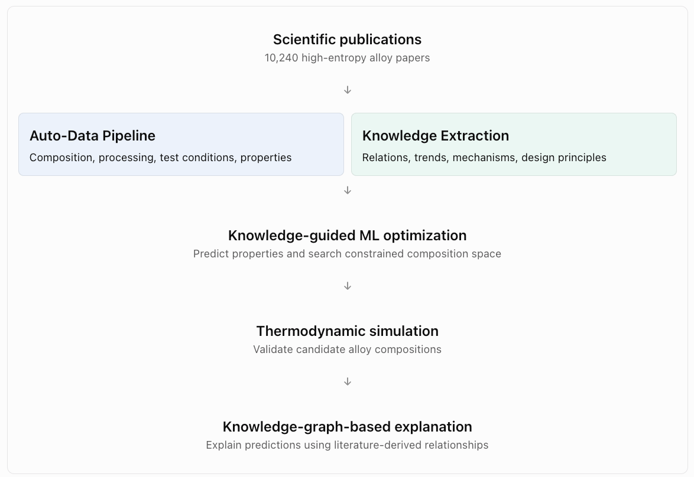

# Paper Summary: MatSeek — An Automated Knowledge-Driven Framework for Materials Research

Paper: [MatSeek: An Automated Knowledge-Driven Framework for Materials Research](https://openreview.net/forum?id=Tc2vIWAfy4\&utm_source=chatgpt.com) Conference: ICLR 2026 Topic: LLM-based scientific knowledge extraction, structured databases, knowledge-driven materials discovery.

## 1. Overview

The central idea of MatSeek is that extracting structured data from scientific publications is not enough. Scientific literature contains two complementary types of information:

1. Factual data: Experimental measurements, material compositions, processing conditions, and observed properties.
2. Scientific knowledge: Empirical trends, causal or mechanistic explanations, and design principles describing how and why material properties change.

Traditional LLM-based extraction systems primarily focus on the first category, converting publications into structured databases. MatSeek attempts to extract both categories and integrate them into a unified framework.

The authors apply MatSeek to 10,240 publications about high-entropy alloys, constructing a database containing 27,438 records. They demonstrate how the extracted knowledge can guide machine-learning models toward promising alloy compositions while providing scientific explanations for predictions.

## 2. The core architecture

Conceptually, MatSeek consists of two complementary extraction pipelines followed by a knowledge-guided discovery process.

- Input: Scientific publications, 10,240 high-entropy alloy papers
  - Structured data extraction: Compositions, properties, experimental measurements
  - Scientific knowledge extraction: Empirical trends, mechanisms, design principles
- Unified knowledge-driven framework: Structured observations + literature-derived scientific knowledge
- Machine-learning-driven alloy discovery: Constrained composition search + interpretable predictions

This is a conceptual representation of the framework, not a reproduction of the paper's implementation diagram.

The important distinction is that MatSeek treats scientific knowledge as something that can directly influence downstream optimization, rather than merely as text retrieved to explain a result.

Consider two statements from a hypothetical materials-science paper.

Statement A — Structured data

> An alloy containing 20% Cr, 25% Mn, and 55% Fe exhibits a tensile strength of 850 MPa.

A conventional extraction system might produce:

```
{
  "composition": {
    "Cr": 0.20,
    "Mn": 0.25,
    "Fe": 0.55
  },
  "tensile_strength": {
    "value": 850,
    "unit": "MPa"
  }
}
```

Statement B — Scientific knowledge

> Increasing chromium concentration improves corrosion resistance because chromium promotes the formation of a protective oxide layer.

This describes more than a measurement. It captures a relationship and an explanatory mechanism:
```text
(Chromium concentration, Protective oxide layer, Corrosion resistance)
```

This knowledge can potentially be generalized beyond an individual experimental observation.

MatSeek's central insight is that scientific knowledge should be extracted and represented explicitly, rather than remaining implicit in raw text or being approximated solely through numerical data.

## 3. How MatSeek extracts data and knowledge

The structured data pipeline uses multiple stages rather than a single LLM prompt. It filters irrelevant papers, identifies alloy compositions and processing conditions, standardizes these attributes, and extracts experimental properties under specific testing conditions.

This decomposition is important because the same alloy composition can produce different properties depending on processing and testing conditions. MatSeek therefore associates measurements with the correct experimental context instead of extracting isolated numbers.

In parallel, its knowledge-mining component identifies relationships between scientific entities, such as how composition influences microstructure and how microstructure affects mechanical properties. These relationships are assembled into a knowledge graph that can support scientific interpretation.&#x20;

MatSeek consists of five major stages:

- Scientific publications: 10,240 high-entropy alloy papers
- Auto-Data Pipeline: Composition, processing, test conditions, properties
- Knowledge Extraction: Relations, trends, mechanisms, design principles
- Knowledge-guided ML optimization: Predict properties and search constrained composition space
- Thermodynamic simulation: Validate candidate alloy compositions
- Knowledge-graph-based explanation: Explain predictions using literature-derived relationships



The Auto-Data Pipeline decomposes extraction into multiple tasks rather than relying on a single end-to-end LLM prompt. It incorporates literature filtering, attribute extraction, and cross-section information integration.

The knowledge module extracts scientific relationships, organizes them into a knowledge graph, and uses them both to constrain material search and to interpret predictions.

### 3.1 Knowledge-Guided ML Optimization

The central idea is straightforward: Use scientific knowledge extracted from publications to constrain the search space, and use a trained machine-learning model to identify the best candidates within that space.

Importantly, MatSeek does not primarily use scientific knowledge to train the ML model. Instead, it uses knowledge to guide the optimization process that operates on top of the trained model.

#### 3.1.1 The overall architecture

- Structured data: Alloy compositions and measured properties
  -> Train DNN predictor: Composition → Properties
- Scientific knowledge: Literature-derived design principles and relationships
  -> Generate constraints: Elements, bounds, rules
- Iterative optimization: Search candidate compositions satisfying the constraints; score them using the DNN
- Thermo-Calc validation: Evaluate recommended alloys through thermodynamic simulation


The paper calls this inverse alloy optimization: rather than predicting the properties of a given composition, the system searches for compositions that maximize a desired property.&#x20;

[image](https://www.google.com/s2/favicons?domain=https://openreview.net\&sz=32)

OpenReview


#### 3.1.2 Step-by-step explanation

### Step 1 — Train a property predictor

MatSeek extracts experimental records from scientific publications. Each record contains inputs such as alloy composition and measured outputs such as yield strength.

A deep neural network (DNN) learns an approximate mapping:

$$f\_\theta(\mathbf{x})\rightarrow \widehat{YS}$$

where:

- $\mathbf{x}$ represents an alloy composition.
- $\widehat{YS}$ is the predicted yield strength.
- $\theta$ represents the learned network parameters.

For example, the model might predict:

| Alloy composition (illustrative) | Predicted yield strength |
| -------------------------------- | ------------------------ |
| Al₁₅Cr₂₀Fe₃₀Ni₃₅                 | 920 MPa                  |
| Al₂₀Cr₂₅Fe₂₅Ni₃₀                 | 1,050 MPa                |
| Al₁₀Cr₃₀Fe₃₀Ni₃₀                 | 980 MPa                  |

Once trained, this model can quickly evaluate many hypothetical compositions without requiring physical experiments for every candidate.

### Step 2 — Extract scientific knowledge and generate constraints

This is where MatSeek differs from conventional ML optimization.

Suppose scientific publications suggest that certain elements improve strength, some elements increase density, and particular composition ranges are favorable.

MatSeek uses literature-derived knowledge to generate a machine-readable design-space specification.

The paper describes a JSON schema containing:

- Allowable chemical elements.
- Lower and upper composition bounds.
- Hard constraints governing permissible compositions.

For example, an illustrative specification might be:

```
{
  "elements": ["Al", "Cr", "Fe", "Ni"],
  "bounds": {
    "Al": [0.05, 0.25],
    "Cr": [0.10, 0.35],
    "Fe": [0.20, 0.50],
    "Ni": [0.10, 0.40]
  },
  "constraints": [
    "sum(compositions) == 1.0"
  ]
}
```

These numbers are illustrative, not the actual bounds used by the authors.

The crucial point is that knowledge is converted into explicit constraints that an optimization algorithm can enforce.

### Step 3 — Search for optimal compositions

MatSeek's experiment optimizes specific yield strength (SYS):

$$SYS(\mathbf{x})=\frac{YS(\mathbf{x})}{\rho(\mathbf{x})}$$

where $\rho$ is density.

The optimization problem can be expressed as:

$$\mathbf{x}^\* = \underset{\mathbf{x}\in\mathcal{C}(K)}{\arg\max} \frac{\widehat{YS}(\mathbf{x})}{\rho(\mathbf{x})}$$

Here, $\mathcal{C}(K)$ is the feasible composition space defined using extracted knowledge \\(K\\).

The optimizer repeatedly generates candidate compositions, predicts their performance, and searches for better candidates. The paper specifies an iterative local-search optimizer guided by a DNN predictor.&#x20;

The optimizer does not need to ask an LLM to evaluate every composition. The LLM's important role is upstream, when constructing the search constraints.

### Step 4 — Validate the best candidates

The highest-scoring candidates are evaluated using Thermo-Calc, a thermodynamic simulation package.

This provides an independent, physics-based assessment of the proposed alloy compositions. It is more expensive than a DNN prediction but much cheaper than experimentally manufacturing and testing every candidate.

Simulation is not equivalent to experimental validation, so physical testing remains important.

#### 3.1.3 Why knowledge-guided optimization is more efficient

The authors compare three different search strategies:

| Strategy | Search space                                                             | Main limitation                                    |
| -------- | ------------------------------------------------------------------------ | -------------------------------------------------- |
| Vanilla  | All 27 supported elements, without knowledge constraints                 | Enormous search space                              |
| LLM-only | Constraints proposed by an LLM without grounding in retrieved literature | May be plausible but unsupported                   |
| MatSeek  | Constraints grounded in extracted scientific knowledge                   | Smaller, more scientifically informed search space |

The paper reports that knowledge-guided search identifies high-performing candidates more efficiently than unconstrained search.&#x20;

Consider a simplified example with four alloy elements and 21 possible concentration values for each.

- Unconstrained combinations: 194,481 (21⁴) combinations
- Knowledge-constrained example: 625 (5⁴) combinations

Illustrative search-space comparison, before enforcing the sum-to-one constraint; not experimental results from MatSeek.

Knowledge constraints can eliminate vast regions of the search space before optimization begins.

There is a tradeoff, however: overly restrictive or incorrect knowledge could exclude genuinely optimal solutions.

#### 3.1.4 What this means for SemOS

The most interesting aspect of MatSeek is the conversion of extracted scientific knowledge into executable constraints.

This suggests a general architecture:

$$ \text{Documents} \rightarrow \text{Knowledge} \rightarrow \text{Constraints} \rightarrow \text{Optimization}$$

SemOS should distinguish three representations:

| Representation        | Example                                                                               |
| --------------------- | ------------------------------------------------------------------------------------- |
| Knowledge assertion   | Increasing chromium can improve corrosion resistance through oxide formation          |
| Operational rule      | Prefer compositions with sufficient chromium under specified environmental conditions |
| Executable constraint | `Cr >= threshold`, with the threshold established from applicable evidence            |

These are not equivalent. A scientific relationship does not automatically justify a universal numerical constraint. The transformation needs to preserve context, assumptions, and provenance.

## 4. Experimental results

Publications

# 10,240

Data records

# 27,438

Precision\*

# 96.49%

\*GPT-5 yield-strength extraction precision; corresponding recall was 83.47%.

The paper reports that its staged extraction pipeline achieves higher precision than direct end-to-end LLM extraction. It then uses the resulting database to train property predictors, constrain candidate searches with scientific knowledge, and validate promising compositions using thermodynamic simulations such as Thermo-Calc.&#x20;

An important qualification is that a knowledge-guided prediction is not equivalent to experimental validation. The results support the usefulness of the integrated workflow, but its generality beyond alloy research remains to be established.

The paper reports three principal outcomes:

- Automated database construction: 27,438 structured records extracted from 10,240 publications.
- Knowledge-guided discovery: Extracted design knowledge narrows the search space for candidate alloy compositions, improving the efficiency of the discovery process.
- Interpretable predictions: Knowledge-graph relationships provide scientific explanations for recommended compositions, while thermodynamic simulations provide an additional validation step.

The authors also report identifying a lightweight alloy that improves upon the existing Pareto frontier, demonstrating the framework's potential for multi-objective material optimization.&#x20;

## 5. Implications for SemOS

This paper is particularly relevant to SemOS because it demonstrates a practical distinction between extracting facts from documents and extracting reusable knowledge from documents.

I would interpret its architecture as three conceptual layers:

| Layer                     | Purpose                              | SemOS equivalent                                     |
| ------------------------- | ------------------------------------ | ---------------------------------------------------- |
| L0 — Evidence             | Original observations and statements | Document text, chunks, citations                     |
| L1 — Structured data      | Normalized measurable facts          | Metrics, properties, conditions, provisions          |
| L2 — Scientific knowledge | Relationships, mechanisms, rules     | Causal relationships, knowledge graphs, Scene Blocks |

This is my architectural interpretation, not the paper's terminology.

One particularly important implication is that knowledge extraction should preserve conditions and provenance. For example, the relationship "increasing element X improves property Y" may only be valid for certain compositions, temperatures, processing conditions, or phases.

For SemOS, I would represent scientific knowledge as a structured assertion containing the subject, relation, object, applicable conditions, evidence, and confidence, rather than storing only a simple subject–predicate–object triple.

## 6. My assessment

The paper's strongest contribution is not a fundamentally new extraction algorithm. It is the integration of structured observations, scientific relationships, predictive modeling, and validation into one workflow.

However, three questions remain important when generalizing this approach:

1. Knowledge correctness: How reliably can LLMs distinguish established mechanisms from hypotheses, correlations, and unsupported causal claims?
2. Knowledge normalization: How should equivalent, contradictory, or condition-dependent relationships from different publications be reconciled?
3. Knowledge generalization: How can extracted relationships be represented independently of a particular application, such as alloy optimization?

These are especially important for SemOS, whose corpus extends beyond materials science to standards, regulations, and other technical documents.

The most valuable takeaway: Structured data tells us what was observed. Scientific knowledge attempts to explain why it happens, under what conditions, and how that understanding can be reused. MatSeek demonstrates why both should be first-class objects in a scientific knowledge system.