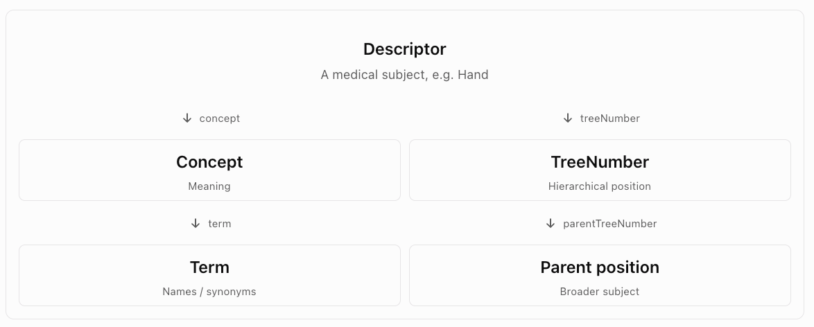

# MeSH — Medical Subject Headings

MeSH (Medical Subject Headings) is a hierarchical, controlled vocabulary developed and maintained by the U.S. National Library of Medicine (NLM). It is designed to organize, index, and retrieve biomedical and health-related information.

For your work on SemOS, MeSH is particularly interesting because it is more than a collection of hierarchical categories. It combines:

- Concept identification: Stable identifiers for medical subjects.
- Hierarchical classification: A concept can occupy multiple positions in a hierarchy.
- Terminology normalization: Multiple terms and synonyms can refer to the same concept.
- Semantic relationships: Concepts can have broader, narrower, and related relationships.
- Definitions and descriptions: Scope notes explain the meanings and intended uses of descriptors.

One important characteristic is that MeSH separates the identity of a medical subject from its position in the classification hierarchy. This is highly relevant to your requirement that SemOS categories be dynamically reorganized.

## 1. The overall structure of MeSH

MeSH has several major types of records.

| Record type                  | Purpose                                                         | Example                                       |
| ---------------------------- | --------------------------------------------------------------- | --------------------------------------------- |
| Descriptor                   | Represents an indexed biomedical subject                        | Hand, Diabetes Mellitus                       |
| Concept                      | Represents a distinct meaning within a descriptor               | A specific meaning or conceptual grouping     |
| Term                         | Represents a name or lexical expression                         | Preferred name, synonym, alternative spelling |
| TreeNumber                   | Represents a position in the classification hierarchy           | `A01.378.800.667`                             |
| Qualifier                    | Specifies an aspect of a subject                                | diagnosis, therapy, adverse effects           |
| Supplementary Concept Record | Represents additional substances and other specialized concepts | Drug or chemical substance                    |

The relationships between these components can be illustrated as follows.



This is a simplified view; the actual RDF model contains additional properties and relationships.

## 2. MeSH hierarchical categories

MeSH organizes descriptors into 16 top-level categories, identified by letters.

| Code | Category                                                         |
| ---- | ---------------------------------------------------------------- |
| A    | Anatomy                                                          |
| B    | Organisms                                                        |
| C    | Diseases                                                         |
| D    | Chemicals and Drugs                                              |
| E    | Analytical, Diagnostic and Therapeutic Techniques, and Equipment |
| F    | Psychiatry and Psychology                                        |
| G    | Phenomena and Processes                                          |
| H    | Disciplines and Occupations                                      |
| I    | Anthropology, Education, Sociology, and Social Phenomena         |
| J    | Technology, Industry, and Agriculture                            |
| K    | Humanities                                                       |
| L    | Information Science                                              |
| M    | Named Groups                                                     |
| N    | Health Care                                                      |
| V    | Publication Characteristics                                      |
| Z    | Geographicals                                                    |

The hierarchy can extend to 13 levels, and a descriptor can appear in multiple branches.&#x20;

[image](https://www.google.com/s2/favicons?domain=https://www.nlm.nih.gov\&sz=32)

National Library of Medicine

+1


For example:

```
A — Anatomy
└── A01 — Body Regions
    └── A01.378 — Extremities
        └── A01.378.800 — Upper Extremity
            └── A01.378.800.667 — Hand
                └── A01.378.800.667.430 — Fingers
                    └── A01.378.800.667.430.705 — Thumb
```

Unlike a conventional taxonomy where each category has exactly one parent, MeSH allows the same descriptor to occupy multiple positions.

This is one reason MeSH is a better reference for your dynamic categories than a rigid, single-parent tree.

## 3. Descriptor, Concept, and Term: What is the difference?

This is perhaps the most important part of MeSH's design.

### 3.1 Descriptor

A descriptor is the primary unit for indexing and retrieval. It represents a subject that can be assigned to biomedical documents.

For example, a document about diabetes can be indexed with the descriptor Diabetes Mellitus.

Each descriptor has a unique identifier, a preferred heading, and associated metadata. Many also have scope notes, alternative terms, and hierarchical placements.

### 3.2 Concept

Within a descriptor, MeSH organizes terms into one or more concepts. A concept represents a particular meaning, and related concepts can be grouped under one descriptor for indexing purposes.

A descriptor is therefore not necessarily identical to a single, narrowly defined concept.

### 3.3 Term

A term is a lexical representation of a concept — the actual words used to name it.

A concept can have several terms, including a preferred term and alternative terms.

A simplified example:

```text
(DESCRIPTOR: Myocardial Infarction, Indexing subject) 
contains (CONCEPT: Myocardial infarction, Clinical meaning)
contains two terms: Myocardial infarction, Heart attack
```

This is an illustrative simplification of the descriptor–concept–term structure.

This distinction is useful for SemOS because you can normalize different names without losing their original terminology.

For example, a search for "heart attack" can retrieve documents indexed under "Myocardial Infarction" even when the exact query words are absent.

## 4. Qualifiers: An additional semantic dimension

MeSH qualifiers describe a particular aspect of a subject.

For example:

| Descriptor        | Qualifier    | Meaning                               |
| ----------------- | ------------ | ------------------------------------- |
| Diabetes Mellitus | diagnosis    | Diagnosis of diabetes                 |
| Diabetes Mellitus | therapy      | Treatment of diabetes                 |
| Liver             | drug effects | Effects of drugs on the liver         |
| Neoplasms         | epidemiology | Distribution and occurrence of cancer |

MeSH uses combinations such as `Liver/drug effects` to express a more specific subject without creating a separate descriptor for every combination. Not every qualifier is valid for every descriptor; MeSH defines allowable combinations.&#x20;

[image](https://www.google.com/s2/favicons?domain=https://www.nlm.nih.gov\&sz=32)

National Library of Medicine

+1


This resembles faceted classification.

For SemOS, you could apply the same principle:

```
Category: Temperature Monitoring
Facet: Application = Vaccine Storage
Facet: Aspect = Calibration
Facet: Equipment = Data Logger
```

Rather than generating a deeply nested category for every possible combination, categories and facets can be managed independently.

## 5. MeSH as RDF: How the data is represented

Example:
```
# A descriptor occupies a tree position
mesh:D006225
    meshv:treeNumber
    mesh:A01.378.800.667 .

# A tree position has a parent
mesh:A01.378.800.667.430.705
    meshv:parentTreeNumber
    mesh:A01.378.800.667.430 .
```

These represent two distinct relationships:

- `treeNumber`: Descriptor → TreeNumber
- `parentTreeNumber`: TreeNumber → TreeNumber

The descriptor can have properties that describe its medical meaning, while the tree-number resource describes its hierarchical position.

NLM explicitly states that tree numbers have no intrinsic semantic significance and can change when the hierarchy is revised.

This is a strong argument against using hierarchical paths as permanent category IDs.

## 6. MeSH compared with ICS and CCS

| Feature                   | ICS / CCS                         | MeSH                                                        |
| ------------------------- | --------------------------------- | ----------------------------------------------------------- |
| Primary domain            | Technical standards               | Biomedical knowledge                                        |
| Classification unit       | Standards subject                 | Biomedical subject descriptor                               |
| Hierarchical structure    | Yes                               | Yes                                                         |
| Multiple parents          | Multiple document classifications | Multiple descriptor placements                              |
| Synonyms                  | Limited                           | Extensive                                                   |
| Definitions               | Primarily category descriptions   | Scope notes and concept definitions                         |
| Separate concept identity | Classification code               | Descriptor and concept IDs                                  |
| Facets                    | Limited                           | Qualifiers                                                  |
| Semantic relationships    | Relatively limited                | Richer terminology relationships                            |
| RDF support               | ICS has OWL distribution          | Official RDF dataset                                        |
| Versioning                | Periodic revisions                | Annual descriptor revisions, frequent supplementary updates |

MeSH is closer to a thesaurus or lightweight knowledge organization system than a simple category tree. However, it is not a complete formal ontology of biomedical knowledge. Its broader/narrower relationships are designed primarily for subject indexing and retrieval, and should not automatically be interpreted as strict `is-a` relationships.

## 7. How to obtain and use MeSH data

NLM provides downloadable datasets, an API, and a SPARQL interface.

[Download MeSH datasets](https://www.nlm.nih.gov/databases/download/mesh.html?utm_source=chatgpt.com)

XML and RDF datasets, including historical releases

[MeSH RDF and SPARQL](https://id.nlm.nih.gov/mesh/?utm_source=chatgpt.com)

Query descriptor, concept, term, and hierarchy relationships

[MeSH Browser](https://meshb.nlm.nih.gov/?utm_source=chatgpt.com)

Explore records, definitions, synonyms, and tree positions

The 2026 production datasets are available. NLM provides MeSH RDF as compressed N-Triples (`mesh.nt.gz`) and supports SPARQL queries for retrieving subsets of the vocabulary.

## 8. Summary
| # | Fact | Assessment                                                                                                                                                            |
| - | --------------------------------------------------------------------------- | --------------------------------------------------------------------------------------------------------------------------------------------------------------------- |
| 1 | The primary unit is a descriptor.                                           | &#x20;Correct. Descriptors are the primary units for subject indexing.                                                                                                |
| 2 | There are 16 top-level categories of descriptors.                           | &#x20;Correct. The 16 categories (A–Z, with gaps) organize the descriptor hierarchy.                                                                                  |
| 3 | A descriptor can have one or more concepts.                                 | &#x20;Correct. One concept is designated preferred.                                                                                                                   |
| 4 | A concept can have one or more terms.                                       | &#x20;Correct. One term is designated preferred for each concept.                                                                                                     |
| 5 | A descriptor may have multiple aspects.                                     | &#x20;Correct, in the sense that a descriptor can be indexed with different applicable aspects.                                                                       |
| 6 | Each aspect is described by a qualifier.                                    | &#x20;Generally correct. Qualifiers represent standardized indexing aspects, but not every conceivable aspect has a qualifier.                                        |
| 7 | Descriptors are related by broader/narrower and parent/child relations.     | &#x20;Needs clarification. Hierarchical parent-child relationships are represented explicitly between tree-number resources, not simply between descriptors.          |
| 8 | One descriptor may have multiple parents. | A descriptor can have multiple hierarchical placements, potentially giving it multiple parents. Top-level descriptors can have no parent descriptor. |

MeSH is not a strict tree of descriptors.

Instead, it separates descriptors from hierarchical positions.

For example, if Descriptor X appears at two tree numbers:

```
mesh:X meshv:treeNumber mesh:A01.100 .
mesh:X meshv:treeNumber mesh:E02.200 .
```

And those positions have different parents:

```
mesh:A01.100 meshv:parentTreeNumber mesh:A01 .
mesh:E02.200 meshv:parentTreeNumber mesh:E02 .
```

Then Descriptor X has two hierarchical placements, each with a different parent position.

These are illustrative identifiers.

## A more precise summary of MeSH

1. Descriptor is the primary unit for indexing biomedical subjects.
2. Descriptors are organized into 16 top-level subject categories.
3. A descriptor contains one or more concepts.
4. A concept contains one or more terms.
5. A descriptor may be indexed under different aspects.
6. Qualifiers represent standardized aspects of descriptors, subject to applicability rules.
7. TreeNumbers represent hierarchical positions and are connected through `parentTreeNumber` relationships.
8. A descriptor can have multiple TreeNumbers, and therefore multiple hierarchical parents. A tree-number position has at most one immediate parent position.

One additional distinction matters: the descriptor–concept–term relationships are not the same as broader/narrower relationships. They describe how terminology is organized within an indexing subject, rather than how subjects are positioned in the hierarchy.

For SemOS, the key design principle is to model descriptors (conceptual identity) and tree positions (classification structure) independently. That allows multiple parents and dynamic reorganization without changing the identity of the underlying category.

## 9. MeSH and SemOS

MeSH offers three particularly valuable architectural ideas.

First: Separate category identity from hierarchy. Use a stable identifier for each category, and store hierarchical placements as independent, versioned relationships. A category can then be moved, merged, or assigned multiple parents without changing its identity.

Second: Separate concepts from terms. A category should have a preferred name, alternative names, definitions, and potentially multiple language representations. This supports semantic normalization without requiring vector embeddings.

Third: Support facets instead of forcing everything into a hierarchy. A technical subject may have aspects such as application, measurement, process, equipment, regulatory requirement, and risk. Representing these independently avoids combinatorial growth in category paths.

For SemOS, I would consider this simplified data model:

```
Category
  id
  preferred_label
  alternative_labels[]
  definition
  scope_note
  status

CategoryRelation
  source_category_id
  target_category_id
  relation_type
  valid_from
  valid_to

CategoryMapping
  category_id
  external_system
  external_concept_id
  mapping_type
```

`relation_type` might include `broader`, `narrower`, and `related`; `mapping_type` might include `exactMatch`, `closeMatch`, and `broadMatch`.

For category merging and splitting, I would additionally maintain explicit history and provenance rather than simply deleting old categories.

The most important lesson from MeSH is that a category is not its hierarchical path, and a concept is not its name. Treating identity, terminology, meaning, and hierarchical placement as separate dimensions will make SemOS's dynamic category system considerably more flexible and maintainable.