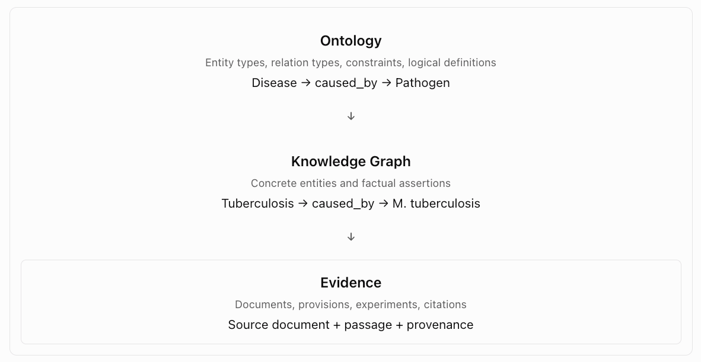

# 1. Overview
We need to design a formal way to capture relations. Relations are mostly domain specific, not stable.
It is very difficult to contain (i.e., a fixed set of) relations in general.

# 2. Reviews
## 2.1 MeSH
MeSH has an ontology-like data model, but it does not provide a rich domain ontology describing relationships between biomedical entities.

The distinction is between terminological semantics and domain semantics.

MeSH defines several entity types and relationships:

| Entity     | Relationships                                 | Purpose                               |
| ---------- | --------------------------------------------- | ------------------------------------- |
| Descriptor | `treeNumber`, `concept`, `allowableQualifier` | Defines an indexing subject           |
| Concept    | `term`, `broaderConcept`, `relatedConcept`    | Organizes meanings within descriptors |
| Term       | Preferred-term and lexical relationships      | Represents names and synonyms         |
| TreeNumber | `parentTreeNumber`                            | Represents classification hierarchy   |
| Qualifier  | Descriptor–qualifier applicability            | Specifies indexing aspects            |

These relationships primarily describe how biomedical terminology is organized, rather than how biomedical phenomena interact.

For example, MeSH can represent:

```
Heart Disease
    └── Coronary Artery Disease
```

But it does not systematically represent domain relationships such as:

```
Coronary Artery Disease
    ├── caused_by → Atherosclerosis
    ├── affects → Coronary Arteries
    ├── diagnosed_by → Coronary Angiography
    ├── treated_by → Coronary Artery Bypass Grafting
    └── increases_risk_of → Myocardial Infarction
```

These are illustrative biomedical relationships, not assertions extracted from MeSH.

The distinction is significant: a hierarchy supports classification and retrieval, whereas typed domain relationships support more expressive knowledge representation and reasoning.

### 2.1.1 MeSH vs. a domain ontology

| Capability                    | MeSH                       | Rich domain ontology             |
| ----------------------------- | -------------------------- | -------------------------------- |
| Stable concept identifiers    | Yes                        | Yes                              |
| Preferred labels and synonyms | Yes                        | Usually                          |
| Hierarchical classification   | Yes                        | Usually                          |
| Definitions and scope notes   | Yes                        | Usually                          |
| Typed domain relations        | Limited                    | Central feature                  |
| Formal logical axioms         | Limited                    | Often extensive                  |
| Causal relationships          | Not systematically modeled | Possible                         |
| Constraints on relations      | Limited                    | Can be expressed formally        |
| Automated logical reasoning   | Limited                    | Depends on ontology and reasoner |
|

MeSH is best described as a controlled biomedical vocabulary and thesaurus, represented using an RDF vocabulary.

An important nuance is that OWL itself does not guarantee a rich domain ontology. An OWL file may define only a small set of classes and properties.

## 2.1.2 Other biomedical resources go further

Several resources are worth examining.

| Resource               | Relationship capabilities                                                        | Best use                                          |
| ---------------------- | -------------------------------------------------------------------------------- | ------------------------------------------------- |
| UMLS Metathesaurus     | Integrates many vocabularies, including MeSH, with source-specific relationships | Concept normalization and terminology integration |
| UMLS Semantic Network  | Semantic types and relations such as `treats`, `causes`, `affects`, `part_of`    | General biomedical relationship schema            |
| SNOMED CT              | Formal clinical concept relationships and logical definitions                    | Clinical knowledge modeling                       |
| Relation Ontology (RO) | Standardized relations such as `part_of`, `has_part`, `develops_from`            | Reusable relation vocabulary                      |
| OBO Foundry            | Collection of interoperable scientific ontologies                                | Domain-specific ontology integration              |

For example, the [UMLS Metathesaurus](https://www.nlm.nih.gov/research/umls/META3_current_relations.html?utm_source=chatgpt.com) provides relationships between concepts, while the [UMLS Semantic Network](https://www.nlm.nih.gov/research/umls/META3_current_semantic_types.html?utm_source=chatgpt.com) defines biomedical semantic types and their permitted relationships.

SNOMED CT goes further by representing clinical concepts using formal relationships and logical axioms, although its licensing and distribution requirements need to be considered.

# 3. Ontology vs. Knowledge Graph

Consider:

```
Disease
    caused_by → Pathogen
    affects → AnatomicalStructure
    treated_by → Treatment
```

This defines a domain ontology: the types of entities and relationships that can exist.

Now consider:

```
Tuberculosis
    caused_by → Mycobacterium tuberculosis

Tuberculosis
    affects → Lung

Tuberculosis
    treated_by → Rifampicin
```

These are knowledge assertions about particular biomedical subjects. Together, they form part of a knowledge graph.

The distinction is not absolute: ontologies can contain named individuals and assertions, and knowledge graphs often incorporate ontology definitions. But separating the schema from factual assertions is a useful engineering practice.



# 4. Design

## 4.1 Layers

There are three complementary layers for knowledge representation:

1. Taxonomy and terminology: ICS, CCS, MeSH, EuroVoc, etc. provide category hierarchies, identifiers, labels, synonyms, and definitions.
2. Domain ontology: Defines entity types such as `Product`, `Material`, `Process`, `Metric`, `Requirement`, and `Organization`, together with relation types such as `measures`, `requires`, `applies_to`, `part_of`, and `regulated_by`.
3. Knowledge assertions: Concrete relationships extracted from standards, regulations, and other documents, with evidence, confidence, and provenance.

For example, a standard might state that a vaccine storage unit must maintain a particular temperature range. SemOS could represent the equipment category using a taxonomy, define `has_operating_temperature_range` in its ontology, and store the actual range as an evidence-backed assertion.

The taxonomy answers "What kind of thing is this?"

The ontology answers "What kinds of relationships can exist?"

The knowledge graph answers "What is known about this particular thing?"

These are complementary rather than competing representations.

## 4.2 Vocabulary and Thesaurus
Use datasets such as MeSH as a reference vocabulary for domain concept normalization, not as the foundation of 
SemOS's relation ontology. For relations, investigate the UMLS Semantic Network and OBO Relation Ontology. 
They provide a much stronger starting point for developing a reusable, typed relationship system across 
your standards corpus.