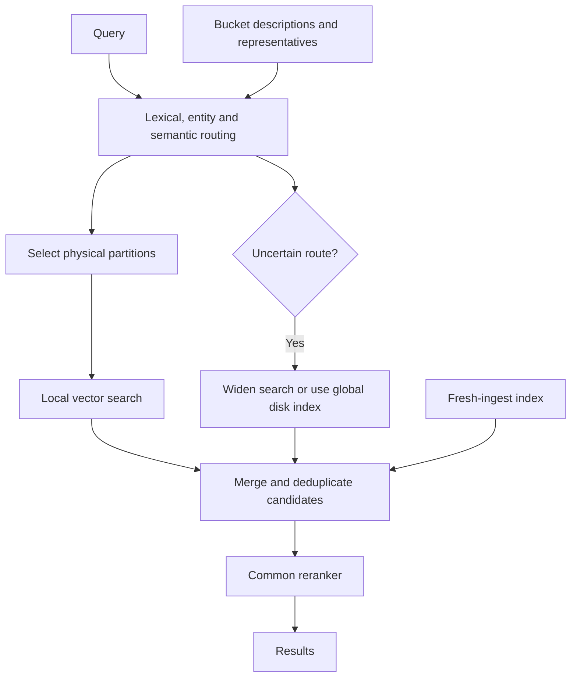

# Semantic vector routing — research on scalable retrieval with semantic buckets

**Date:** 2026-10-18 \
**Status:** Research report and proposed evaluation; no implementation or experimental validation. \
**Scope:** Memory scaling, retrieval noise, semantic buckets, query routing, relevant prior research, and a comparative pilot. \
**Code root:** Not applicable; this report does not describe a shipped feature. \
**Evidence checked:** 2026-10-18.

## 1. Summary

Organizing vectors into related groups, routing queries to promising groups, and searching locally is a viable architecture with substantial research precedent. The research opportunity is improving how those groups are formed and selected, particularly when human-readable categories and language models are involved.

Vector search does not inherently require every vector to reside in memory: disk-backed global indexes already work. Semantic routing can reduce the amount searched and potentially avoid irrelevant candidates, but it can also exclude relevant evidence before local search begins. Splitting the corpus alone does not reduce its total memory requirement if all resulting indexes remain resident.

The proposed next step is a comparative pilot of semantic routing with overlapping membership and adaptive search expansion, alongside global disk-backed search and ordinary geometric partitioning. This is a research recommendation, not a production architecture decision.

## 2. Details

### 2.1 Research question, method, and boundaries

**Focal question:** Can semantic organization and query routing reduce resident memory and search cost while preserving relevant evidence across topic boundaries, compared with tuned global disk-backed and geometrically partitioned vector search?

The report supports a developer deciding whether to prototype this architecture. The immediate horizon is a comparative pilot. The user remains the decision owner for acceptable recall loss, latency, and operating cost. Corpus size, query traffic, hardware, and these acceptance thresholds are unknown.

The investigation used the scientific-brainstorming workflow: independent AI-assisted candidate generation before literature search, separate storage and retrieval reviews, primary-source checking, adversarial review, and a second design round. These are AI perspectives, not independent human expert assessments. No benchmark, user study, or implementation was performed. The scope is retrieval architecture; patient-specific care, human-subject research, and regulated experiments are outside it. Any later pilot involving private documents must follow the workspace's data-governance rules and avoid sending sensitive content to external models without authorization.

Throughout this document, **evidence** means a located result, **inference** means reasoning from the design or sources, and **proposal**, **assumption**, and **prediction** describe ideas requiring experiments.

### 2.2 Memory scaling: storage and semantic organization are separate decisions

Consider 100 million vectors with 1,536 float32 dimensions:

$$100{,}000{,}000 \times 1{,}536 \times 4 = 614.4\text{ GB}$$

This is raw vector payload alone, excluding indexes, metadata, caches, replicas, and temporary work. GB here uses decimal units.

**Evidence:** PostgreSQL with pgvector can search indexes larger than RAM. Its FAQ explicitly states that indexes need not fit in memory, although performance generally improves when they do. It offers both HNSW, a graph index, and IVFFlat, which groups vectors into centroid-associated lists. Disk-backed PostgreSQL search therefore does not necessarily mean partition-based search. [pgvector documentation](https://github.com/pgvector/pgvector#frequently-asked-questions)

| Approach | How it reduces memory pressure | Main tradeoff |
|---|---|---|
| Disk-backed graph search | Keeps much of the graph and full vectors on SSD | Random input/output and cache sensitivity |
| Disk-backed clustered search | Keeps a smaller routing structure in RAM and reads selected vector lists | Missing neighbors across cluster boundaries |
| Quantization | Stores compact approximations of vectors | Approximation error; possibly additional rescoring |
| Selective bucket residency | Keeps frequently used buckets or pages resident | Cold reads and workload-dependent cache behavior |

**Evidence:** DiskANN demonstrated billion-point search on a workstation with 64 GB RAM and solid-state drive (SSD) storage. Its design uses a disk-resident graph and full vectors, with compressed representations in memory. This challenges the premise that scalable search must load all full vectors into RAM. Its headline experiments used SIFT descriptors; those results do not predict performance on modern high-dimensional text embeddings. [DiskANN, NeurIPS 2019](https://papers.nips.cc/paper_files/paper/2019/hash/09853c7fb1d3f8ee67a61b6bf4a7f8e6-Abstract.html)

Disk storage still needs working memory. Qdrant documents disk-backed structures whose pages enter the operating system's cache as accessed. Eviction reduces residency but creates subsequent disk reads. Stored-on-disk placement does not guarantee negligible RAM consumption or stable latency. [Qdrant memory documentation](https://qdrant.tech/documentation/ops-configuration/memory-tiers/)

### 2.3 Prior research closely related to the proposal

| Research | Mechanism | Connection to semantic buckets |
|---|---|---|
| Topical selective search, 2010 | Organize documents into topical shards; select and search a subset | Almost the same high-level architecture, before modern dense-vector databases |
| Query-biased partitioning, 2016 | Form partitions using information from query logs | Organizes around user information needs, beyond document topics |
| Pyramid, 2019 | Partition similar vectors and use a higher-level graph to route queries | Distributed vector-search implementation of selective routing |
| SPANN, 2021 | Keep centroids in RAM and vector posting lists on disk; use overlap and adaptive probing | A close storage-and-routing analogue |
| Learning-to-rank routing, 2024 | Learn which clusters contain useful neighbors | Establishes a cheaper learned-router baseline against a large language model (LLM) |

The original topical selective-search study reported substantial search-cost reductions without reducing average accuracy on its evaluated collections. This supports feasibility, rather than a universal guarantee for semantic buckets. [Kulkarni and Callan, 2010](https://www.cs.cmu.edu/~anaghak/lsdsir2010.pdf)

Pyramid explicitly partitions similar items and directs each query to selected subsets. [Pyramid](https://arxiv.org/abs/1906.10602)

SPANN addresses three problems the proposed system will also face: uneven partition sizes, neighbors near partition boundaries, and queries requiring different search breadth. Its solutions include balanced clustering, overlapping assignments, and query-dependent pruning. These are geometric groups rather than named human categories, but the architecture is strongly related. [SPANN](https://arxiv.org/abs/2111.08566)

The learned-routing work frames cluster selection as a ranking problem and demonstrates improvements using a simple linear model. An LLM router should be compared with inexpensive alternatives. [A Learning-to-Rank Formulation of Clustering-Based Approximate Nearest Neighbor Search](https://arxiv.org/abs/2404.11731)

### 2.4 Retrieval noise: supporting evidence and counterevidence

**Evidence supporting the concern:** Reimers and Gurevych theoretically and experimentally examined increasing false positives as dense-retrieval indexes grow. Lower-dimensional representations were particularly vulnerable in their analysis. A larger search universe creates more opportunities for misleading similarity under the studied conditions. [The Curse of Dense Low-Dimensional Information Retrieval for Large Index Sizes](https://arxiv.org/abs/2012.14210)

**Counterevidence to inevitable degradation:** Increasing corpus size can also add useful evidence. A NeurIPS 2024 study found improvements as its retrieval datastore grew, constructing a datastore containing 1.4 trillion tokens. Its task and system differ from ordinary vector search, but it challenges inevitable degradation from scale. [Scaling Retrieval-Based Language Models with a Trillion-Token Datastore](https://papers.nips.cc/paper_files/paper/2024/hash/a5d8aba27dfef4e849e8cb03fb87a954-Abstract-Conference.html)

Four effects should be measured separately:

| Effect | What goes wrong | Would semantic buckets necessarily help? |
|---|---|---|
| Corpus quality | Duplicate, obsolete, or unreliable material accumulates | Only if organization also controls quality |
| Embedding relevance | Irrelevant documents receive high similarity scores | Potentially |
| Approximate nearest-neighbor (ANN) search | Search misses neighbors that exact vector search would find | Depends on routing and local indexes |
| Answer generation | Retrieved distractions confuse the downstream LLM | Potentially, alongside reranking and context selection |

A system can have excellent nearest-neighbor recall and poor answer relevance. Recent research explicitly distinguishes recovery of mathematically nearest vectors from recovery of semantically relevant results. [Semantic Recall for Vector Search](https://doi.org/10.1145/3805712.3809894)

### 2.5 The principal failure mode: topic is different from question relevance

A document categorized as employment might contain decisive evidence for a tax question. A document about a person's ancestry could be relevant to a query mentioning a politician, even though a category classifier selects politics.

This is a documented selective-search failure mode. The query-biased partitioning paper describes relevant genealogy documents being placed outside the politics shards favored by the router. It uses query information to improve alignment between partitions and information needs. [Query-Biased Partitioning for Selective Search](https://www.cs.cmu.edu/~callan/Papers/cikm16-zhuyund.pdf)

**Design inference:** Group material according to the questions it can help answer, alongside what it is about. This is not a validated claim that LLM-generated question labels solve routing.

For a query, let:

- $G$ be its relevant documents;
- $S$ be all documents accessible through the selected buckets;
- $F$ be the final returned documents, with $F\subseteq S$.

For a nonempty relevance set:

$$\frac{|F\cap G|}{|G|} \leq \frac{|S\cap G|}{|G|}$$

**Final recall cannot exceed the relevant evidence available in the selected buckets.** Perfect local vector search cannot recover an excluded document. A fallback helps only to the extent that it expands the accessible candidate set.

### 2.6 Splitting vectors does not automatically save total RAM

**Inference:** Dividing the illustrative 614.4 GB corpus into 100 equal buckets yields approximately 6.14 GB per bucket. Three resident buckets contain about 18.4 GB of raw vectors. This is an illustrative payload calculation, not a serving-memory estimate:

- Keeping all 100 buckets resident retains the original payload.
- Replicating vectors across buckets increases storage and potentially memory.
- Loading several gigabytes from disk for every query can undermine latency.
- Concurrent queries may touch enough different buckets to recreate a large working set.

The actual saving comes from selective residency, compression, or a smaller working set. Semantic organization is useful when it helps achieve those conditions.

## 3. Proposed architecture

**Proposal:** Combine semantic organization with bounded physical partitions. This design emerged after the evidence check and adversarial review; it remains a candidate for evaluation.

1. **Keep one logical corpus with stable document IDs.** Categories, tags, and bucket membership become searchable metadata. This permits multiple memberships without duplicating the underlying document.

2. **Separate semantic buckets from physical shards.** A category such as finance may be enormous; a specialist tag may contain only dozens of documents. Let one category span several bounded shards, and let a shard serve several related labels. This permits balancing by bytes, query traffic, and update volume.

3. **Represent each bucket using more than its name.** A proposed bucket directory contains a description, aliases, entities, representative passages, several vector representatives, and example questions. A single centroid can conceal internal diversity. Whether richer representations justify their cost requires testing.

4. **Start with inexpensive routing.** Combine lexical/entity matching and embedding-based ranking of bucket representatives. Test a small learned router. Reserve LLM disambiguation or query decomposition for cases where it produces measurable gains.

5. **Use overlap selectively.** Multi-topic documents and boundary cases can have multiple memberships. Cap replication and measure its benefit. References avoid duplicating canonical content, although local indexes may still require repeated vector representations.

6. **Adapt search breadth.** Narrow queries can search fewer partitions; ambiguous or cross-topic queries should search more. An LLM's stated confidence is insufficient: routing confidence must be calibrated against observed evidence misses.

7. **Merge under a common scoring scheme.** Use compatible embeddings and distance definitions, deduplicate by stable IDs, and apply a common reranker. If buckets use different embedding models, raw similarity scores need additional treatment before comparison.

8. **Maintain freshness explicitly.** A small searchable ingest index can expose new documents before classification and redistribution finish. Bucket splits, moves, deletions, and taxonomy changes require versioned updates. Dynamic maintenance is substantial enough to have its own systems literature; SPFresh studies incremental rebalancing under changing vector distributions. [SPFresh](https://www.microsoft.com/en-us/research/publication/spfresh-incremental-in-place-update-for-billion-scale-vector-search/)

A global fallback has a cost too. Maintaining both local indexes and another global index adds storage, maintenance, and possibly RAM. It should be a measured option, with fallback frequency and resource consumption reported.

### 3.1 Candidate register and adversarial review

Independent candidate generation considered disk-backed global search, hard topic buckets, overlapping buckets, and routed search with a broader fallback. The evidence review refined the comparison to the four candidates below. These are AI-assisted proposals, not measured outcomes.

**Evaluation criteria:** Preserve relevant evidence as a gate; then compare resident RAM, tail latency, routing cost, and maintenance burden. Lower cost is desirable only within an agreed quality tolerance. No numerical weights or scores were assigned, and the table is not a ranking.

| Candidate | Potential advantage | Main challenge | Disconfirming observation |
|---|---|---|---|
| A: Global disk-backed ANN | Simpler architecture; established feasibility | SSD reads and embedding distractors | Fails the required quality/latency budget |
| B: Hard semantic buckets | Interpretable and potentially selective | Irrecoverable routing misses | Cross-topic recall falls materially |
| C: Balanced geometric partitions | Strong existing routing baselines | Groups may poorly reflect information needs | Semantic routing clearly improves the quality/cost curve |
| D: Overlapping semantic routing with adaptive expansion | More robust to ambiguity | Replication, router, and fallback overhead | Its operating cost matches or exceeds A/C |

**Evidence status:** A and C have support located for architectural feasibility. B has mixed evidence: topical selective search supports the mechanism, while routing failures challenge hard boundaries. D is a literature-inspired proposal; no direct validation of this particular combination was performed.

Candidate B remains useful where the search scope is explicit, such as a user selecting a known collection. Inferred topic boundaries carry more uncertainty. Adversarial review identified excluded evidence, replication, cache churn, hot buckets, stale classifications, and uncalibrated router confidence as key risks. The proposal was revised to separate semantic and physical organization, add adaptive expansion, and account explicitly for fallback overhead.

The minority alternative remains important: a tuned global disk-backed index may meet requirements with less complexity. The current evidence does not justify eliminating it.

### 3.2 Research directions after the literature check

These are AI-assisted proposals informed by the literature. This search does not establish their novelty.

| Proposal | Assumption | Prediction | What would challenge it? |
|---|---|---|---|
| Organize buckets using answerable-question profiles | Question profiles capture relevance beyond topical similarity | Better routing on cross-topic queries | No improvement over centroids and ordinary metadata |
| Learn when to widen routing | Observable query and router signals predict evidence misses | Lower average cost at a fixed recall target | Poor calibration on new topics or languages |
| Allocate overlap according to observed misses | A limited set of documents accounts for many boundary failures | Better recall per replicated byte | Duplication grows broadly without sufficient benefit |

Existing research already separates partition construction from routing and evaluates neighborhood-preserving shards at billion scale. Those methods provide important competitors for these proposals. [Unleashing Graph Partitioning for Large-Scale Nearest Neighbor Search](https://arxiv.org/abs/2403.01797)

### 3.3 Proposed comparative pilot

**Next action:** A comparative pilot, with success criteria fixed before tuning. This is an evaluation outline, not a completed validation or formal experimental protocol.

Use the same documents, embeddings, hardware, reranker, and resource accounting to compare candidates A–D. Include an exact vector-search reference on a manageable evaluation corpus, plus independently judged relevance labels. Exact neighbors measure index approximation; relevance labels measure usefulness.

Evaluate:

- Narrow, ambiguous, cross-topic, rare-entity, multilingual, and newly emerging queries.
- Increasing corpus sizes, distinguishing added useful documents from added distractors.
- Warm and cold caches, realistic concurrency, and uneven bucket popularity.
- Inserts, deletions, taxonomy changes, and embedding upgrades.

Report routing evidence recall, ANN recall, judged relevance, peak and steady-state memory, SSD reads, p50/p95/p99 latency, throughput, replication, update cost, and router inference cost. Include operating-system cache memory; process memory alone can conceal the working set.

Use an oracle that selects buckets using known relevant-document locations to distinguish partition quality from router quality. If oracle routing works but the actual router fails, improve routing. If even oracle routing requires many buckets, the partition structure or workload offers limited selectivity.

Keep a held-out query set separate from router training and threshold selection. Inspect cross-topic and multilingual results separately so an average does not hide concentrated losses. Any numerical acceptance thresholds must be chosen by the decision owner before evaluating the final holdout.

### 3.4 Provisional decision and revisit triggers

**Provisional recommendation:** Advance candidate D to a pilot alongside A and C. Preserve the simpler global disk-backed option until semantic routing demonstrates lower cost or better relevance at matched quality. The user must set the acceptable recall loss and latency budget; no measurements currently justify choosing a production winner.

**Revisit triggers:** Routing misses on cross-topic queries; excessive fallback frequency; replication or cache churn erasing savings; workload or language drift; material changes in corpus size, embeddings, or hardware. These are proposed triggers, not observed failures.

### 3.5 Exact search for small buckets

**Proposal:** A bucket small enough to scan efficiently should use exhaustive vector search instead of maintaining its own approximate-nearest-neighbor (ANN) index. For example, a configurable threshold near 5,000 vectors is a reasonable starting point for evaluation, not a universal cutoff.

An exhaustive scan computes the query distance or similarity against every eligible vector in the bucket, then selects the top *k*. For vectors of dimension *d* and a bucket containing *n* eligible vectors, this costs approximately $O(nd)$ arithmetic per query. The results are exact relative to the stored vectors, metric, and filters: there is no ANN traversal or index-pruning error. This is especially attractive when the bucket is small, queries are infrequent, vectors are already resident, or filtering leaves only a small candidate set.

The comparison should include the full cost of each option. An ANN index consumes memory and requires build and update work; exhaustive search consumes CPU on each query and may become slower as the bucket grows or concurrency rises. If vectors must be fetched from storage for each scan, the scan can become I/O-bound. Thus, choose the strategy using observed query latency and throughput under expected concurrency, resident bytes, update rate, and index-maintenance cost—not vector count alone. The threshold should be configurable and can differ by vector dimension, hardware, distance metric, filter selectivity, and workload. Buckets near the crossover can be benchmarked during the pilot, with hysteresis or an explicit rebuild policy to avoid repeatedly switching strategies as their size fluctuates.

The exhaustive path still needs a consistent distance metric, embedding version, filter semantics, and top-*k* merge behavior so its results can be combined with ANN results from larger buckets. It should also report scanned-vector count and latency, making it possible to identify buckets that have outgrown the scan path.

### 3.6 Bounded in-memory vector cache

**Proposal:** Add a vector cache with an explicit configurable maximum memory budget. The cache holds vector payloads needed by local searches, whether those vectors come from a small-bucket scan or from a disk-backed shard. It is a working-set optimization; it does not replace durable vector storage or, by itself, bound memory used by indexes, metadata, query buffers, or concurrent requests.

Account for cache capacity in bytes rather than entry count because vector dimensions, precision, and payload formats can differ. On a cache miss, load the vector from its backing store and insert it if it fits. When an insertion would exceed the configured limit, evict the least recently used entries until there is room; this makes “older” mean least recently accessed, rather than simply the oldest vector by creation time. If one item exceeds the entire budget, use it for the current request without caching it. Keep a small operational headroom so temporary allocations and concurrent loads do not push the process over its memory target.

Cache keys should include stable vector identity and the embedding or content version. Updates and deletions must invalidate prior entries; otherwise a cache hit could return stale vector data. Concurrent misses for the same key should avoid redundant backing-store reads, and eviction must not invalidate vectors already in use by an active search. If a hard memory bound matters, account for in-flight loads and pinned entries when admitting new items; when entries are temporarily non-evictable, defer or bypass caching rather than exceeding the budget.

Measure cache bytes, hit and miss rates, evictions, load latency, and backing-store reads, alongside process and operating-system cache memory. A high hit rate is not sufficient if the cache is dominated by a few hot buckets or causes churn for the rest of the workload. Evaluate warm and cold starts and realistic query concurrency. The configured cache budget should be allocated from a total memory budget that also includes index structures, routing metadata, runtime overhead, and concurrent-query working memory.

## 4. Known limitations

- The targeted search covered disk ANN, topical selective search, cluster routing, learned routing, and corpus-size effects. It is not a systematic literature review and does not establish novelty.
- The sources establish prior art and plausible mechanisms; they do not establish superiority for LLM-generated categories or validate this proposed architecture.
- Published benchmark memory and latency results depend on dimensionality, data type, hardware, workload, recall definition, and concurrency. They are not deployment estimates for this workspace.
- No repository feature, database schema, API, or runtime behavior changed. There is no associated OpenSpec implementation contract. If this proposal is implemented, specifications and implementation documentation must describe the resulting behavior separately.
- No source-code tests were needed for saving this research document. Document verification covers its filing, structure, citations, and isolated commit; it does not validate the architecture.

## 5. Method attribution

The scientific-brainstorming skill materially informed independent ideation, evidence labeling, adversarial review, and the provisional decision process. Its current publication record was checked during the research:

Kassis, T., Agarwal, V., He, Y., Patel, D., and Brueckner, A. M. (2026). *Scientific Agent Skills: A Library of Procedural Knowledge for Research Agents*. [https://doi.org/10.48550/arXiv.2609.00065](https://doi.org/10.48550/arXiv.2609.00065).
