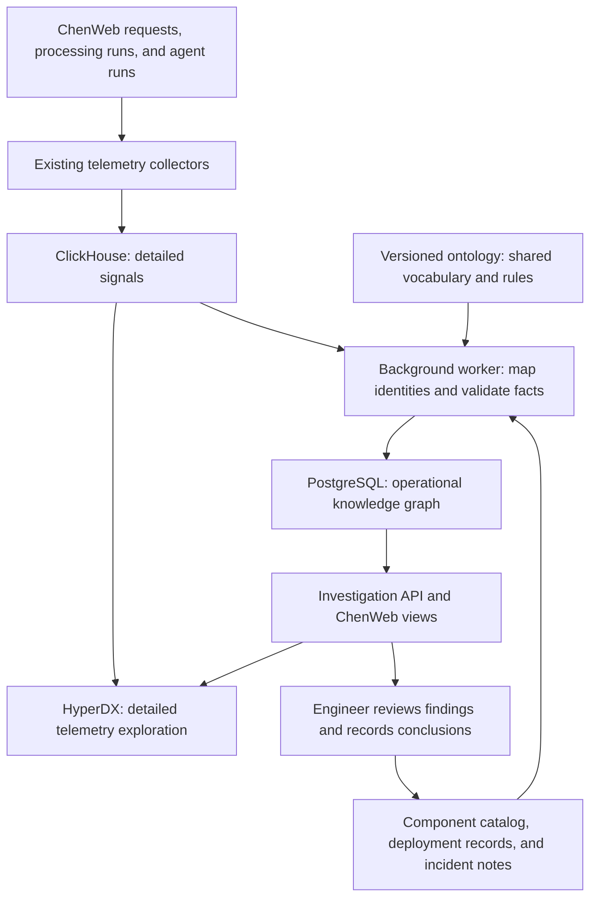

# Telemetry — understanding ChenWeb through connected evidence

## 1. Purpose and status

ChenWeb's telemetry should help an engineer understand what happened, what was affected, what may have caused it, and what helped last time. It should connect the user's experience to application work, background processing, databases, external providers, and recent changes. The goal is to find the problem earlier, shorten investigations and preserve what engineers learn so the next investigation starts with useful context.

This document describes a **proposed architecture**, not a completed feature. Section 3 identifies the existing foundation verified in the repository. The ontology, investigation features, and rollout below are proposed additions. This is a high-level direction; implementation should establish its detailed behavior in OpenSpec before building it.

ChenWeb is much smaller than Netflix. We should begin with the existing telemetry stack, a small shared vocabulary, PostgreSQL, and one background worker. We can expand when actual investigation needs or measured load justify it.

## 2. What “ontology driven” means

An **ontology** is a shared description of the things we care about, their properties, and how they relate. For telemetry, it answers questions such as “What is a processing run?”, “Which component performed it?”, and “What does it mean for an incident to affect that component?” Engineers do not need to learn a special query language to use it.

A **knowledge graph** is the collection of actual things and connections described using that vocabulary. The ontology defines that a run can use a component. The graph records that run 482 used the metric extractor.

For example, the system could record these facts:

- Processing run 482 processed document 73.
- Run 482 used the metric extractor and called an external model provider.
- The extractor belonged to the ChenWeb deployment running release R17.
- Run 482 failed with a provider timeout.
- Incident I12 affected document processing, and an engineer recorded which mitigation worked.

These connections let an engineer move from a failed document to the relevant run, errors, dependencies, deployment, and previous incidents without reconstructing the links by hand.

“Ontology driven” means this agreement guides collection, identity matching, validation, and investigation from the beginning. It is more than drawing a graph over unrelated logs afterward. Each source maps its own fields to the same approved concepts and identities.

### 2.1 The Netflix influence

Netflix describes slow investigations caused by disconnected tools using different names for the same operational entities. Its approach combines a shared ontology, a knowledge graph, enrichment, evidence-backed hypotheses, and incident knowledge. It uses RDF, OWL, SHACL, and SPARQL—standards for representing, defining, validating, and querying graph data—and a distributed graph store. Its correlation results remain hypotheses for people to assess. These ideas inform ChenWeb's direction; the storage and rollout choices below are our proposal for a much smaller system. [Netflix TechBlog](https://netflixtechblog.com/ontology-driven-observability-building-an-end-to-end-knowledge-graph-at-netflix-scale-421392cf5adf)

## 3. Existing foundation

The repository already contains useful telemetry building blocks. Their presence in code and local configuration does not establish that they are enabled or healthy in a running environment.

| Foundation | What exists today | Source |
|---|---|---|
| Request telemetry | Shared OpenTelemetry initialization and HTTP middleware, request IDs, request spans, and a request-duration metric | [Shared initialization](../../../../shared/go/api/observability/init.go), [middleware](../../../../shared/go/api/observability/middleware.go) |
| Local collection and investigation | A Docker Compose setup for ClickStack, including ClickHouse storage and the HyperDX interface, with collectors for application telemetry and JSON log files | [Observability README](../../../../ChenWeb/observability/README.md), [Compose configuration](../../../../ChenWeb/observability/docker-compose.yml) |
| Document processing | Instrumentation for pipelines, phases, processors, and model calls, including document and operation identifiers | [Processing instrumentation](../../../../ChenWeb/server/api/doc-processing/observability.go) |
| Agent runs | A normalized agent-trace model and instrumentation for tools, token usage, latency, and available cost data | [Agent trace orientation](../../../../ChenWeb/observability/README.md#agent-run-trace-normalization), [span recording](../../../../ChenWeb/server/api/agentplatformhandler/trace_observability.go) |

This proposal builds on those pieces. It does not assume an operational knowledge graph, incident workflow, or root-cause engine is already connected to them. Existing document-domain ontology code also does not by itself provide an operational telemetry ontology.

## 4. Questions the system should answer

The main features should support an engineer's investigation:

| Feature | Example question |
|---|---|
| Health and user impact | Is document processing failing or slowing down? Which operations and workspaces are affected? |
| Connected investigation | For this failed operation, which requests, processing steps, model calls, and errors belong together? |
| Change context | What deployment or configuration change happened before the failures? |
| Dependencies and responsibility | Which component or provider is involved, what depends on it, and who maintains it? |
| Evidence-backed hypotheses | What are the plausible explanations, and what evidence supports or contradicts each one? |
| Operational memory | Have we seen this pattern before? What did engineers rule out, confirm, and do to resolve it? |
| Performance and resource use | Where is time spent, and which processing or agent operations account for model usage and cost? |

The first release should answer a narrow subset well: follow one document-processing run, see its failures and timing, identify its components, and open the supporting telemetry. Broader impact analysis and incident learning can follow.

## 5. High-level architecture

The design has two connected parts: a **signal store** containing detailed telemetry and a **knowledge layer** containing operational entities, selected findings, and their relationships.

### 5.1 Collect signals with useful context

Telemetry includes four kinds of evidence: metrics summarize measurements over time; events record changes such as a deployment; logs describe individual occurrences; traces show the steps of an operation and how long they took.

Reuse OpenTelemetry and the current collectors for signals they already handle. Add simple deployment and configuration-change records rather than introducing a new event platform. Carry a consistent environment, component identity, release identity, and relevant request, run, or trace identifiers. Background jobs must retain enough context to connect them to the operation that started them, even after the HTTP request finishes.

Coverage can grow gradually. Start with document processing; add browser experience and other dependencies when they help answer a concrete investigation question. The interface should make gaps in coverage visible.

### 5.2 Keep detailed signals in their existing store

ClickHouse should hold the large, short-lived stream of telemetry. The graph should hold selected facts and references to the underlying evidence, not a node for every log line or metric sample.

For example, the graph might record that a run failed with repeated provider timeouts, together with its trace reference and a bounded log search. HyperDX remains useful for inspecting the details. Evidence references should retain the source, identifiers, environment, and time range needed to find the records.

### 5.3 Build knowledge in one background worker

Start with one worker running ordered steps: read new source records, resolve identities, validate relationships, and save accepted facts. Use incremental checkpoints and repeatable writes so retries do not create duplicates. A failed source should leave a visible gap and be retried without blocking unrelated sources.

Begin with direct mappings and explicit rules. A trace carrying a known run ID is stronger evidence than two records with similar names. Unknown or ambiguous identities should be held for review, rather than silently creating new components.

### 5.4 Store the small graph in PostgreSQL

A knowledge graph describes how information is connected; it does not require a dedicated graph database. Initially, PostgreSQL can hold typed entities, their relationships, evidence references, and reviewed findings. Use ChenWeb's centralized connection pool and goose migrations when implementing it.

Keep the ontology versioned and reviewed separately from the continuously arriving operational records. Validation should check that entity types, required properties, and relationship endpoints follow the model. Stable identifiers and explicit relationship meanings should make later export or migration possible. PostgreSQL alone does not provide RDF or SPARQL compatibility; adopting those standards would require an explicit mapping and validation effort.

### 5.5 Serve engineers and, later, assistants

Expose a small investigation API for looking up a run, its neighborhood of related entities, its timeline, and its supporting evidence. Start with a run detail view and links to HyperDX. A graph visualization is optional; a clear timeline and related-record list may be more useful initially.

Future assistants should use the same API and permissions. They can summarize evidence and suggest next steps, while engineers remain responsible for confirming causes and approving operational actions.

## 6. Start with a small operational vocabulary

The first model should describe only what the first investigation needs. The following are proposed concepts, not existing database tables or final schema names.

| Concept | Plain meaning | Example connection |
|---|---|---|
| Application | A product we operate | ChenWeb contains a component |
| Component | A named part that performs work; it may live inside the same process as other components | Metric extractor depends on a model provider |
| Environment | The operational context, such as staging or production | A deployment runs in staging |
| Deployment | A particular release running in an environment | A run executed under a deployment |
| Run | One execution of a request, processing job, or agent task | A processing run handled a document |
| Resource | Something used or processed, referenced by identity | A run processed a document or used a database |
| Observation | A selected finding supported by signals | A timeout observation belongs to a run |

Add incidents, hypotheses, and reviewed resolutions when the incident workflow is introduced. Keeping a component distinct from an application avoids treating every processor as a separately deployed service.

### 6.1 Identity comes first

Maintain a small authoritative component catalog, initially as reviewed configuration. It should define stable IDs, aliases, maintainers, and known dependencies. Use the real source record IDs for runs and resources, qualified by their source and operational scope. Keep staging and production deployments and observations distinct.

Names are display labels, so a rename should not split a component's history. Similar spelling should not merge two components. A trace ID identifies a trace; it does not replace every job or document identity. Any matching based on weaker evidence must remain distinguishable from an exact source link.

The operational ontology should have its own vocabulary and lifecycle. It may reference a document or an existing domain concept by ID, but telemetry arrival should not modify the governed meaning of document-domain terms.

## 7. Findings must remain explainable

For each relationship or finding, retain where it came from, when it was observed, the period it applies to when known, and the evidence behind it. Display freshness and source coverage. A dependency seen last month may not describe the release running today.

Separate three kinds of knowledge:

- **Observed facts:** a run returned a timeout; a deployment record reports a release change.
- **Hypotheses:** failures started after that deployment and may be related.
- **Reviewed conclusions:** an engineer confirmed or rejected an explanation and recorded why.

A nearby deployment is a lead, not proof of causation. Begin with transparent correlation rules based on shared identities, dependencies, and time. Show their reasoning without presenting an uncalibrated score as a probability. Later, a language model may help summarize notes or propose links, but its output must pass the same identity and validation rules. Passing validation establishes that a claim fits the model; it does not establish that the claim is true.

Preserve rejected explanations as well as successful mitigations. Corrections should supersede earlier conclusions while retaining their history. This gives future investigations a record of what people learned, rather than repeatedly offering the same discarded theory.

## 8. An example investigation

Suppose a document-processing run fails soon after a release. This is an illustrative future workflow, not a report of an actual incident.

1. An engineer opens the run from its document or failure record.
2. The view shows its processors, durations, external calls, deployment, and any missing telemetry.
3. The timeline places provider timeouts beside recent changes. The engineer opens the underlying trace and logs in HyperDX.
4. The system suggests checking the release and the provider, explaining which evidence links each possibility to the failure.
5. The engineer discovers a provider outage, rejects the release hypothesis, and records the evidence and successful mitigation.
6. A later investigation can surface that reviewed incident when the same provider-timeout pattern appears.

The value is the context assembled around the failure and the knowledge retained afterward. The engineer still decides what the evidence supports.

## 9. Keep operation simple and bounded

The initial deployment should reuse the existing collection stack and PostgreSQL, with one worker in the ChenWeb deployment. There is no initial need for a distributed graph store, a new message broker, or a team of AI agents.

Basic limits still matter at small scale:

- Set explicit retention periods for detailed signals and longer-lived incident knowledge. If raw evidence expires, show that clearly rather than leaving an apparently usable link.
- Process in batches, cap investigation time ranges and relationship expansion, and index common identity and time lookups.
- Keep unique request and document IDs in logs and traces; avoid using them as labels on aggregate metrics, where they create a separate series for almost every operation. Audit existing instrumentation against this rule before expanding coverage.
- Bound exporter and worker buffers, retries, and work per cycle. Graph enrichment should run outside user requests; overload should be visible without stalling application work.
- Monitor collection failures, worker lag, rejected identities, stale facts, and storage growth. Missing telemetry must appear as unknown coverage, not healthy behavior.

Use measured pressure to choose the next step. A worker falling behind may need a separate process; slow graph queries may need better indexes or precomputed views. Consider a specialized graph store only if actual relationship queries outgrow PostgreSQL. Keeping collectors, mappings, storage access, and investigation queries separate gives us room to make those changes without redesigning the vocabulary.

## 10. Access and sensitive information

Capture identifiers, counts, durations, statuses, and error categories by default. Document bodies, prompts, model responses, credentials, and personal information should not enter general telemetry. Redact at collection boundaries, including error text and free-form fields. Existing instrumentation needs an audit; this proposal does not certify every current field as safe.

Investigation results must respect workspace and resource permissions, including graph connections and evidence links. Broader operational access should be explicit. Retention, deletion, and access rules must cover derived knowledge and summaries as well as raw signals. Keep content capture disabled by default, and make any exceptional capture deliberate and time limited.

## 11. Delivery in useful increments

| Increment | Deliverable | How to judge it |
|---|---|---|
| 1. One connected workflow | Component catalog, small ontology, run/resource identity mapping, PostgreSQL knowledge layer, one worker, and a document-processing investigation view | A known failed run leads to the correct component and supporting telemetry; retries do not duplicate facts; unresolved identities and missing evidence are visible |
| 2. Change and incident context | Deployment/configuration records, incident timelines, maintainers, dependencies, and reviewed conclusions | An engineer can inspect relevant changes and record both accepted and rejected explanations |
| 3. Repeated-pattern assistance | Similar incidents, simple evidence-backed hypotheses, and optional AI summaries | Compare suggestions with reviewed incidents and measure whether engineers find useful evidence faster |
| 4. Growth when needed | Broader signal coverage or independently deployed workers/storage where justified | Make changes against measured collection lag, query latency, storage cost, or coverage gaps |

Begin with a few representative successful, failed, retried, and partially observed processing runs. Evaluate identity correctness, evidence navigation, permission enforcement, freshness, and recovery after worker interruption. Measure investigation time and usefulness before claiming improvement. More graph records alone are not a success measure.

## 12. Boundaries and follow-up decisions

The first version will not provide complete system coverage, automatic root-cause certainty, or autonomous remediation. It can still be useful by connecting a narrow workflow accurately. Historical telemetry may lack the identifiers required for reliable backfill; expose that limitation rather than guessing.

Before implementation, decide the initial component catalog owner, exact run boundaries and identity mapping, source permissions, retention periods, and where deployment/change records will originate. Capture the resulting schema, API contracts, validation behavior, and operational checks in OpenSpec. Update this devdoc's status and existing-foundation section as each increment becomes available.

This document adds architectural direction and feature scope. It changes no runtime behavior, schemas, or existing specifications. Detailed database layouts, endpoint definitions, and ontology serialization are intentionally left to implementation design.
