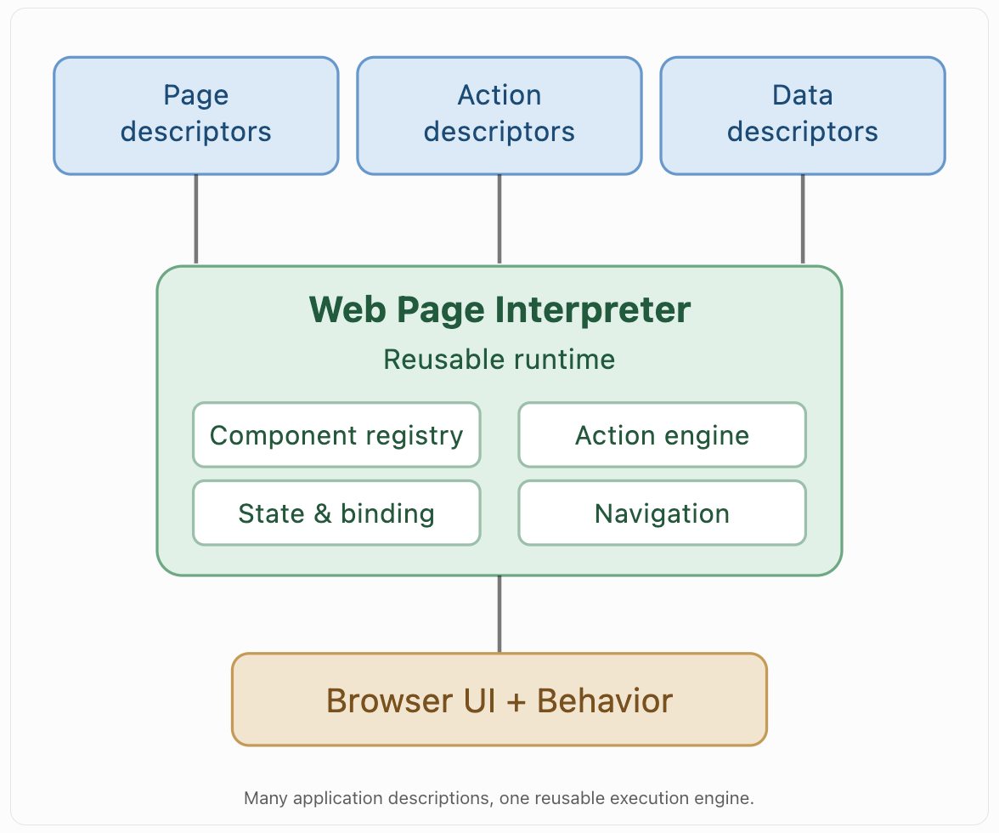
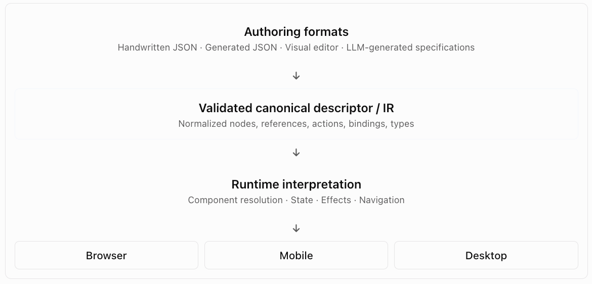
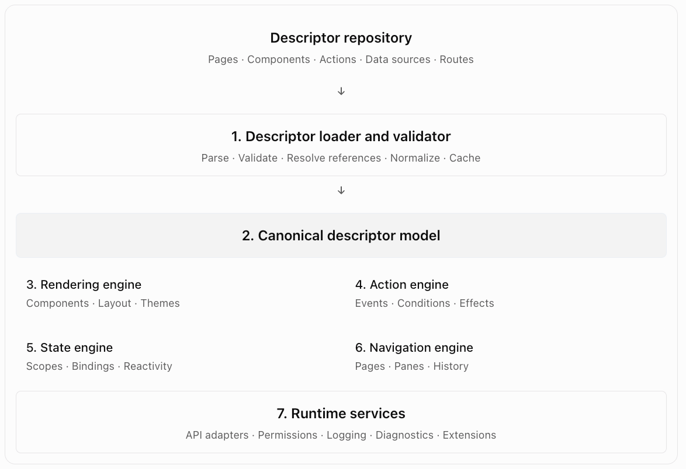

# Deep Research: Descriptor-Driven Web Page Interpreters

## 1. Executive summary

Web Page Interpreter (WPI) is an implementation of a broader architectural idea: separating application intent from application execution.

Instead of writing frontend code for each page, users describe the page declaratively, using JSON, and provide a generic runtime that interprets the description.

The same principle can be extended beyond rendering to user interactions, navigation, data binding, validation, state management, workflows, and even application permissions.

The result is potentially more significant than reducing frontend code. It creates a different programming model in which much of an application's behavior can be expressed as data rather than imperative code.

Several established technologies explore different parts of this idea:

- Schema-Driven UI: Describes user interfaces as structured data.
- Server-Driven UI (SDUI): Lets a server determine the structure and sometimes behavior of client interfaces.
- Model-Driven Engineering (MDE): Uses models as the primary specification of software systems.
- Interpreters and virtual machines: Execute declarative instructions using a reusable runtime.
- State machines and statecharts: Represent application behavior as states, events, transitions, and actions.
- Workflow engines: Interpret reusable action definitions.
- Domain-Specific Languages (DSLs): Express application-specific concepts independently of implementation details.

WPI should be designed as a small declarative application runtime, not merely a JSON-to-HTML renderer.

That distinction matters because rendering is comparatively straightforward. The difficult engineering problems are application state, dynamic data, event handling, action composition, extensibility, security, and preserving enough expressiveness without recreating JavaScript inside JSON.

A successful WPI architecture could be summarized as:


The key principle is:

Descriptors specify what should exist and what should happen. The interpreter determines how to make it happen.

There are important qualifications to this principle, especially when application-specific business logic is involved. Those boundaries will be a major focus of the analysis.

## 2. Existing technologies and projects

The concept is well established, but existing implementations differ substantially in scope. Some only render forms; others support actions, state, navigation, or entire applications.

The most relevant projects are the ones that treat both interface structure and interaction behavior as declarative objects.

### 2.1 Comparison of existing systems

| Project                  | UI descriptors    | Declarative actions    | Scope                       |
| ------------------------ | ----------------- | ---------------------- | --------------------------- |
| JSON Forms               | Yes               | Conditional UI rules   | Forms                       |
| react-jsonschema-form    | Yes               | Mostly host callbacks  | Forms                       |
| Microsoft Adaptive Cards | Yes               | Yes                    | Cards and interactions      |
| XState                   | State definitions | Yes                    | Behavior and workflows      |
| Formily                  | Yes               | Reactive form behavior | Forms                       |
| Appsmith                 | Yes               | Yes                    | Applications                |
| Retool                   | Yes               | Yes                    | Applications                |
| Airbnb Ghost Platform    | Yes               | Yes                    | Cross-platform applications |

This is a conceptual comparison, not a claim that the projects implement the same descriptor format or runtime semantics.

### 2.2 JSON Forms: separation of data and presentation

[Preview results live | Nullplatform docs](https://images.openai.com/static-rsc-4/PbEdo5DyqpPunAhnaSbkP-kavJ-lKYujbbAFZwiKaOl9JPdjPB57Q9aEQfPW1FnbI6ks0uCvBVOFZGGrDcYCb6_L4lqoCfvGaX4gUbjZMlD3VKN2V0Vq7_povipfz0mOq8g5mJhQ9ZHTvzuOFxDQf6C-7utD8691vyWk5ftVb64?purpose=inline)

JSON Forms

Open source · [Website](https://jsonforms.io/?utm_source=chatgpt.com) · [GitHub](https://github.com/eclipsesource/jsonforms?utm_source=chatgpt.com)

JSON Forms separates a data schema from a UI schema. The data schema defines fields and validation; the UI schema defines controls, layouts, and visibility rules.

For example, its UI rules can show, hide, enable, or disable controls based on JSON Schema conditions. This demonstrates that UI behavior need not be implemented through a separate event handler for every control.&#x20;

[image](https://www.google.com/s2/favicons?domain=https://jsonforms.io\&sz=32)

JSON Forms

+2


The important limitation is scope. JSON Forms is designed for form-based interfaces, not as a complete page-navigation and workflow execution engine.

Lesson for WPI: Separate the data model from the UI model, even though both are expressed in JSON.

### 2.3 Microsoft Adaptive Cards: actions as data

[Get started with Adaptive Cards](https://images.openai.com/static-rsc-4/8yPfFlCE9Z_9dqglyvNo6JQMvAIwkirQ8jKG9PXrRsQ-NjzF3fejAyRskEJS-HOV8_9JdxPzLRrs0uwLQUdsPxuGPcZ7W6dLR3znf2BQG5E7QoZcaM9RHsUm4g3eHnv7fZBIFpGOO72RAKs_lTvGh5-mcVOP5vZVrW6uo6K9Zlo?purpose=inline)

Adaptive Cards

[Website](https://adaptivecards.io/?utm_source=chatgpt.com) · [GitHub](https://github.com/microsoft/AdaptiveCards?utm_source=chatgpt.com)

Adaptive Cards is especially relevant because it models both UI elements and actions using JSON.

Its action vocabulary includes `Action.OpenUrl`, `Action.Submit`, `Action.Execute`, `Action.ShowCard`, and `Action.ToggleVisibility`. The host interprets those actions according to the environment.&#x20;

[image](https://www.google.com/s2/favicons?domain=https://learn.microsoft.com\&sz=32)

Microsoft Learn

+2


For example:

```
{
  "type": "Action.OpenUrl",
  "title": "View details",
  "url": "https://example.com/details"
}
```

The action is not JavaScript. It describes an operation that a host knows how to execute.

This is remarkably close to the idea of:

```
{
  "type": "openPage",
  "page": "show-metric-details",
  "target": "right-pane"
}
```

The key difference is that WPI could support a considerably richer application environment, including internal panes, data bindings, shared state, and multi-step workflows.

Lesson for WPI: A finite, extensible action vocabulary is a viable alternative to embedding arbitrary JavaScript event handlers in descriptors.

### 2.4 Airbnb Ghost Platform: full application-level SDUI

Airbnb's Ghost Platform is a particularly strong architectural precedent.

Airbnb described a platform in which backend responses control the layout, ordering, content, and interaction actions of UI sections across web, Android, and iOS clients.&#x20;

[image](https://www.google.com/s2/favicons?domain=https://www.infoq.com\&sz=32)

InfoQ


The architecture illustrates three important properties:

1. The client provides reusable rendering and interaction capabilities.
2. The backend supplies structured UI definitions.
3. Multiple clients can interpret a shared UI specification while using platform-native components.

This is stronger than generating HTML from JSON. It demonstrates how application presentation can be treated as a protocol between a backend and multiple frontend runtimes.

However, server-driven and descriptor-driven are not identical.

Your WPI could load descriptors from local files, databases, embedded resources, or an API. A server is not inherently required.

I would describe WPI as descriptor-driven UI, with server-driven UI as one possible deployment architecture.

### 2.5 XState: formalizing actions and behavior

XState ([Documentation](https://stately.ai/docs?utm_source=chatgpt.com)) provides a complementary architectural model.

A state machine consists of states, events, transitions, guards, and actions. A transition can be described independently of the implementation of the action it invokes.

For WPI, a dropdown selection could become an event:

```
{
  "event": "category.changed",
  "guard": "categoryIsSelected",
  "actions": [
    "updateSelectedCategory",
    "openMetricDetails"
  ]
}
```

The action implementations are registered separately.

XState does not by itself provide a general-purpose JSON web-page renderer. Its relevance is the behavioral model, particularly when actions become asynchronous, conditional, or state-dependent.&#x20;

[image](https://www.google.com/s2/favicons?domain=https://statecharts.dev\&sz=32)

Statecharts


Lesson for WPI: Consider state machines for complex interaction lifecycles, rather than attempting to represent every interaction as an independent callback.

## 3. The deeper computer science model

The distinction between what and how can be formalized using the concepts of interpreters, declarative programming, and intermediate representations.

### 3.1 A web page descriptor is a program

Consider this descriptor:

```
{
  "type": "button",
  "text": "Save",
  "onClick": {
    "action": "submit",
    "target": "metric-form"
  }
}
```

Although it is JSON, it is not merely passive data.

It contains instructions that affect runtime behavior.

The descriptor therefore belongs to a small programming language. JSON is simply its serialization format.

We can express this formally:

$$UI = Render(D, S, E)$$

where:

- $D$ = page descriptor
- $S$ = application state
- $E$ = runtime environment, including theme and component implementations

For behavior:

$$(S', Effects) = Execute(A, Event, S, E)$$

where:

- $A$ = action descriptor
- $Event$ = user or system event
- $S'$ = resulting state
- $Effects$ = navigation, API calls, notifications, and other external operations

This gives WPI two fundamental interpreters:

Rendering interpreter

Transforms declarative UI descriptions into browser-visible interfaces.

Action interpreter

Transforms declarative action descriptions into state transitions and effects.

The two interpreters share a common application state and execution environment.

### 3.2 Connection to virtual machines

A useful analogy is a virtual machine.

| Virtual machine        | WPI                          |
| ---------------------- | ---------------------------- |
| Instruction set        | Component and action types   |
| Program                | JSON descriptors             |
| Runtime                | Web Page Interpreter         |
| Registers/memory       | Application state            |
| External operations    | Browser and backend services |
| Instruction validation | Descriptor schema validation |
| Execution trace        | Event and action trace       |

This analogy is valuable because it encourages to define a stable instruction set.

For example:

```
UI instructions:
  text
  button
  select
  table
  grid
  form
  pane
  tabs

Action instructions:
  setState
  navigate
  openPage
  fetchData
  submitForm
  showMessage
  executeSequence
  executeConditional
```

These are not actual CPU instructions, but they serve a similar architectural purpose: they establish the operations supported by the runtime.

An important consequence is that descriptors should have an explicit version, just as executable formats and protocols have versions.

### 3.3 Connection to intermediate representations

Compiler design provides another useful analogy.

A compiler often separates source-language syntax from an intermediate representation (IR) and from the target machine implementation.

WPI could adopt a similar architecture:


This suggests separating an easy-to-author descriptor format from a stricter runtime representation.

For example, authors might use shorthand:

```
{
  "type": "text",
  "value": "$metric.name"
}
```

The normalization stage could convert it into an explicit binding:

```
{
  "type": "text",
  "value": {
    "kind": "stateRef",
    "path": "metric.name"
  }
}
```

The second form is easier for a generic interpreter to validate, analyze, and execute consistently.

This is especially useful since we do want to generate descriptors using LLMs.

### 3.4 The important limitation: what and how are relative

Example:

> When a dropdown value changes, open a particular page in a particular pane.

It contains both what and how.

That is correct, but the separation depends on the abstraction level.

At one level, `openPage` is the what: it specifies a desired operation.

At a lower level, `openPage` is implemented by how: resolving the page descriptor, locating the target pane, updating navigation state, and rendering the page.

Consequently, the separation is not an absolute boundary between data and code.

It is a boundary between declarative semantics and operational implementation.

This distinction is important when designing the descriptor language. It is not necessary to eliminate all procedural concepts from descriptors. It is necessary to ensure that descriptors refer to stable, reusable operations rather than their low-level implementations.

## 4. Proposed WPI architecture

Below is the recommended WPI architecture. 


It divides WPI into the following major subsystems:
1. Descriptor repository: Pages · Components · Actions · Data sources · Routes
2. Descriptor loader and validator: Parse · Validate · Resolve references · Normalize · Cache
3. Canonical descriptor model: it contains the following:
   - Rendering engine: Components · Layout · Themes
   - Action engine: Events · Conditions · Effects
   - State engine: Scopes · Bindings · Reactivity
4. Navigation engine: Pages · Panes · History
5. Runtime services: API adapters · Permissions · Logging · Diagnostics · Extensions

These subsystems are logical boundaries; they do not necessarily require separate packages or processes.

### 4.1 Descriptor model

A page descriptor should describe a complete logical page, including actions. But it separates 
a page from the data it needs. Data are normally retrieved from databases, files, the outputs
of other pages, etc. A page descriptor, however, assumes the shape of the data it needs.

With this design, the same page can be used to visualize any data, as long as the data follows
the same format.

Notice that the descriptor has no references to React, Svelte, DOM APIs, or JavaScript functions.

It describes logical UI objects.

The interpreter decides how to instantiate them.

### 4.2 Programming Languages
Descriptors and actions (possibly other similar entities) are all data, describing what we
need. They are programming language neutral. 

The interpreter can be implemented in different programming languages. For phase I, it uses
Svelte for the frontend, Go for the backend, possibly with some Python code, as we are
doing now.

### 4.3 Databases
Databases are treated as independent switchable modules. For phase I, it supports
PostgrelSQL. But it is important to make databases pluggable and switchable.

### 4.4 Component registry

Components are defined by Component Descriptors in JSON. They are registered
wht the system. Example registry:

```
registry.register("select", SelectRenderer);
registry.register("table", TableRenderer);
registry.register("pane", PaneRenderer);
registry.register("form", FormRenderer);
```

For a Svelte implementation, a registry can map type identifiers to Svelte components. The interpreter resolves the type and instantiates the appropriate component with validated properties and bindings.

A particularly useful design decision is to support composite components.

For example, a `metric-search-panel` can itself be defined as a descriptor containing a search input, filter dropdowns, buttons, and a table.

This produces two layers of reuse:

- Primitive components implemented in frontend code.
- Composite components implemented in descriptors.

The second layer could substantially reduce the need to write new frontend code.

### 4.5 Action registry

Actions are defined by Action Descriptors in JSON. They are registered with the system.

Registry:

```
actions.register("setState", setState);
actions.register("openPage", openPage);
actions.register("fetchData", fetchData);
actions.register("showMessage", showMessage);
```

An action descriptor becomes an invocation of one of these registered operations.

```
{
  "type": "openPage",
  "args": {
    "page": "show-metric-details",
    "target": "right-pane"
  }
}
```

A critical improvement is to define a common `ActionContext` containing the current event, page instance, state, navigation context, and authorized services.

Without such a context, action handlers will gradually become coupled to global application objects.

## 5. Action abstraction: the most important part

Rendering is a tree transformation. Actions introduce sequencing, conditional execution, asynchronous effects, error handling, and changes to application state.

### 5.1 Separate events, actions, and arguments

Actions can be decomposed into four concepts:

| Concept      | Example                    | Purpose                    |
| ------------ | -------------------------- | -------------------------- |
| Event source | `category-type`            | Identifies the control     |
| Event        | `change`                   | Specifies the trigger      |
| Action       | `openPage`                 | Specifies the operation    |
| Arguments    | Page, pane, selected value | Parameterize the operation |

The action should not need to know which particular dropdown triggered it.

Consider:

```
{
  "id": "select-metric-category",
  "type": "openPage",
  "args": {
    "page": "show-metric-details",
    "target": "right-pane",
    "params": {
      "category": {
        "$ref": "event.value"
      }
    }
  }
}
```

The event payload supplies the selected category.

The action engine resolves the reference and invokes the registered `openPage` handler.

This is considerably more reusable than an action implementation containing hardcoded component IDs.

### 5.2 Prefer explicit event payloads

Make events first-class runtime objects.

For example:

```
{
  "type": "change",
  "source": "category-type",
  "value": "performance",
  "pageInstance": "metric-browser:1"
}
```

A standard event structure could contain:

```
Event
  type
  source
  value
  previousValue
  timestamp
  pageInstance
  metadata
```

The event schema should vary by event type. A table row-selection event, for example, may contain a record ID and row data, while a button click may not have a value.

This avoids requiring action handlers to inspect the DOM or query individual UI components.

### 5.3 Actions should be composable

A single action is often insufficient.

For example, selecting a category might require:

1. Updating the selected category.
2. Fetching matching metrics.
3. Opening a detail page.
4. Displaying a message if loading fails.

It can be represented as a sequence:

```
{
  "type": "sequence",
  "steps": [
    {
      "type": "setState",
      "path": "selectedCategory",
      "value": {
        "$ref": "event.value"
      }
    },
    {
      "type": "fetchData",
      "source": "metrics-by-category",
      "params": {
        "category": {
          "$ref": "event.value"
        }
      },
      "result": "metrics"
    },
    {
      "type": "openPage",
      "page": "show-metric-details",
      "target": "right-pane",
      "params": {
        "category": {
          "$ref": "event.value"
        }
      }
    }
  ]
}
```

The sequence handler is reusable. It executes arbitrary sequences of registered actions.

This introduces a higher-order abstraction: actions that operate on other actions.

### 5.4 A recommended action taxonomy

| Category    | Action types                                     | Purpose                               |
| ----------- | ------------------------------------------------ | ------------------------------------- |
| State       | `setState`, `resetState`, `patchState`           | Modify application state              |
| Navigation  | `openPage`, `closePage`, `navigate`, `goBack`    | Control pages and panes               |
| Data        | `fetchData`, `submitData`, `refreshData`         | Access data sources                   |
| UI          | `showMessage`, `openDialog`, `focus`, `scrollTo` | Control interface behavior            |
| Logic       | `sequence`, `condition`, `parallel`, `switch`    | Compose operations                    |
| Validation  | `validate`, `clearErrors`                        | Enforce input constraints             |
| Collection  | `selectItem`, `addItem`, `removeItem`            | Manipulate collections                |
| Workflow    | `invokeWorkflow`, `cancelWorkflow`               | Execute long-running behavior         |
| Integration | `invokeService`                                  | Call registered external capabilities |

Avoid introducing a large action vocabulary immediately. Begin with a small set of primitives and expand it based on concrete use cases.

### 5.5 Declarative conditions

Actions frequently depend on conditions.

For example:

```
{
  "type": "condition",
  "test": {
    "op": "notEmpty",
    "args": [
      {
        "$ref": "event.value"
      }
    ]
  },
  "then": {
    "type": "openPage",
    "page": "show-metric-details",
    "target": "right-pane"
  }
}
```

The condition is a structured expression, not JavaScript source code.

A relevant existing project is JsonLogic.

JsonLogic represents rules as JSON, supports common operators, and is designed for evaluating decisions without arbitrary code execution or side effects.&#x20;

[image](https://www.google.com/s2/favicons?domain=https://jsonlogic.com\&sz=32)

jsonlogic.com


Borrow its principles, although we do not necessarily need to adopt its exact syntax.

In particular, distinguish between:

- Expressions: Pure calculations that return values.
- Actions: Operations that can modify state or cause effects.

This is one of the most important boundaries in WPI.

An expression should not silently make an API request or navigate to another page.

### 5.6 Asynchronous action execution

Asynchronous operations create additional design requirements.

Suppose the user selects category A and immediately selects category B.

Two requests begin:

```
t0: select A → request A starts
t1: select B → request B starts
t2: request B completes
t3: request A completes
```

Without an explicit concurrency policy, the older response for A may overwrite the newer response for B.

Consider supporting execution policies such as:

| Policy     | Behavior                                         |
| ---------- | ------------------------------------------------ |
| `latest`   | Only the latest invocation may commit its result |
| `queue`    | Execute invocations sequentially                 |
| `parallel` | Allow independent invocations concurrently       |
| `drop`     | Ignore new invocations while one is running      |

These policies should be specified in action descriptors, not reimplemented in every page.

For a dropdown-driven data request, `latest` is usually the appropriate default.

For financial or irreversible operations, neither silent cancellation nor blind retries should be assumed. Those operations need explicit server-side idempotency and confirmation semantics.

### 5.7 Reusable action definitions

A further improvement is to define parameterized actions independently of pages.

For example:

```
{
  "id": "open-details",
  "parameters": {
    "page": "string",
    "target": "string",
    "itemId": "string"
  },
  "body": {
    "type": "openPage",
    "page": {
      "$ref": "args.page"
    },
    "target": {
      "$ref": "args.target"
    },
    "params": {
      "id": {
        "$ref": "args.itemId"
      }
    }
  }
}
```

A dropdown, table, search result, or button could invoke this action with different arguments.

This is analogous to a function definition and function invocation.

The important distinction is that the function body is declarative and interpreted by the runtime.

## 6. State and data binding

State is likely to become one of the most difficult parts of WPI.

A descriptor-driven UI cannot be fully functional without a well-defined way to represent, read, and update state.

### 6.1 Recommended state scopes

Distinguish at least four scopes.

| Scope      | Lifetime                    | Example                  |
| ---------- | --------------------------- | ------------------------ |
| Component  | Component instance          | Dropdown open/closed     |
| Page       | Page instance               | Selected metric category |
| Session    | Browser application session | Active workspace         |
| Persistent | Across sessions             | User preferences         |

Additionally, a page should receive immutable input parameters, separate from its mutable state.

For example:

```
{
  "page": "show-metric-details",
  "params": {
    "category": "performance"
  }
}
```

The page can initialize its state or fetch data based on these parameters.

This is preferable to having every page read arbitrary global variables.

### 6.2 State bindings

Consider:

```
{
  "type": "text",
  "value": {
    "$ref": "state.selectedCategory"
  }
}
```

The rendering engine should automatically update this text when `selectedCategory` changes.

This needs a reactive dependency mechanism.

At a conceptual level:

```
state.selectedCategory
        |
        +-- category dropdown
        |
        +-- category heading
        |
        +-- metrics query parameters
```

When the state changes, the runtime updates only the affected bindings and their dependent components.

For a Svelte-based implementation, this can be integrated with Svelte's reactive state mechanisms. Do not
create another entirely separate DOM-diffing framework.

### 6.3 Derived state

Some values are computed from other values.

For example:

```
{
  "id": "has-selection",
  "expression": {
    "op": "notEmpty",
    "args": [
      {
        "$ref": "state.selectedCategory"
      }
    ]
  }
}
```

The derived value can control button availability, visibility, or other UI properties.

Derived state can be:

- Pure and deterministic.
- Dependency-tracked.
- Cached when appropriate.
- Recomputed only when inputs change.
- Checked for circular dependencies.

This makes the system easier to reason about than arbitrary event-driven updates.

### 6.4 Data sources as descriptors

Data access can also be abstracted.

For example:

```
{
  "id": "metrics-by-category",
  "type": "api",
  "operation": "listMetrics",
  "params": {
    "category": {
      "$ref": "state.selectedCategory"
    }
  },
  "cache": {
    "policy": "staleWhileRevalidate",
    "ttlSeconds": 60
  }
}
```

The descriptor specifies a logical operation, not a hardcoded endpoint.

The data-source registry maps `listMetrics` to a backend adapter.

This approach is especially useful when backend APIs change. Page descriptors can remain stable as long as the logical data-source contract remains stable.

The runtime must still handle authentication, authorization, errors, retries, pagination, and cancellation.

## 7. Navigation and panes: an architectural opportunity

Most conventional web frameworks emphasize URL-based page navigation. WPI should allow composable workspaces, where several pages can coexist.

This resembles desktop window management and IDE layouts.

```text
Metric workspace
 => left-pane
      Metric category (a page)
 => middle-pane
      PDF Viewer (a page)
 => right-pane 
      Metric details (a page)
```

Model navigation state explicitly:

```
{
  "workspace": {
    "panes": {
      "left-pane": {
        "page": "metric-browser"
      },
      "middle-pane": {...},
      "right-pane": {
        "page": "show-metric-details",
        "params": {
          "category": "performance"
        }
      }
    }
  }
}
```

This has several benefits.

- navigation becomes a state transition rather than an imperative DOM operation.
- workspace layouts can be saved and restored.
- navigation history can be maintained per pane.
- the same page descriptor can be opened in multiple panes with different parameters.

A closely related precedent is OpenUI5. Its routing configuration distinguishes routes from targets, and targets specify where views or components are placed within container controls.&#x20;

[image](https://www.google.com/s2/favicons?domain=https://ui5.github.io\&sz=32)

OpenUI5 Markdown Documentation

+1


We can go one step further: make pane navigation a first-class WPI runtime service, independent of the underlying frontend framework.

One subtle but important issue is identity.

A page ID such as `show-metric-details` identifies a page descriptor, not a running page instance.
It should generate an Page Instance ID when a page is instantiated so that if the same page is 
opened twice, each instance is identified by its own instance identity and state.

For example:

```
Definition:
  show-metric-details

Instances:
  details:metric-123
  details:metric-456
```

This distinction prevents accidental state sharing.

## 8. How far can the abstraction go?

The central engineering question is not whether WPI can render unlimited pages.
Being able to represent any pages is never the goal of WPI.

Instead, abstraction should be incremental and driven by needs.

We can classify behavior into three levels.

### Level 1: Generic UI behavior

Examples include opening a page, setting state, filtering a table, sorting results, displaying a dialog, and validating a form.

These are excellent candidates for declarative action descriptors.

Their operational semantics are largely independent of the business domain.

### Level 2: Domain operations

Examples include calculating a compliance score, evaluating a product specification, or comparing a measurement against a standard.

These operations have domain-specific semantics.

You could expose them as registered services:

```
{
  "type": "invokeService",
  "service": "evaluateMetricCompliance",
  "args": {
    "metricId": {
      "$ref": "state.selectedMetric"
    }
  }
}
```

The page remains declarative, but the underlying business logic is implemented in a domain service.

This is an appropriate abstraction boundary.

### Level 3: Arbitrary application logic

Examples include complex algorithms, streaming data processing, advanced editors, sophisticated graphical interaction, and specialized visualization engines.

Some of these can be represented declaratively, but doing so may require increasingly complex descriptors.

The descriptor language may eventually start to acquire variables, loops, functions, exceptions, asynchronous execution, and other features of a general-purpose programming language. For the first phases, refrain from going too far.

### The abstraction boundary

The abstraction may have two layers:
- Declarative layer: Page composition, bindings, navigation, action orchestration, simple expressions, validation rules
- Registered capability layer: Specialized components, domain operations, backend services, complex algorithms

This creates a useful balance:

- The application is largely declarative.
- The runtime remains manageable.
- Domain logic remains testable in ordinary programming languages.
- New capabilities can be added without changing the fundamental descriptor model.

This is a declarative core with an imperative capability boundary.

## 9. Critical engineering challenges

### 9.1 Descriptor language complexity

The biggest risk is uncontrolled growth of the descriptor language.

A simple system starts with:

```
{
  "type": "button",
  "text": "Save"
}
```

Then requirements introduce conditional visibility, validation, asynchronous operations, nested components, dynamic data, expressions, loops, and custom actions.

Eventually, descriptors become difficult to read and maintain.

Follow three design principles:

1. Keep primitive descriptors simple.
2. Use composition and references instead of deeply nested duplication.
3. Move complex domain behavior into registered capabilities.

### 9.2 Descriptor validation

Every descriptor should be validated before execution.

Use JSON Schema to validate structural properties, but add semantic validation for cross-references and runtime constraints.

JSON Schema Draft 2020-12 provides a mature standard for structural validation.&#x20;

[image](https://www.google.com/s2/favicons?domain=https://json-schema.org\&sz=32)

JSON Schema


For example, a descriptor might be structurally valid but refer to a nonexistent pane:

```
{
  "type": "openPage",
  "page": "show-metric-details",
  "target": "unknown-pane"
}
```

A semantic validator should detect that error.

I recommend at least these validation stages:

| Stage        | Example check                                    |
| ------------ | ------------------------------------------------ |
| Syntax       | Valid JSON                                       |
| Schema       | Valid component and action properties            |
| References   | Page, pane, and action IDs resolve               |
| Types        | Action argument types are compatible             |
| Capabilities | Runtime supports required component types        |
| Security     | Descriptor requests only authorized capabilities |

These checks should ideally run both during development and at runtime.

### 9.3 Security

A descriptor-driven application creates a security boundary because descriptors can instruct the runtime to perform operations.

Never treat arbitrary JSON descriptors as trusted merely because they are not JavaScript.

Potential risks include unauthorized API operations, unsafe URL navigation, injection through rich text, excessive resource consumption, and prototype pollution through dynamic state paths.

OWASP specifically warns against passing untrusted keys to recursive merge or path-setting functions, including dangerous keys such as `__proto__`, `constructor`, and `prototype`.&#x20;

[image](https://www.google.com/s2/favicons?domain=https://cheatsheetseries.owasp.org\&sz=32)

OWASP Cheat Sheet Series


For WPI:

- An allowlisted component and action registry.
- Capability-scoped access to backend services.
- Strict validation of paths and URLs.
- No arbitrary `eval` or dynamically constructed JavaScript.
- Resource limits on nested descriptors, expression evaluation, and action execution.
- Server-side authorization for every protected operation, independent of what the descriptor allows.

A descriptor may request a capability. It should not grant itself that capability.

### 9.4 Error handling

Action execution needs consistent failure semantics.

For example, what happens when `fetchData` fails inside a `sequence`?

Should subsequent steps execute? Should the UI display an error? Should the action retry?

Equally important: errors should NEVER go silently.

Explicit error handling:

```
{
  "type": "fetchData",
  "source": "metric-details",
  "onError": {
    "type": "showMessage",
    "level": "error",
    "text": "Unable to load metric details"
  }
}
```

### 9.5 Debugging and observability

A conventional debugger can show a JavaScript call stack.

For WPI, developers will also need a descriptor-level execution trace.

For example:

```
EVENT  category-type.change
  value = "performance"

ACTION select-metric-category
  STEP 1 setState
    selectedCategory = "performance"

  STEP 2 fetchData
    source = metrics-by-category
    status = success
    records = 128

  STEP 3 openPage
    page = show-metric-details
    target = right-pane

RENDER right-pane
  pageInstance = details:42
  status = completed
```

This should be a built-in capability, not an afterthought.

Each trace record should contain descriptor IDs, page instance IDs, event IDs, action execution IDs, durations, and errors.

This makes it possible to debug at the abstraction level used by descriptor authors.

### 9.6 Descriptor versioning

Because the interpreter and descriptors may evolve independently, compatibility needs to be explicit.

For example:

```
{
  "schemaVersion": "1.2",
  "requires": {
    "components": ["table@2", "select@1"],
    "actions": ["openPage@1"]
  }
}
```

The runtime can reject unsupported descriptors or apply well-defined migrations.

I would avoid silent changes in action semantics. If `openPage` changes how it handles existing pane state, that can break many descriptors at once.

### 9.7 Accessibility and semantics

The interpreter should preserve keyboard navigation, focus management, semantic HTML, labels, validation announcements, and other accessibility behavior.

This is another benefit of centralized component implementations: fixing accessibility in one renderer can improve every page that uses it.

However, descriptors must still supply sufficient semantic information, such as accessible labels and the purpose of interactive controls.

## 10. Implementation strategy

Build WPI incrementally rather than attempting to define a complete declarative programming language upfront.

Phase 1 — Declarative rendering

Implement page loading, schema validation, component registry, layout composition, and simple data bindings.

Deliverable: multiple pages rendered entirely from descriptors, without page-specific frontend components.

Phase 2 — Declarative actions

Add the action registry, standardized events, state updates, navigation, action sequences, and conditional execution.

Deliverable: the dropdown-to-right-pane example working entirely through descriptors.

Phase 3 — Data and state

Add state scopes, reactive bindings, data-source descriptors, asynchronous action policies, caching, and error handling.

Deliverable: complete interactive CRUD-style pages.

Phase 4 — Composition and extensions

Add reusable composite components, parameterized actions, registered domain services, and descriptor imports.

Deliverable: new application pages constructed primarily by composing existing descriptors.

Phase 5 — Production runtime

Add descriptor versioning, capability permissions, developer diagnostics, execution tracing, compatibility testing, and performance optimization.

Deliverable: a stable runtime supporting independently evolving descriptors.

Use three representative pages to evaluate the architecture: a search/filter page, a form with validation and submission, and a multi-pane master-detail workspace.

If all three can be implemented without adding page-specific JavaScript, that is a meaningful demonstration of the abstraction.

### 11. LLM-generated applications

Once pages and actions are described using a validated JSON language, an LLM can potentially generate pages and complete application.

For example, a user might request:

> Create a page showing all performance metrics, with a category filter on the left and metric details on the right.

An LLM could generate a WPI descriptor rather than Svelte or React source code.

This has significant advantages:

- Output can be schema-validated before execution.
- The LLM uses a constrained component and action vocabulary.
- Generated pages inherit established design and accessibility behavior.
- The system can reject unsupported operations before rendering.
- Descriptors can be inspected, diffed, and version-controlled.

This is potentially a more controlled approach than allowing an LLM to generate arbitrary frontend source code.

However, schema-valid JSON is not necessarily semantically correct. The generated page still needs reference checking, authorization, and behavioral tests.

### 12. Further implications: WPI as an application platform
There are several interesting consequences of this architecture.

### 12.1 Application introspection

Because the application structure and actions are explicit data, WPI can inspect its own applications.

For example, it can answer:

- Which pages can open `show-metric-details`?
- Which actions modify `selectedCategory`?
- Which components depend on the `metrics-by-category` data source?
- Which pages reference an obsolete component?
- Which actions can invoke a sensitive backend operation?

This is substantially more difficult when behavior is scattered across arbitrary JavaScript event handlers.

WPI descriptors naturally form a graph:

```
Page
 ├── contains → Component
 ├── references → DataSource
 └── defines → EventBinding
                  └── invokes → Action
                                 ├── reads → State
                                 ├── writes → State
                                 └── navigatesTo → Page
```

A dependency graph like this can support static analysis, impact analysis, documentation generation, and automated testing.

### 12.2 Automatic test generation

Declarative actions can be tested without necessarily rendering a browser.

For example:

```
{
  "given": {
    "state.selectedCategory": null
  },
  "when": {
    "event": "category-type.change",
    "value": "performance"
  },
  "expect": {
    "state.selectedCategory": "performance",
    "navigation.right-pane.page": "show-metric-details"
  }
}
```

A test runner could execute the descriptor against a simulated runtime and assert the resulting state and effects.

This creates a strong opportunity for model-based testing.

### 12.3 Multiple frontend implementations

If WPI descriptors do not depend on Svelte, React, or browser-specific details, multiple renderers could interpret the same descriptors.

For example:

```
                  WPI Descriptor
                        |
             +----------+----------+
             |          |          |
           Svelte      React     Native UI
             |          |          |
           Browser     Browser     Mobile
```

The descriptor's logical behavior could remain consistent across platforms.

This requires careful separation of logical components from platform-specific presentation capabilities. Not every UI component has a meaningful equivalent on every platform.

## 13. Final architectural recommendations

Design decisions are summarized below.

| Decision                | Recommendation                                   |
| ----------------------- | ------------------------------------------------ |
| Overall model           | Declarative application runtime                  |
| Descriptor format       | JSON, validated by JSON Schema                   |
| Internal representation | Canonical, normalized descriptor IR              |
| Rendering               | Component registry with pluggable renderers      |
| Events                  | Standardized typed event payloads                |
| Actions                 | Registered, parameterized primitives             |
| Action composition      | Sequence, condition, parallel execution          |
| Expressions             | Pure, deterministic expression language          |
| State                   | Scoped, reactive, instance-aware                 |
| Navigation              | Declarative pages, panes, and routes             |
| Data access             | Logical data-source descriptors                  |
| Business logic          | Registered domain services                       |
| Extensibility           | Versioned component and action capabilities      |
| Security                | Allowlisted operations and capability boundaries |
| Debugging               | Descriptor-level event and action tracing        |
| Testing                 | Schema, semantic, and behavioral tests           |

## 14. References worth studying

These are the most relevant starting points from the research.

| Resource                                                                                                              | Why it matters                                              |
| --------------------------------------------------------------------------------------------------------------------- | ----------------------------------------------------------- |
| [JSON Forms](https://jsonforms.io/docs/?utm_source=chatgpt.com)                                                       | Separation of data schema, UI schema, and conditional rules |
| [Microsoft Adaptive Cards](https://github.com/microsoft/AdaptiveCards?utm_source=chatgpt.com)                         | JSON-defined components and actions                         |
| [Airbnb's Server-Driven UI](https://www.infoq.com/news/2021/07/airbnb-server-driven-ui/?utm_source=chatgpt.com)       | Full application-level descriptor architecture              |
| [XState](https://stately.ai/docs?utm_source=chatgpt.com)                                                              | State machines, guards, actions, and workflows              |
| [JsonLogic](https://jsonlogic.com/?utm_source=chatgpt.com)                                                            | Pure expressions represented as JSON                        |
| [OpenUI5 Routing](https://ui5.github.io/docs/04_Essentials/routing-configuration-9023130.html?utm_source=chatgpt.com) | Declarative navigation targets and containers               |
| [JSON Schema](https://json-schema.org/specification?utm_source=chatgpt.com)                                           | Descriptor validation and language contracts                |
| [react-jsonschema-form](https://rjsf-team.github.io/react-jsonschema-form/docs/?utm_source=chatgpt.com)               | Schema-driven form rendering and customization              |

## Conclusion

Three increasingly powerful abstractions in the WPI proposal:

**First, presentation abstraction.** A page is represented as a composition of logical UI components. A generic renderer converts that representation into browser UI.

**Second, behavioral abstraction.** Events and actions are represented declaratively. A generic action interpreter executes them, including state changes, navigation, and asynchronous operations.

**Third, application abstraction.** Pages, actions, state, data sources, and navigation form a coherent, machine-interpretable application model.

The third abstraction is where WPI becomes especially interesting.

It means that an application is no longer primarily a collection of frontend source files. It becomes a collection of interconnected declarative models executed by a common runtime.

The key architectural objective should therefore be:

Maximize the range of applications expressible through stable, reusable primitives, while minimizing the need to extend the interpreter for each new application.

That is a more useful objective than simply minimizing frontend source-code size. It can be evaluated quantitatively by tracking how often new pages require new components, new action implementations, or changes to the runtime itself.