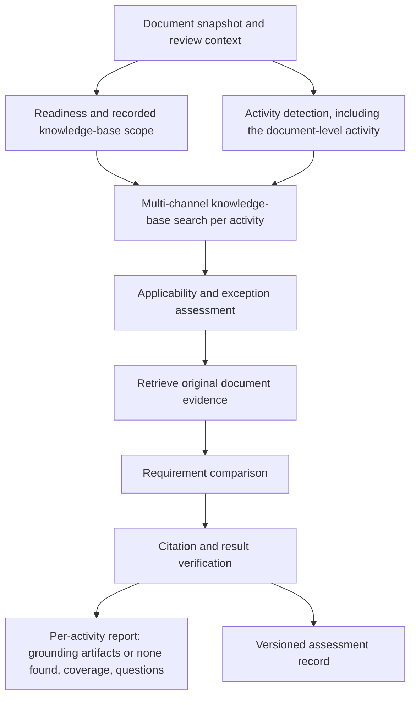

# Compliance reviewer — research, current implementation, and proposed design

**Date:** 2026-11-11 (America/Chicago) \
**Status:** Research and design proposal. Delivery phase 1 thin slice implemented 2026-11-12 (`ChenWeb/server/api/doc-reviews/review-compliance.go`, aspect `compliance`, per chunk): activity detection incl. the document-level activity, `searchengine.Search` over provisions and chunks, per-activity candidates / none-found rows. Retrieval results are reported as candidates, not analysis-accepted grounding; applicability, requirement comparison, gaps, verifier, run manifest and coverage report (phases 3-4) are not built. Delivery phase 2 tooling (evaluation snapshot, LLM-adjudicated gold labelling with a judged pool, scorer; openspec `compliance-reviewer-phase2`) is built and smoke-tested on one record; the gold set itself, the baseline and the `min_cosine` choice are not done (see devdoc 2026111201, Evaluation tooling). Formerly filed as `devdocs/202611/2026111103-devdoc-compliance-reviewer-research.md`. \
**Scope:** Detecting the activities a document describes that rules could govern, and grounding each one in the laws, regulations, standards, contracts, and policies the knowledge base holds, including obligations the document never names. \
**Ground sources:** The knowledge base, whatever it holds, searched through the hybrid search engine. The reviewer’s algorithm does not depend on the knowledge base’s contents; a richer knowledge base gives better results. The first iteration runs on the existing production knowledge base, which is mostly Chinese standards; later iterations may add sources (decided 2026-11-11, §5.1). \
**Code roots:** `ChenWeb/server/api/doc-reviews`, `ChenWeb/server/api/doc-processing`, `ChenWeb/server/api/searchengine`, `ChenWeb/server/api/kbsearch`.

## 1. Summary

A useful compliance reviewer must discover which rules might govern the activities described in a document, establish which rules actually apply, and compare their requirements with evidence in that document. Finding similar sentences is only one part of that work. A design sentence such as “Log user activities in a database table” can raise questions about auditability, personal information, access, retention, and deletion without naming a law or standard.

The recommendation is one new, independent, evidence-grounded **Compliance Review** reviewer, exposed as an optional aspect. It runs per chunk, with no block or document-level fallback. It neither invokes nor depends on the existing legal, regulatory, internal-policy, standards, or provision reviewers; shared search and review infrastructure may be reused. It detects the activities a document describes, including the activity the document itself performs, such as specifying a product. It then searches the knowledge base for artifacts that could govern each activity, analyzes the ones it finds, and reports per activity. A requirement of a found artifact that the document never addresses is reported as a gap, which catches omissions that sentence-by-sentence review cannot find.

Every assessment should distinguish grounding, applicability, document evidence, and execution completeness. “No grounding artifact found,” “no contradiction found,” “requirement not documented,” “applicability unknown,” and “search failed” are different outcomes. The engine should report scoped document assessments, with source versions and evidence, rather than declare that an organization or deployed system is compliant.

The knowledge base is the reviewer’s only source of grounding, searched only through the server’s hybrid search engine (`searchengine`). Activity detection, search, analysis, and reporting do not depend on its contents; only their results do. An empty knowledge base still yields an activity list, with each activity reported as “no grounding artifacts found.” A richer knowledge base supplies more potentially governing artifacts without changing the algorithm. Today’s production knowledge base is mostly Chinese standards; laws, regulations, company policies, and contracts can be added later. §5.1 sets out the design rules. Finding no grounding after a successful search is normal, never an error or a compliance verdict.

The inspection also found two defects in the existing reviewers that make their results misleading today and do not depend on the new engine (§2.2): a failed model call becomes an empty, successful result, and the reference documents a user selects never reach the reviewers. These are separate bugs in existing review infrastructure (§12), not prerequisites or dependencies of the new compliance reviewer.

This document records a source-code inspection and primary-source research. Existing behavior is described in §2; everything from §5 onward is proposed unless explicitly identified as an existing integration. Nothing was deployed for this research; §13 lists what it did not check.

### 1.1 Decisions needed before delivery phase 1

None of these choices changes the reviewer’s algorithm. They decide what the first version is tested on and who judges its results.

| Decision | Why it matters | Current position |
|---|---|---|
| Source scope | Retrieval and gold labels depend on it | **Decided 2026-11-11:** the knowledge base, whatever it holds, searched through the hybrid search engine; the algorithm does not depend on its contents (§5.1) |
| Evaluation documents | Results can only be judged on concrete documents. A useful set has activities the knowledge base covers and activities it does not, because “no grounding artifacts found” must be tested too | Open; the production inventory below helps pick them |
| Organization context for those documents | Applicability depends on organization role, products or services, territory, and adopted standards. A missing fact makes applicability `unknown`; it does not stop a run | Not supplied; must come from the adjudicator |
| Adjudicator | Findings need an accountable person to judge them | Not decided |
| Annotation budget | Sets the size of the gold set, and therefore which release gates in §11.3 can be measured | Not estimated |

The first piece of work is an inventory of the production knowledge base, which is cheap. It is not a design input, since the reviewer runs on whatever the knowledge base holds. It is needed to choose evaluation documents and to read the results. “No grounding artifacts found” means one thing when the knowledge base holds no relevant source and another when it holds one that search missed; only the inventory and the gold labels can tell these apart. Count sources by type, subject, and edition, for example mandatory, recommended, group, enterprise, local, and industry standards. Count how many are search-ready, with indexed provisions and original chunks, and how many have extracted references. Almost every production record carries a document number (over 99%), so the count can be made from identifiers. This research looked only at a development database, which is not representative of production.

### 1.2 Terms used in this document

| Term | Meaning here |
|---|---|
| Aspect | One checkbox in the document-review UI; each aspect runs one reviewer |
| Capsule | The doc-processor orientation file, `KnowledgeStore/Capsules/coding-capsules/doc-processor/+CAPSULE.md` |
| Chunk, page block | Distinct input units. Extraction chunks are saved by the chunking processor; the current review scheduler also creates fixed-size line chunks. Existing page blocks group whole pages. The new compliance reviewer runs per chunk only, without fallback; its chunk source must be pinned in its implementation contract. |
| P5 | The internal group name of the legal, regulatory, internal-policy, and standards reviewers |
| Doc-processor Phase B, Phase C | Pipeline stages, not delivery phases: Phase B runs extraction processors concurrently; Phase C (post-process) indexes their output |
| Lexical search, BM25 | Keyword search; BM25 is the ranking formula it uses |
| Semantic search, cosine | Search by embedding similarity; cosine is the similarity score |
| Recall@K | The share of relevant items that appear in the top K results |
| Activity | Something the document describes doing that a rule could govern, including what the document itself does, such as specifying a product |
| Knowledge base | The searchable collection the reviewer may take grounding from: standards, laws, regulations, policies, contracts, or anything else added to it. Its contents change the results, not the algorithm |
| Grounding artifact | A knowledge-base item, such as a standard clause, policy section, or law article, that analysis accepts as possibly governing an activity |
| Mandatory, recommended standard | Chinese standard types: a mandatory standard (such as `GB`) must be implemented; a recommended one (such as `GB/T`) binds only when adopted |
| Normative references | The documents a document formally lists as indispensable for applying it, in a section for that purpose (规范性引用文件 in Chinese standards) |
| Obligation | One assessable requirement taken from a grounding artifact |
| Evidence boundary | The documents a review may look in: the reviewed document alone, or it plus named supporting documents |
| ePHI | Electronic protected health information under the US HIPAA rules |
| OSCAL | NIST's machine-readable format for security assessment records |

## 2. Existing reviewers and the inspected defects

### 2.1 What was inspected

The starting point was the [doc-processor capsule](../../../Capsules/coding-capsules/doc-processor/+CAPSULE.md), followed by actual Go implementations, prompts, reviewer configuration, module records, and related devdocs. It describes the working-tree snapshot on the date above, including unrelated uncommitted changes in the local repositories.

Important source locations, relative to the workspace root:

| Source | What it establishes |
|---|---|
| `ChenWeb/server/api/doc-reviews/aspects.go` | Existing aspect names, labels, groups, and tool-use flags |
| `ChenWeb/server/api/doc-reviews/review-document.go` | Reviewer runtime resolution and dispatch |
| `ChenWeb/server/api/doc-reviews/review-legal-compliance.go` | Existing legal reviewer’s chunk implementation, separate page-block entry point, tool loop, and errors |
| `ChenWeb/server/api/doc-reviews/review_cache_scheduler.go` | Effective configured chunk versus document dispatch |
| `ChenWeb/server/api/doc-reviews/review-regulatory-compliance.go` | Corresponding regulatory reviewer |
| `ChenWeb/server/api/doc-reviews/review-internal-policy.go` | Internal policy reviewer |
| `ChenWeb/server/api/doc-reviews/review-standards-compliance.go` | Existing standards compliance aspect, additional to the four highlighted in the request |
| `ChenWeb/server/api/doc-reviews/review-provisions.go` | Cross-document provision matching and comparison |
| `ChenWeb/server/api/doc-reviews/review-tools.go` | Record-scoped tools and explicitly selected cross-record context tools |
| `ChenWeb/server/api/doc-reviews/review-artifact-window.go` | Context assembly, scheduling, and heuristic authority classification |
| `ChenWeb/server/api/doc-reviews/review-p5_test.go` | Mock-based normalization/default tests for the compliance reviewers |
| `ChenWeb/doc-review.local.toml` | Local reviewer configuration; settings are not evidence of deployment |
| `ChenWeb/prompts/prompt-review-{legal-compliance,regulatory-compliance,internal-policy,standards-compliance}.md` | The existing review rubrics |
| `ChenWeb/server/api/searchengine/{types,engine,filters}.go` | Server-side hybrid retrieval interface and filters |

### 2.2 Existing reviewers and their limits (inspection before bug fixes)

| Reviewer | Existing mechanism | Consequence for the proposed work |
|---|---|---|
| `legal_compliance` | Locally configured `per-chunk`; the normal scheduler calls `processChunk` directly. Its separate `StrategyDocument`/`ReviewDocument` entry point builds page blocks. Optional tool loop or one JSON extraction per unit. | Existing behavior does not define the new compliance reviewer’s processing unit; cross-chunk evidence must be explicitly retrieved. Missing context outside a unit remains a problem. |
| `regulatory_compliance` | Similar prompt-driven checking, normally per chunk under local configuration, with optional tools. | Needs a verified source corpus and explicit applicability decisions, not only a more detailed rubric. |
| `internal_policy` | Prompt asks for deviations from explicitly stated or referenced policies and tells the model not to invent policies. | This restraint is useful, but unreferenced company policies will not reliably be discovered. |
| `standards_compliance` | Separate existing aspect for standards. | The independent new reviewer may discover standards through shared search; it does not call this existing reviewer. |
| `provisions` / Provision Consistency | Loads extracted `kb.provisions`, retrieves peers from other documents, adds original context, and asks the model to compare. | Useful comparison infrastructure, but its starting population is extracted provisions, not all activities or all applicable obligations. |

The local TOML selects `per-chunk` for legal/regulatory/standards and `per-block` for internal policy. `PostProcessIndex` uses `runReviewersPromptCacheOptimized`; `buildPromptCacheReviewTasks` directly schedules `processChunk` for configured chunk reviewers. The legal reviewer implements that interface. The scheduler currently sends unsupported input/interface combinations to `ReviewDocument`, which can select a different processing unit. This is an existing dispatch defect: a configured per-chunk reviewer must either run per chunk or return an error, never fall back to blocks or another strategy. The new compliance reviewer has no fallback entry point.

The legal rubric asks the model to infer legal context and covers potentially missing disclosures, privacy requirements, and contractual terms. It also mixes legally required terms with customary terms. This can produce useful concerns, but custom and legal obligation must become different categories in a rigorous assessment. A missing copyright notice or disclaimer is not automatically a legal violation merely because it is commonly seen.

**Defect: failed model calls disappear.** On the normal configured path, the chunk reviewer interface in `review-document.go` is `processChunk(ctx, recordID, index, cfg, input) []ReviewFinding`. It has no error return, so no chunk reviewer can report a failure. The legal reviewer’s `processChunk` logs a failed JSON extraction and returns no findings; a failed tool loop is logged and whatever partial findings it produced are returned as if complete. Existing page-block entry points behave the same way: `processBlock` returns no findings on failure, and the concurrent callback in `ReviewDocument` wraps that result with a nil error. An empty or short finding list therefore cannot establish that all units were reviewed. Twenty reviewers implement `processChunk`, so the fix is an interface change across all of them, not a patch to one reviewer. The artifact reviewers, including Provision Consistency, follow the same pattern: `runArtifactUnitsChunkGrouped` in `review-artifact-window.go` documents that each unit handles its own model errors by returning no findings. It is independent of the model’s reasoning accuracy.

**Defect: selected reference documents are dropped.** The request’s selected `reference_docs` are accepted, stored, and printed in reports, but `controller.go::RunReview` does not pass that selection into `ReviewProcessor`. It sets run IDs, depth, requested aspects, and stores before calling `PostProcessIndex`. A user who selects reference documents today gets a report that lists them, although no reviewer received them. The future reviewer also needs explicit, tested propagation of the selected authority/evidence set.

Both defects affect existing reviewers. Fix them as independent bugs; neither makes the new compliance reviewer depend on another reviewer. Any actual execution error must be logged and abort the affected reviewer, including a failed model call, tool loop, retrieval, parsing, or persistence operation. Cancel that reviewer’s outstanding work, propagate the original error, and mark it failed. Other independent reviewers may continue. A completed search with no accepted grounding artifact is a normal result, not an execution error.

### 2.2.1 Which existing reviewers use blocks?

Not all existing reviewers are per chunk. The inspected `ChenWeb/doc-review.local.toml` explicitly configures these 20 aspects as `per-block`:

* `formatting_consistency`, `logical_flow`, `heading_hierarchy`, `toc_accuracy`, `navigability`, `section_balance`, `modularity`.
* `relevance`, `currency`, `internal_contradictions`, `terminology_consistency`, `cross_reference_correctness`, `requirement_traceability`.
* `prerequisites`, `internal_policy`, `limitations`, `version_history`, `review_status`, `ownership`, `references`.

Configuration alone does not prove a reviewer is implemented or enabled: `toc_accuracy` and the P6 entries require checking against runtime registration. The actual block-capable implementations are `formatting_consistency`, `logical_flow`, `heading_hierarchy`, `navigability`, `section_balance`, `modularity`, `relevance`, `currency`, `internal_contradictions`, `terminology_consistency`, `cross_reference_correctness`, `requirement_traceability`, `prerequisites`, `internal_policy`, and `limitations`. Legal, regulatory, and standards reviewers also contain block entry points, although configured per chunk. Metrics, provisions, entities, inventory items, and metrics completeness use artifact-oriented processing, not ordinary line-chunk or page-block dispatch.

This inventory describes existing code and local configuration, not deployed settings or a decision to convert every reviewer. The new compliance reviewer is independently specified as per chunk only.

### 2.2.2 Bug-fix implementation boundary (2026-11-11)

The follow-up bug fix changes the chunk/block/artifact methods to return errors and cancels an affected reviewer on its first failure. Tool execution, malformed model output, retrieval, and persistence errors propagate; a failed loop is not repaired by another model call or forced to produce a successful result. Findings from failed reviewers are not returned as successful output. Successful independent reviewers can finish, and aspect success is recorded only after findings are saved. Configured per-chunk processing cannot silently dispatch to a block/document method.

Selected supporting documents remain unsupported by existing reviewer inputs. The current correction disables their selection in the UI and rejects new nonempty `reference_docs` with HTTP 422. Previously accepted requests with such selections fail explicitly. Historical selections remain readable; re-enabling the feature requires tested access checks and evidence delivery. The proposed supporting-document workflow in §5.2 is future behavior, not a claim that this fix implements it.

The new independent compliance reviewer remains unimplemented. See [the bug-fix devdoc](../../devdocs/202611/2026111105-devdoc-reviewer-error-handling.md) for code and verification details.

### 2.3 What Provision Consistency already does well

The [provisions reviewer devdoc](../../devdocs/202611/2026111002-devdoc-provisions-reviewer.md) describes the current implementation in detail. The inspected code confirms these useful seams:

* Similarity search calls `searchengine.Search` using an indexed provision reference, excludes the document under review, and combines lexical and vector results. Object-anchor peers provide another candidate route.
* Matches carry source documents, original line context, and identifiers. The reviewed provision is shown with its extraction chunk.
* A provision with no matches finishes without a model call. That means “no comparison candidates,” not “compliant.”
* `ARTIFACT_CONNECT_MIN_COSINE` defaults to 0.75 for this path. Its minimum-cosine condition can remove lexical matches. Copying that condition into authority discovery would risk losing exact clause identifiers or semantically distant obligations. The value is also out of date: the code comment in `searchengine/similar.go` says 0.75 was tuned for text-embedding-3-small and needs recalibrating for bge-m3, the embedding model the workspace now uses.
* `docAuthorityClass` uses document numbers, titles, and filenames to classify standards, regulations, and peers. It is explicitly heuristic. It does not establish legal force, authentic publication, jurisdiction, effective edition, or applicability.
* The similarity lookup supplies exclusion/type filters but no knowledge-store or document-group boundary in that call. The new assessment engine must provide explicit authorization filtering; retrieval capability alone is not an access policy.

Keep this reviewer for cross-document consistency. A peer document may supply useful comparison evidence without being a governing authority. Its agreement with the reviewed document does not prove compliance.

### 2.4 Available document processors

The capsule lists enough existing building blocks to avoid starting a second parsing pipeline:

| Existing processor or artifact | Proposed use | Limitation |
|---|---|---|
| Blocking, structure analysis, chunking, canonical line file | Stable passages, headings, tables, source positions | A chunk boundary is not a legal scope boundary; include parent definitions and exceptions. |
| `extract_metadata`, document facets, `classify_document` | Seed issuer, domain, document type, jurisdiction hypotheses | Document jurisdiction is not necessarily the operating organization’s jurisdiction; inferred facts need provenance. |
| `extract_provisions` | Seed explicit obligations and prohibitions | Does not replace discovery of activities, declarative claims, or omitted obligations. |
| `extract_references` | Resolve explicit citations and identify held source editions | Citation resolution is not legal applicability; provision-family artifact resolution is not implemented in this layer. |
| `extract_metrics`, test methods | Numeric thresholds, periods, measurement and verification details | Units, triggers, exceptions, and whether a requirement is binding still need assessment. |
| Entities, relations, inventory items, products | Identify actors, processes, systems, materials, and regulated objects | Mentioning a regulated object does not establish the organization’s regulated role. |
| Semantic projections, topics, scene blocks, summaries | Candidate discovery, query expansion, navigation | Derived text is a retrieval aid; findings cite original source passages. |
| Ontology normalization/association/projection | Optional concept alignment and relationships | Feature-gated; do not make it a prerequisite for the first useful reviewer. |
| `review_document` | Existing on-demand review controller and reporting path | New dependencies, result states, and evidence storage still need explicit implementation. |

The [reference processor orientation](../../../Capsules/coding-capsules/doc-processor/extract-references-spec.md) documents access-aware holding resolution and its current metric resolver. Reuse the resource/version model; do not assume it already resolves governing provisions.

`ApplicabilityResolver.ResolveReviewFacts`, `semrules.FactSet`, and the adapter in `ChenWeb/server/api/kbhandler/ontology_review_document_facts.go` already support provenance-bearing facts and conditional ontology review scopes. They are not currently connected to the document-review pipeline and do not establish legal applicability. Reuse that fact machinery where suitable, extending its vocabulary and context rather than writing another generic fact evaluator.

### 2.5 What the existing tests establish

`TestStandardsComplianceReviewerProcessBlockDefaults`, `TestLegalComplianceReviewerProcessBlockDefaults`, `TestRegulatoryComplianceReviewerProcessBlockDefaults`, and `TestInternalPolicyReviewerProcessBlockDefaults` (all in `review-p5_test.go`) use fake model outputs and check fields such as aspect, severity, and finding type. They establish output plumbing, not correct law discovery or legal reasoning. Other review tests exercise tools and scheduling. No representative, expert-adjudicated end-to-end compliance benchmark exists, so no accuracy figure can be justified from these tests.

## 3. Why the problem is larger than provision matching

### 3.1 Five separate questions

1. **What activity does the document describe?** Identify actions, actors, data, affected people, products, location, timing, and conditions—even without “shall” or “must.”
2. **Which knowledge-base artifacts could govern it?** Search for candidate sources, including requirements and company rules the document never mentions. Finding none is a valid answer.
3. **Which candidate obligations actually apply?** Resolve territory, regulated role, effective date, scope, thresholds, adoption, exceptions, and unknown facts.
4. **What does the document establish?** Compare statements and referenced evidence with each applicable obligation; check the whole declared review boundary before asserting an omission.
5. **What was successfully assessed?** Report source coverage, incomplete searches, missing inputs, processing failures, and unresolved questions.

A relevant rule can be inapplicable. An applicable rule can be unmentioned. A requirement can be documented without being implemented. The result model must preserve those distinctions.

### 3.2 Document compliance and implementation compliance

A product specification can promise access controls without proving those controls exist. A procedure may reference an approved retention schedule instead of restating it. A law may require an organization to maintain records without requiring every architecture note to discuss those records.

The initial product should assess **documented alignment within a stated evidence boundary**. Each review records its document role: for example, detailed security design, employee procedure, public privacy notice, contract, or informal proposal. Whether a missing topic is a documentation gap depends on that role and on the governing document requirements.

Implementation evidence—configuration, source code, audit events, test reports, interviews—can be a later evidence class. A document-only assessment must leave implementation unverified.

### 3.3 Activities, including the document’s own

The reviewer works from activities. It finds “logging” and searches for artifacts that could govern it. A grounding artifact usually carries more requirements than the sentence that led to it: a logging rule may also require retention, integrity protection, and deletion. Each requirement of a found artifact that the document never addresses is a gap, even though no sentence mentions it. That is how a document that never mentions deletion still gets checked for a required deletion policy.

Some obligations attach to no sentence at all. A rule may require every product specification of a certain kind to cover labelling, whatever the text says. To catch these, the reviewer treats the document itself as an activity: its type, its subject (a product, service, or process), and its purpose. The same search then finds artifacts that govern documents of that kind. For example, the development data contains an enterprise standard for automatic blood-pressure monitors. Its document-level activity, specifying a medical electrical device of that type, leads to the standard for automatic non-invasive sphygmomanometers (YY 9706.230—2023) when the knowledge base holds it, and to “no grounding artifacts found” when it does not.

This replaces a hand-curated checklist of obligations (a “profile”) as the means of finding omissions. A curated checklist made the reviewer depend on the checklist rather than on the knowledge base. Where a checklist exists, such as a company’s logging policy, it is simply another knowledge-base artifact the same search can find.

Deduplicate at obligation and evidence scope, not by similar finding titles.

## 4. Research findings and technology choices

### 4.1 How the field’s building blocks developed

Structured legal document identifiers address the identity problem: a law, a language/version expression, and a particular file are different things. [Akoma Ntoso’s naming convention](https://docs.oasis-open.org/legaldocml/akn-nc/v1.0/akn-nc-v1.0.html) provides a useful model for retaining those differences. Adopt the distinction in the resource model without requiring an XML conversion project.

[LegalRuleML 1.0](https://docs.oasis-open.org/legalruleml/legalruleml-core-spec/v1.0/os/legalruleml-core-spec-v1.0-os.html), standardized in 2021, provides vocabulary for normative rules, including conditions, temporal information, jurisdiction, exceptions, provenance, and competing interpretations. Its practical lesson here is that a rule needs more structure than a sentence and an embedding. It is a representation standard, not an automatic source of correct legal judgments.

Also in 2021, [ContractNLI](https://aclanthology.org/2021.findings-emnlp.164/) framed document inference as entailment, contradiction, or not mentioned, with supporting evidence spans. Its contract setting is narrower than this product, but the separation is useful: failure to find support is not proof of contradiction. Its discussion of long context and exceptions also supports retrieving surrounding definitions and qualifying clauses.

[LegalBench](https://arxiv.org/abs/2308.11462) expanded evaluation across legal reasoning tasks in 2023. [LegalBench-RAG](https://arxiv.org/html/2408.10343v1) subsequently focused on retrieval of precise supporting passages. Neither provides a ready-made gold set for this workspace’s company policies, Chinese standards, or selected jurisdictions. Their value is methodological: assess retrieval and reasoning separately and score actual evidence, not only whether the right document appeared somewhere in the results.

[A Reasoning-Focused Legal Retrieval Benchmark](https://arxiv.org/html/2505.03970v1), published in 2025, directly studies fact-pattern-to-rule retrieval when the wording overlaps poorly. It evaluates structured legal query expansion. This supports testing an intermediate issue-discovery step for ordinary activity sentences. Generated issues remain search hypotheses, and results from that benchmark do not predict this reviewer’s accuracy.

This progression suggests a design combining stable source identity, explicit applicability, broad retrieval, and constrained evidence assessment. It does not justify delegating the whole process to a single prompt.

### 4.2 Compare the practical approaches

| Approach | Strength | Main failure | Decision |
|---|---|---|---|
| Larger one-shot compliance prompt | Small implementation change; broad initial issue suggestions | Model memory substitutes for authority; unclear scope, versions, and coverage | Retain as a baseline and optional discovery assistant. |
| Existing provision similarity | Already integrated; source-grounded peer comparison | Misses unextracted activities and unmentioned obligations; similar peers may not bind | Reuse context and comparison infrastructure, retain its separate purpose. |
| Explicit citations only | Precise when document names an accessible source | Misses implicit obligations and undeclared frameworks | Make it one high-priority retrieval channel. |
| Curated checklist/profile as a separate input | Predictable source boundary and omission coverage | Maintenance cost per subject; results depend on the checklist rather than the knowledge base; incomplete profiles can hide unknown rules | Not a separate input. Store a checklist as a knowledge-base artifact and find omissions through activities, including the document’s own (§3.3). |
| Unrestricted web-search agent | Broad discovery and potentially current sources | Unstable evidence, wrong editions, confidentiality and authorization problems | Separate source-acquisition workflow; not the default assessment runtime. |
| Hybrid retrieval plus applicability and evidence assessment | Combines existing search with explicit decision stages | Needs source governance, annotations, and stage-level diagnostics | Recommended architecture. |
| Fully formal legal rule engine | Reproducible reasoning for curated conditions and priorities | Expensive encoding; broad interpretation still requires judgment | Use deterministic rules for selected predicates and thresholds, expand only where justified. |

“Graph retrieval” is an optional enhancement, not the core requirement. A small approved graph of control-to-activity relationships can help discovery. A large automatically extracted graph can also spread an incorrect source interpretation. Start with relational records and explicit edges; measure recall before adding graph infrastructure.

### 4.3 Useful assessment representation

[NIST OSCAL Assessment Results](https://pages.nist.gov/OSCAL/learn/concepts/layer/assessment/assessment-results/) separates assessment scope, reviewed controls, observations, evidence, risks, and findings. Borrow that separation rather than storing only prose findings. An OSCAL-compatible export can be considered later; adopting its entire schema is not a prerequisite.

The local engine should retain its native IDs and records. If an export format needs UUIDs, treat them as external identifiers mapped to local IDs, not as a reason to bypass workspace ID allocation rules.

## 5. Proposed scope and product behavior

### 5.1 Ground sources: the knowledge base, whatever it holds

**Decision (2026-11-11).** The reviewer takes grounding artifacts only from the knowledge base, and searches it only through the hybrid search engine (`ChenWeb/server/api/searchengine`). How the reviewer detects activities, searches, analyzes, and reports does not depend on what the knowledge base contains. The knowledge base’s richness decides how good the results are:

* **Empty knowledge base.** The reviewer still detects every activity and reports each one as “no grounding artifacts found.”
* **Complete knowledge base**, holding every potentially governing artifact. The reviewer reports, for each activity, the artifacts that govern it (for example g1, g2, and g3), or that none does.
* **Anything in between**, which is where the production knowledge base is. Results improve as artifacts are added, with no change to the reviewer.

The first iteration runs on the existing production knowledge base, which is mostly Chinese standards. Later iterations may add sources such as laws, regulations, company policies, contracts, or externally acquired documents. They arrive as knowledge-base content, not as new reviewer logic.

These design rules follow.

1. **Activity detection does not use the knowledge base.** It reads only the evidence boundary: the reviewed document and any named supporting documents. The activity list is therefore the same whatever the knowledge base holds. That is what lets an empty knowledge base still produce a useful report, and what makes runs against different knowledge-base states comparable.

2. **“No grounding artifacts found” is a result, not a failure, and is always relative to the searched scope.** It means a completed search of the recorded knowledge-base scope returned nothing that analysis accepted as possibly governing. It is distinct from a failed or truncated search, which is an execution state (§9.1). It never means the activity is unregulated, and the report always names the scope searched.

3. **Model knowledge suggests searches, never grounding.** A model may know a law that governs logging. If that law is not in the knowledge base, the reviewer does not cite it, mention it as missing, or reason from it. Model knowledge may expand queries (§6.3), but every grounding artifact is a knowledge-base record the run retrieved and the verifier can check (§6.6).

4. **One procedure reads every artifact; conventions are data.** Analysis reads each grounding artifact’s type, binding force, edition, and modal wording through one procedure. Conventions that differ by source type, jurisdiction, or language are recorded as data that procedure reads, such as a conventions table or prompt guidance. They are never a separate code path per source type, and never trigger words hard-coded into rules. Adding a source type to the knowledge base adds conventions, not reviewer logic. The current knowledge base needs these conventions first:
   * *Binding force.* Article 2 of the Standardization Law (2017 revision) divides national standards into mandatory and recommended ones, makes industry and local standards recommended, requires mandatory standards to be implemented, and encourages adoption of recommended ones. Group and enterprise standards bind only through adoption, such as a contract or a product’s declared standard. The document number gives a first signal: `GB` (mandatory national), `GB/T` (recommended national), `GB/Z` (guidance), `T/` (group), `Q/` (enterprise), `DB` (local), and industry codes with or without `/T`. That signal proposes binding force; it does not decide it. Sector rules can override the default: published medical-device standard lists from the National Medical Products Administration mark many unsuffixed `YY` standards as mandatory, a legal basis this research did not verify. Record binding force per artifact together with its basis. Do not reuse `docAuthorityClass` for this: its pattern `GB/?T?` puts `GB` and `GB/T` in one class and does not recognise `GB/Z`, group, enterprise, or most industry prefixes.
   * *Adoption.* A document’s normative references, the documents it formally lists as indispensable for applying it, adopt those documents for the clauses that cite them. This holds for standards in any language. `extract_references` already produces these lists and resolves them to held editions where it can.
   * *Modal force.* Requirements, recommendations, permissions, and statements of capability are worded differently, for example “shall,” “should,” “may,” and “can” in ISO-style English standards and 应, 宜, 可, and 能 in Chinese ones. Only a requirement can ground an adverse finding; a recommendation produces advice. The Chinese wording follows the national drafting rules, GB/T 1.1-2020, whose exact clause this research did not consult; pin it against an authorized copy before recording it.

5. **Editions are selected by identity and date.** Group retrieval results by artifact identity, such as a document number without its edition year. When several editions are held, select the one in force on the assessment date, using the replacement statement and the publication and implementation dates (in Chinese standards, 代替 in the foreword and the 发布 and 实施 dates). Almost every production record carries a document number (over 99%), so identity is usually available. A superseded edition that ranks above the current one stays a candidate, never the governing text for that date.

6. **The reviewed document is excluded, and documents like it may be peers.** Exclude the reviewed record from results. A document of the same kind, such as another standard when the reviewed document is a standard, governs only when its binding force or adoption is established. Otherwise it remains comparison material for Provision Consistency.

7. **All retrieval goes through `searchengine.Search`.**
   * Bound the knowledge-base scope with `Filters.KnowledgeStoreID` and `Filters.DocumentGroup`, which apply before ranking, and exclude the reviewed record with `Filters.ExcludeRecordIDs`. Record the scope and its index state in the run manifest (§6.1), because results depend on them.
   * Request both `provision` and `chunk` artifacts, so a rule that provision extraction missed can still be found in the original text.
   * Leave `Criteria.MinCosine` unset for authority discovery (§2.3); use the per-list ranks the response reports instead.
   * Record the engine’s limits in the retrieval trace: the fused score is not comparable between queries, `total` counts keyword matches only, and each list returns at most 200 candidates. Treat that cap as truncation in coverage reports.
   * Only indexed records can be found. Chunk search rows exist only after the [chunk backfill](../../devdocs/202611/2026111102-devdoc-chunk-hybrid-search.md) has run for those records, and provision rows only after `extract_provisions` and indexing. An unindexed record is effectively absent from the knowledge base for that run, so the coverage report states how much of the scope was indexed.
   * The same filters let evaluation vary the knowledge base without changing code (§11.1).

The current knowledge base is mostly Chinese. Support English and Chinese source text and findings from the outset. Keep original quotes unchanged; translated queries and explanations are derived artifacts. An English benchmark does not establish Chinese-language performance.

The first release should support activity detection over all passages, including the document-level activity (§3.3); knowledge-base search and analysis per activity; per-activity reports; deterministic citation validation; and explicit uncertainty. Defer autonomous legal corpus crawling, broad case-law analysis, company-wide implementation certification, and automatic document corrections.

### 5.2 User workflow

1. Select a document and **Compliance Review**.
2. Set an assessment date. Confirm organization facts already known to the system; leave unavailable facts explicitly unknown.
3. Select the evidence boundary: the document alone, or the document plus named accessible supporting documents.
4. Optionally narrow the knowledge-base scope to a knowledge store or document group. The default is everything the requester may access.
5. Run the assessment. Show progress by activity detection, search, applicability, evidence assessment, and verification.
6. Read the per-activity results alongside coverage and unresolved questions. Open both the reviewed passage and each grounding passage.
7. Accept, reject, or escalate a finding with a reason. Human disposition is versioned separately from the machine result.

The summary should say, for example: “9 activities detected; 6 with grounding artifacts (14 artifacts, 3 documented gaps, 2 applicability questions); 3 with no grounding artifacts found in knowledge store X; 1 source unreadable.” It should not offer a green “compliant” badge merely because no findings were emitted, and it should never present “no grounding artifacts found” as a pass.

### 5.3 Relationship to existing checkboxes

The new compliance reviewer has its own aspect, configuration, prompts, execution, and results. It can run alone. Selecting an existing reviewer is never required to run it. Existing reviewers may be run separately for evaluation comparisons. Tag sources as law, regulation, standard, contract, company policy, guidance, or peer material. Existing legal/regulatory/policy/standards aspects retain their own execution and semantics; this proposal does not merge or replace them. Provision Consistency stays a comparison view with different semantics.

Do not remove existing options until benchmark evidence and compatibility decisions support migration. Deduplicate shared findings by obligation version and assessment subject while retaining all contributing authorities. If two sources genuinely impose distinct requirements, preserve both.

## 6. Proposed architecture



### 6.1 Freeze the review context

Create an immutable run manifest: reviewed input ID, canonical file hash and generation, supporting-document versions, actor, the knowledge-base scope searched (knowledge store, document group, exclusions) and its index state, assessment date, model/prompt/parser versions, budgets, and available processors. Because results depend on what the knowledge base held, two runs are comparable only when their scopes are recorded. Record both the legal effective date being assessed and the time the source was acquired; these answer different questions. Readiness also records image-only pages, OCR uncertainty, unparsed diagrams/tables, and broken references. The compact renderer omits image-path lines; their absence from a model payload is not evidence that those regions contain no relevant requirements.

Use organization facts with provenance: operating territories, legal entities, regulated role, sectors, data categories, affected individuals, deployment region, contracts, and adopted standards. Each fact is asserted, inferred, disputed, or unknown. A document’s publication country is not an adequate substitute for these facts.

An unknown can trigger candidate discovery without triggering a definitive compliance finding. For example, possible health data can produce a question about regulated-entity status rather than an assertion that HIPAA governs the system.

### 6.2 Discover activities without a modal-word gate

Process every input chunk, including tables and declarative statements, without a block or document-level fallback. Cross-chunk context is explicit evidence retrieval, not a change in processing strategy. Process every substantive passage. Use lightweight lexical/concept triggers to prioritize work, then a constrained model extraction for activity candidates. Explicit provisions are additional seeds, not a prerequisite. Detection reads only the evidence boundary, never the knowledge base (§5.1, rule 1).

Also record one document-level activity (§3.3): the document’s type, its subject product, service, or process, and its purpose, each with the passages that establish it.

An activity record should contain source spans, actor, action, object, purpose, data categories, affected people, destination, geography, duration, conditions, and uncertainty. All inferred fields identify their basis. The logging example yields a logging activity and database destination; identity fields, retention, geography, and sensitive data remain unknown unless surrounding text establishes them.

Normalize synonyms such as “activity history,” “audit trail,” “access record,” “操作日志,” and “审计记录,” while preserving the original phrase. Add neighboring concerns—record integrity, record access, minimization, retention—as candidate issues, not as statements that a particular statute applies.

Do not silently drop low-scoring passages. Record which were screened out and sample them during evaluation. Otherwise the system can look precise simply because it never considered difficult sentences.

### 6.3 Discover candidate authorities through multiple channels

Every channel below runs through the hybrid search engine over the run’s knowledge-base scope (§5.1). For each activity, use a bounded union of:

* Exact citations, document numbers, clause identifiers, and explicit policy references.
* BM25/lexical queries over original chunks and extracted provisions.
* Semantic queries based on the source passage and separate activity/issue expansions. Model-proposed expansions are queries only, never grounding (§5.1, rule 3).
* For the document-level activity, queries built from the document’s type, subject, and purpose.
* Governed entity/object links and access-aware reference holdings.

Keep lexical and semantic candidates independently eligible. An exact clause identifier should survive a low cosine score. Preserve retrieval channel, query, rank, and exclusion reason. Fused rank is a ranking signal, not a probability of relevance or legal applicability.

Retrieve both provisions and original chunks. A failed provision extraction must not erase a governing rule that is present in the corpus. Summaries and semantic projections can suggest locations; the final evidence comes from source text.

Apply access and permitted-source filters before candidate ranking. When the source set is large, enforce authorization inside retrieval rather than retrieving globally and discarding inaccessible results afterward. Recheck access during context loading and report generation.

### 6.4 Decide applicability before alleging a violation

For each candidate obligation, resolve:

| Dimension | Required decision |
|---|---|
| Source authority | Authentic authority, internal owner, adopted standard, contract, guidance, or peer |
| Legal force | Why it binds this subject: law, regulation, incorporation, contract, internal adoption, or none established |
| Territory and role | Which entities, operations, people, places, and regulated roles are in scope |
| Time | Effective edition, transitional period, triggering event, repeal/amendment, and assessment date |
| Conditions | Thresholds, purposes, exceptions, exemptions, definitions, and dependencies |
| Document responsibility | Whether this document must state the requirement or may reference another controlled artifact |
| Unknowns | Which missing facts prevent a decision and who can supply them |

Use deterministic predicates for facts that have clear representations, such as effective intervals and numeric thresholds. Use models to propose interpretations of text, with evidence. Rules that need expert judgment remain unresolved or require human confirmation.

Do not hard-code a universal “law > regulation > standard > policy” conflict resolver. Instrument relationships depend on jurisdiction, incorporation, scope, and legal interpretation. An internal policy cannot simply authorize disregarding a legal duty, but the engine still needs a verified relationship before automatically resolving the concrete case.

Applicability is three-valued: `applicable`, `not_applicable`, or `unknown`. Every decision stores its rationale and evidence; unknown is an actionable state rather than a low numeric confidence disguised as a decision.

### 6.5 Retrieve complete evidence and assess each requirement

Decompose a governing clause into independently assessable requirements when it combines different duties. Retain the link to the original clause. Conversely, allow one obligation to require several passages: definitions, general rule, exception, annex, and referenced schedule.

For each applicable obligation, search the entire declared evidence boundary for supporting, contradictory, or qualifying material. Retrieve definitions and parent sections. Resolve references such as “according to the retention policy” before reporting omission; inaccessible or ambiguous references remain evidence gaps.

A successful top-K search with no support cannot establish absence. Before emitting `not_documented`, require a logged whole-boundary screening pass for that obligation or a justified requirement family, covering all relevant readable sections and referenced evidence. Record examined and unexamined passages, unreadable regions, query/candidate truncation, and budget exhaustion. If a complete screening pass is unaffordable or source readiness is inadequate, return `insufficient_evidence`. Screening is still fallible semantic work; evaluate omission recall against the gold set rather than equating traversal with guaranteed understanding.

Compare concrete dimensions: required actor/action/object, conditions, timing, numeric values and units, record contents, approvals, prohibitions, and evidence required. Numeric comparison must retain calendar versus elapsed duration, minimum versus maximum, triggering event, rounding, and exceptions. “Six months” is not automatically interchangeable with a fixed number of days.

Evaluate the document’s statements, not facts invented to complete the design. A database table could support a secure audit mechanism, but its existence does not establish restricted modification, event coverage, review, or retention. Equally, the mere choice of a table is not evidence of a violation.

### 6.6 Verify before publication

Perform mechanical validation after model reasoning:

* Source and target quotes exactly match the pinned original versions; line, page, and table-row anchors exist.
* The cited source was retrieved by this run from its recorded knowledge-base scope, is accessible, and has a valid edition and obligation ID. A citation the run did not retrieve is rejected, however plausible.
* A conclusive adverse result structurally links an applicability decision and evidence; a similarity score alone is insufficient.
* Claims of omission include the screening ledger, searched document boundary, references checked, and completeness status.
* Numeric deadlines, authorities, and exceptions link to supporting evidence records.
* Duplicate comparison keys merge without erasing distinct obligation identities.

Then perform substantive verification: does the cited text actually support the claimed duty, does an exception alter applicability, does evidence establish the alleged conflict, and is the numeric interpretation justified? These are semantic questions, not guaranteed deterministic checks. A validated citation can still support an incorrect legal interpretation.

A second model or adversarial pass may inspect high-risk conclusions, but model agreement is not independent legal validation. Unsupported conclusions become questions or rejected draft findings. Keep a concise decision rationale and evidence trace; do not depend on storing private model reasoning.

## 7. Authority corpus and version governance

Source quality is a product capability. A better reasoner cannot retrieve a rule that is missing from the accessible corpus. Because the reviewer searches whatever the run’s knowledge-base scope holds (§5.1), governing what enters the knowledge base, and recording what it covers, is how results improve. The reviewer itself does not change as sources are added.

Maintain approved source sets with an owner, jurisdiction/domain, coverage statement, acquisition method, update schedule, licensing, and effective editions. Official publications establish source authenticity; company policy owners establish internal approval and applicable organization scope. A source’s title or domain name alone is insufficient.

Reuse `kb.ref_resources` and `kb.ref_resource_versions` for identity where their actual interfaces fit. Add assessment-specific metadata or links rather than create a competing resource catalog. Distinguish publish date, effective date, applicability interval, retrieval time, language, translation status, and superseded edition. Preserve immutable source content or hashes plus retrievable snapshots.

Normalized obligations need actor, modality, action, object, conditions, exceptions, parameters, temporal rules, source fragments, and approval state. Machine-extracted obligations begin as candidates; a reviewed obligation takes precedence over a machine-extracted one for the same clause. Guidance stays labelled as advisory, so advice never becomes a statutory violation.

Crosswalks between standards are candidate links, not equivalence proofs. NIST’s [SP 800-53 publication page](https://csrc.nist.gov/pubs/sp/800/53/r5/upd1/final) explicitly cautions about treating mapped controls as equivalent. Retain the particular source requirement even when a shared control concept groups it with others.

On a source update, calculate affected obligation versions and mark dependent assessments as needing reassessment. A source added to the knowledge base can also turn an earlier “no grounding artifacts found” into a finding, so record which activities were reported without grounding and against which scope. Keep historical results reproducible under their original manifest. Do not silently replace an old citation with the latest source text.

External acquisition should be a separate, logged workflow that approves and versions sources before assessment use. Send public search queries containing generalized issues, never private document passages by default. Licensed standards require authorized holdings; a public abstract is insufficient for clause-level conclusions.

## 8. Worked example: “Log user activities in a database table”

This example illustrates the method. §8.3 cites laws and foreign standards. Whether the reviewer reports them depends only on whether the knowledge base holds them (§5.1). Against a knowledge base that holds none of them, the logging activity is reported as “no grounding artifacts found” (§8.4). Against one that holds them, the same run reports them with the analysis below.

### 8.1 What can be concluded immediately

The statement describes recording activity and a storage choice. It does not identify event types, actors, identities, fields, purpose, legal entity, operating territory, retention, access rules, or controls against modification. Some facts may exist elsewhere in the document or in a referenced policy.

The immediate output is an activity candidate and context questions, not a legal violation. Whether more detail is required also depends on whether this is a detailed security design or a brief high-level proposal.

### 8.2 Candidate concerns and their evidence requirements

| Concern | Discovery route | Facts and evidence needed before a conclusion |
|---|---|---|
| Audit-event coverage and record contents | “log user activities” → audit logging, event records, actor/action/time/outcome | Adopted logging requirements; actual event list and documented fields |
| Integrity and access restrictions | Database storage → modification, deletion, unauthorized reading | Applicable control text; roles, write paths, administration, and protection design |
| Personal-information processing | User-linked records → identification, purposes, minimization | Whether data identifies people; applicable territory/role; fields and purposes |
| Retention and deletion | Persistent records → retention schedule and disposal | Applicable source, category of record, duration trigger, minimum/maximum, holds, exceptions |
| Health-sector audit controls | Access activity → possible ePHI access auditing | Regulated-entity role and whether the system contains or uses ePHI |
| Company policy | Activity → approved security/retention policies | Policy owner, organization scope, approved edition, actual requirements and exceptions |

### 8.3 Conditional authority examples

For EU personal-data processing, [GDPR](https://eur-lex.europa.eu/eli/reg/2016/679/oj/eng) Articles 2–3 establish scope; Articles 5–6 concern processing principles and lawfulness; Article 32 concerns security. These are candidate requirements only after the activity and organization facts establish applicability. The sentence does not establish a GDPR breach or a universal logging-retention period.

For an adopted security-control profile, the [NIST SP 800-53 Rev. 5 control catalog](https://nvlpubs.nist.gov/nistpubs/SpecialPublications/NIST.SP.800-53r5.pdf) supplies separate candidate controls: AU-2 event logging, AU-3 record content, AU-9 protection, AU-11 retention, and AU-12 generation. AU-11 uses an organization-defined retention period. The applicable profile and assigned parameters must be known before the reviewer can assess a specific period.

For a qualifying network operator and relevant network logs, China’s amended [Cybersecurity Law](https://www.cac.gov.cn/2025-12/29/c_1768735112911946.htm) Article **23(3)** supplies a minimum six-month retention requirement. The [2025 amendment](https://www.cac.gov.cn/2025-10/29/c_1763461514768457.htm) took effect on 2026-01-01; older editions place this provision in Article 21(3). Do not apply this duration to every user-activity row merely because it is called a log. This is also a concrete regression case: source identity must survive renumbering while citations remain correct for the assessment date. A second trap sits in the same source: the official amended text still ends with the original clause “本法自2017年6月1日起施行” (in force from 2017-06-01), while the amending decision takes effect on 2026-01-01. An engine that reads the effective date from the law’s own final article picks the wrong date for the amended edition.

China’s [Personal Information Protection Law](https://www.cac.gov.cn/2021-08/20/c_1631050028355286.htm) supplies another conditional branch: Articles 3–4 address scope and personal information/processing; Articles 6 and 13 address minimization and processing grounds; Article 19 addresses necessary retention with exceptions for laws and administrative regulations. A security-retention duty and a privacy constraint are not automatically inconsistent. Compare the same record category, purpose, required period, and exception before declaring a conflict.

In the US health context, [45 CFR 164.312(b)](https://www.ecfr.gov/current/title-45/subtitle-A/subchapter-C/part-164/subpart-C/section-164.312) concerns recording and examining activity in systems containing or using electronic protected health information, within the rule’s regulated scope. [164.316(b)](https://www.ecfr.gov/current/title-45/subtitle-A/subchapter-C/part-164/subpart-C/section-164.316) sets six-year retention for the documentation it defines. That is not an unconditional six-year mandate for every raw audit event. An evaluator should test this distinction explicitly.

For standards, [ISO’s explanation of their voluntary status and normative language](https://www.iso.org/foreword-supplementary-information.html) and [standards in regulation](https://www.iso.org/sites/ConsumersStandards/1_standards.html) illustrate another boundary: “shall” inside a standard does not by itself prove that this organization is legally bound. Record the incorporation, contract, certification scope, or internal adoption that makes the particular standard relevant.

The important pattern is conditional branching: “If the knowledge base holds an artifact that could govern this logging activity, and its conditions are met, assess its requirements; if essential facts are missing, ask for those facts.” Do not attach every logging-related law in the corpus to every use of the word “log.”

### 8.4 Example result when the knowledge base holds no grounding artifact

```json
{
  "activity": "record_user_activity",
  "source_text": "Log user activities in a database table",
  "knowledge_base_scope": {"knowledge_store_id": "<store>", "document_group": null, "indexed_share": "<share>"},
  "grounding": "none_found",
  "grounding_artifacts": [],
  "execution_status": "completed",
  "conclusion": "No grounding artifacts were found in the searched knowledge-base scope. This does not mean the activity is unregulated."
}
```

Illustrative only, not the existing API schema; a production payload adds real source anchors and the run manifest. The result names no law, although a model could suggest several (§5.1, rule 3).

### 8.5 Example when the knowledge base holds a company logging policy

Assume the knowledge base holds a **hypothetical** approved company policy requiring actor, action, timestamp, result, restricted modification, and a defined retention schedule. The same run now reports the logging activity with that policy as its grounding artifact. If the organization facts needed to decide whether the policy covers this system are missing, its applicability is `unknown` and the result lists questions, such as which organization unit and which events are in scope.

If a complete detailed design contains only the example sentence and the policy applies, report those missing specifications as documentary gaps against that policy. If the design references a controlled logging specification that supplies them, include that evidence and avoid duplicate gaps.

Do not prescribe “append-only database table” as the sole legal solution unless the governing requirement actually mandates it. Suggest an outcome—document permitted modification paths and protection against unauthorized changes—and allow alternative implementations that satisfy the requirement.

## 9. Proposed result and storage model

### 9.1 Separate four axes

| Axis | Values | Meaning |
|---|---|---|
| Grounding (per activity) | `found`, `none_found` | Whether a completed search of the recorded knowledge-base scope produced any artifact that analysis accepted as possibly governing this activity. `none_found` is relative to that scope; a failed or truncated search is an execution state, not `none_found` |
| Applicability | `applicable`, `not_applicable`, `unknown` | Whether this obligation governs this subject in this context |
| Document evidence | `supported`, `contradicted`, `partially_supported`, `not_documented`, `insufficient_evidence`, `not_assessed` | What the reviewed evidence establishes; `supported` remains documentary support, not implementation certification |
| Execution | `completed`, `partial`, `failed`, `stopped`, `skipped` | Any execution error logs and aborts the reviewer with `failed`; `partial` can describe retained incomplete output, never successful continuation after error. User cancellation is `stopped`. A successful no-grounding result is `completed`. |

`not_documented` requires a completed search over the declared boundary and a reason the document should cover the requirement. Use `insufficient_evidence` when sources, references, or context are missing. Never map `none_found`, `not_applicable`, `unknown`, and tool failures to the same empty finding list.

Severity is a separate judgment about the consequence of a substantiated gap. Keep materiality, applicability certainty, and evidence confidence separate. Calibrate confidence on held-out annotations before using it to suppress findings; model-supplied decimals are not calibrated probabilities.

### 9.2 Records to retain

Proposed logical records, with physical names deliberately left to implementation:

| Record | Important content |
|---|---|
| Assessment run | Manifest, evidence boundary, knowledge-base scope and index state, execution state, stage counts, budgets, requester |
| Activity candidate | Original spans, normalized activity, whether it is the document-level activity, extracted facts, uncertainty, grounding outcome |
| Authority/obligation link | Existing resource/version IDs, source fragments, approved normalized obligation |
| Applicability decision | Subject, facts used, predicate results, exceptions, unresolved questions, disposition |
| Retrieval trace | Queries/channels, candidate IDs/ranks, filters, reasons for exclusions, truncation |
| Obligation assessment | Applicability/evidence/execution axes, evidence references, rationale, verifier results |
| Finding | User-facing concern, source and target evidence, severity, remedy, stable assessment link |
| Human disposition | Reviewer, time, accepted/rejected/escalated state, reason, source/result version |

Reuse `kb.doc_review_findings` for presentation where appropriate, but retain the full assessment and coverage records separately. JSON metadata alone is a poor long-term home for queryable source/version and obligation relationships. An informational analysis or unknown applicability must not inflate the adverse-finding count.

Use table-owned identity primary keys and `shared/go/api/idmanager` for run/correlation IDs shared across tables. Any eventual schema work uses goose and normal startup migration paths, centralized connection pools, parameterized queries, indexes on run/source/obligation versions, and explicit lifecycle/retention rules.

### 9.3 Coverage report

Track total substantive passages, screened passages, unreadable/image-only regions, activities detected, activities searched, activities with grounding found, activities with none found, retrieved candidates, applicability decisions, assessed obligations, unresolved cases, unavailable sources, truncated contexts, failed units, and skipped units. Keep denominators: “18/24 activities searched” is meaningful; “18 checks passed” can hide six missing checks. State parsing/OCR limitations in document coverage instead of counting only successfully extracted text.

Report two kinds of coverage. **Document coverage** can be counted: passages screened and activities searched. **Knowledge-base coverage** cannot honestly be declared exhaustive. The report states the scope searched and how much of it was indexed, so a reader can tell “none found” in a thin knowledge base from “none found” in a rich one.

## 10. Integration and reuse plan

### 10.1 Reusable-module search

The reusable-module skill was used to list capabilities and search `search review reference`, followed by module inspection and code searches. Two catalogued modules fit:

* [Artifact Search, `20261111-01`](../../modules/module-artifact-search.md): reuse indexed chunks/provisions, source spans, and hybrid retrieval. The lower-level `searchengine.Search` package is an existing code seam; its `Filters` include record IDs, exclusions, store, group, and structural filters. The caller still has to enforce authorization and legal source selection.
* [Compact Document Lines, `20261110-01`](../../modules/module-compact-document-lines.md): reuse artifact-review rendering and source chunk loading. It preserves line numbers but omits page numbers and overlap flags in rendered text; keep those separately in evidence references.

The compact loader can rebuild chunks when saved artifacts are absent, but the compliance reviewer must not take that fallback. Missing or invalid required chunk input is an error: log it and abort the reviewer. A separately requested preprocessing run may create a new pinned generation before a later review. Original chunk indexing already has stricter generation/source validation that should inform this check.

Existing code candidates also include the review scheduler/tool loop, finding translation/reporting, explicit reference catalog, facets, object anchors, and processor run isolation. Reuse them within ChenWeb where interfaces fit; do not move project-specific legal logic into `shared/`.

Specifically evaluate the existing applicability fact types and reducer before adding new fact storage. They already carry observation method, evidence, confidence, source fingerprint, invocation, and vocabulary release. Missing deployment facts must stay missing; a document classifier cannot reliably supply the actual operating organization’s deployment context.

No new reusable code was created or registered. During implementation, register any newly reused uncatalogued module or new reusable module using the catalogue workflow.

### 10.2 Add an aspect before adding a processor

The first integration is a new independent on-demand, per-chunk reviewer within `review_document`, with no block or document-level fallback, rather than another automatic doc-processor Phase B processor. Authority discovery and applicability depend on review context and user scope; they are not universal extraction properties of a document.

Ordinary submissions already use the request/run lifecycle and `kb.doc-review.start`; the controller directly invokes `ReviewProcessor.PostProcessIndex`. Its `HandleEvent` is a no-op. Reuse this lifecycle, adding frozen context and readiness at the controller seam, rather than interpreting the doc-processor Phase C method name (`PostProcessIndex`) as evidence that all preprocessing has run.

Its readiness check requires a pinned canonical document and a recorded knowledge-base scope with its index state. Provision, entity, metric, reference, and semantic artifacts are optional accelerators. Their absence does not select a fallback strategy: the reviewer still runs per chunk. Missing required canonical/chunk input is an execution error and aborts the reviewer; optional extracted artifacts are not required. Do not silently initiate extraction processors or treat their absence as no obligations.

If repeated activity discovery proves expensive, later propose a configurable activity-extraction processor using shared chunk batching. Only then add its processor spec, runtime registration, dependencies, status, indexing, deployment prompts, and capsule entry. This is a measured optimization, not a prerequisite.

### 10.3 Extend tools with explicit boundaries

The nine core review tools in `review-tools.go` are document-intrinsic. `search_provisions` searches the current record, so it is not an authority discovery tool. Cross-record `get_artifact_context` and `get_document_metadata` are explicitly selected additions. Their mere presence does not supply a complete source authorization or applicability layer.

`review-tools_test.go` explicitly excludes the old names `search_reference_docs`, `get_reference_roster`, and `check_entity_in_reference` from the registry; a standards-reviewer comment naming them is stale. The cross-record context implementation does not itself check document authorization; an outer check may exist, but the new path must supply its own enforceable boundary and test it.

The reference store’s `accessibleHoldings` provides a useful precedent: same user, same knowledge store, or an active grant. Its subject is the citing record’s owner. A review must explicitly decide whether access is evaluated for the initiating user, document owner, or approved service identity; never substitute one for another implicitly.

Introduce narrow authorized operations: search the run’s knowledge-base scope, retrieve a pinned clause with context, inspect applicability facts, and search the evidence boundary. Tools accept run-bound source scope rather than arbitrary store/record arguments chosen by the model. Validate authorization again when dereferencing results. Treat source text and tool content as untrusted data; instructions embedded in a document cannot change tool permissions or the review rubric.

Reuse scheduler, cancellation, budgets, and usage accounting where suitable, while keeping the reviewer independent. Chunk methods return findings and an error. Every actual error is logged and aborts the affected reviewer; cancel its outstanding units and propagate the error to run/aspect status. A failed tool loop must never return its partial findings as a successful result. Required-work budget exhaustion is an error and aborts the reviewer; completed diagnostics may be retained only as incomplete output. A configured per-chunk reviewer must not enter block or document dispatch, even when chunks or its interface are unavailable. A completed search with no grounding artifacts is normal and records `none_found`, without aborting. Finding caps must not masquerade as full coverage, and an unsearched activity must never be reported as “no grounding artifacts found.”

Current status progression can mark a fully progressed aspect successful even when output limits caused work to be skipped. `GetRequestWithFindings` also exposes findings through completed effective runs. Design partial-run retrieval and reporting explicitly so an overall failure neither hides valid completed assessments nor presents them as complete coverage.

### 10.4 Prompts, UI, and reports

Keep prompts in versioned files following current ChenWeb naming rules, with separate discovery, applicability, comparison, and verification contracts. Resolve models through operator configuration and environment/profile references; do not hard-code a concrete model or assume that a more expensive model solves source coverage.

Apply Paraglide to English/Chinese UI copy. Server-generated findings and reports use the existing language-aware paths, preserving original evidence text. Existing prompts’ Chinese-output behavior is a compatibility consideration, not a reason to hard-code the new product to one language.

Extend the report to list results per activity, and to show the knowledge-base scope searched, assessment date, evidence boundary, unknowns, and coverage alongside findings. Reports must not reveal an inaccessible company policy through snippets, metadata, or existence leaks.

## 11. Evaluation: establish accuracy before expanding scope

### 11.1 Build a local gold set

Create an independently annotated corpus of document snapshots, organization contexts, a frozen knowledge-base snapshot and scope, and expected assessments. Two annotators label applicability, obligations, target/source evidence, and outcomes; adjudicate disagreements and record genuine ambiguity. Legal/policy interpretation requires qualified domain owners. Existing provision extraction gold sets can help with source spans, but do not substitute for compliance labels.

Include at least these slices:

* Explicit references versus implicit activities; ordinary declarative statements without modal words.
* Activities with no grounding artifact in the knowledge base. The expected result is “no grounding artifacts found,” with no invented citation and no near-neighbor artifact promoted to grounding.
* The same documents run against different knowledge-base scopes: the full scope, the scope with the governing artifacts excluded through `Filters.ExcludeRecordIDs` or a narrower `Filters.DocumentGroup`, and an empty scope. The activity list must stay the same; only grounding may change, and only where the scope changed.
* Each source type and modal convention the knowledge base holds; today that means mandatory, recommended, group, enterprise, and local standards, and requirement versus recommendation clauses.
* Documents the reviewed document lists as normative references versus related ones it does not cite.
* Missing obligations with no triggering sentence, found only through the document-level activity.
* Applicable and deliberately inapplicable near-neighbor authorities.
* Correct and superseded editions, future effective dates, transition periods, and historical review dates.
* Definitions, exceptions, cross-references, tables, numeric boundaries, and multi-section support.
* Policies requiring a document statement versus duties performed elsewhere.
* Supporting-document references that resolve, fail, or are inaccessible.
* English, Chinese, mixed-language sources, and translation disagreements.
* Prompt-injection text, corrupted source spans, missing index rows, embedding outages, and budget exhaustion.
* Real contradictions, partial coverage, correct statements, and harmless high-level omissions.

Split by document family, organization/policy family, and source edition lineage, not random overlapping chunks. Keep templates and near duplicates together. Freeze a held-out set before prompt tuning; version all annotations and source snapshots.

### 11.2 Measure the stages separately

| Stage | Metric or test | Why it matters |
|---|---|---|
| Activity discovery | Recall/precision of activity spans and issue families, including the document-level activity | Establishes whether the example sentence is even considered |
| Knowledge-base independence | Activity lists identical across knowledge-base scopes; grounding changes only where the scope changed | Tests the §5.1 decision directly |
| Authority retrieval | Recall@K at obligation and source-span level; ranking by channel | Separates missing candidates from reasoning errors |
| No grounding | Precision of “no grounding artifacts found” when the knowledge base lacks the artifact; share of those cases where it holds one that search missed | Separates knowledge-base gaps from retrieval misses |
| Applicability | Per-class precision/recall and unknown handling | Finds false application of unrelated law |
| Evidence retrieval | Supporting and qualifying span recall; exception coverage | Measures whether reasoning saw the necessary context |
| Assessment | Confusion matrix over evidence states; per-obligation precision/recall | Prevents “not documented” from collapsing into “contradicted” |
| Citations | Exact-span validity, edition correctness, source entailment | A valid URL alone is insufficient |
| End to end | Expert-adjudicated finding precision/recall by severity and domain | Measures the actual product outcome |
| Abstention | Error rate versus fraction conclusively assessed | Tests whether confident answers become reliable as coverage narrows |
| Operations | Partial/failure detection, p50/p95 latency, tokens, cost, reproducibility | Establishes practical limits and honest completion reporting |

For a gold set with no relevant obligation, retrieval recall has no denominator; score false positives and correct abstention instead. Label sets may be incomplete for open-ended discovery, so adjudicate novel findings rather than automatically calling every unlabelled finding false.

Use paired comparisons on the same cases: current legal/policy prompts; current provision reviewer; proposed engine. Ablate activity expansion, the document-level activity, original-chunk source retrieval, exact citations, applicability filtering, and exception retrieval. This identifies which additional complexity pays for itself.

### 11.3 Proposed release gates

These are proposed engineering gates, not measured results or legal assurance thresholds:

* Every published adverse finding has valid target/source anchors, a pinned source edition, and an applicability rationale.
* No cited artifact that the run did not retrieve from its recorded knowledge-base scope.
* No access-boundary leak in adversarial tests; no failed or skipped unit reported as a completed assessment, and no unsearched activity reported as “no grounding artifacts found.”
* Candidate obligation recall@50 at least 95% on the held-out set, reported separately by language and implicit/explicit cases.
* Expert-adjudicated precision at least 95% for high-severity findings in the pilot, with confidence intervals and denominators. Recall and abstention must be reported alongside precision.
* No known error in edition selection or applicability in the release’s mandatory critical regression cases.

A handful of successful examples cannot establish the statistical precision gate. Choose sample size from the desired uncertainty interval and expected error rate. For scale: if the gate means the point estimate must reach 95% with an interval of about ±5 points, roughly 75 adjudicated high-severity findings are needed when true precision is near 95%. If it means the lower bound of a one-sided 95% interval must reach 95%, even a run with zero errors needs about 60 findings, and each error raises that number substantially. Every finding is labelled twice and adjudicated (§11.1), so the OpenSpec proposal must say which reading applies and budget annotation accordingly. If a gate is missed, narrow the claimed scope (document types or source types), improve the deficient stage, or expose the result as assisted triage with unresolved conclusions; do not hide hard cases by raising a model confidence cutoff.

## 12. Delivery sequence and decisions

Delivery phases are numbered to keep them distinct from the doc-processor’s Phase A–D pipeline stages.

| Delivery phase | Concrete output | Exit evidence |
|---|---|---|
| Independent existing bug fixes | Chunk, existing block, and artifact-unit errors are logged and abort the affected reviewer; its outstanding work is cancelled and its aspect fails. Configured per-chunk dispatch never falls back. Selected reference documents reach the reviewers that support them, or the UI stops offering the selection until they do. Correct the stale standards-reviewer tool comment. These fixes do not couple the new compliance reviewer to existing reviewers. | Tests for model/tool/unit failure, reviewer-local cancellation, no per-chunk fallback, normal empty grounding, and the selected-reference contract |
| 1: corpus inventory and thin slice | The decisions in §1.1; the production knowledge-base inventory; chunk backfill and provision indexing across the knowledge base; activity detection, knowledge-base search, and per-activity reports on 10–15 documents chosen to include activities the knowledge base covers and activities it does not; each run repeated with a narrowed scope; judged by the adjudicator | Per-activity grounding finds artifacts and gaps the current reviewers miss, at acceptable cost; activity lists unchanged across scopes; a go/no-go decision for the full gold set |
| 2: baseline and gold set | Snapshot current reviewers; freeze a knowledge-base snapshot and scope for the gold set; record organization context; annotate gold cases | Reproducible baseline, known source coverage, adjudicated labels |
| 3: discovery and applicability | Activity records including the document-level activity, multi-channel retrieval, source/version records, applicability decisions, questions | Retrieval/applicability metrics, knowledge-base independence tests, adversarial access tests |
| 4: assessment | Per-artifact requirement comparison and whole-boundary omission screening, deterministic verifier, coverage records | Stage metrics, failure propagation, golden example cases |
| 5: pilot | Optional new aspect, bilingual views/reporting, human dispositions; compare with existing reviewers | Held-out evaluation, precision/recall/abstention, operating cost |
| 6: expansion | More sources in the knowledge base (laws, regulations, company policies, contracts) and an external acquisition workflow, none of which needs reviewer changes; organization and jurisdiction facts; corpus change impact; selected formal predicates | Evaluation on the new content; no assumed transfer from pilot |

The independent existing bug fixes are ordinary bug fixing and need no proposal. They are not a delivery dependency of the new reviewer. Phase 1 is small enough to run before the full annotation effort and shows whether that effort is worth funding. From phase 2 onward, implementation should begin with an OpenSpec proposal defining applicability, evidence states, source authorization, versioning, and failure semantics. This research is input to that proposal, not its approved contract. Estimates need a corpus inventory and annotation budget; a credible schedule cannot be inferred from the number of existing reviewer files.

Key decisions recommended now:

1. Fix existing review error handling and selected-reference bugs (§2.2) independently of the new reviewer; an execution error logs and aborts its reviewer.
2. Make the §1.1 decisions and run the corpus inventory before annotating a gold set.
3. Build one new independent compliance reviewer and optional aspect, processing per chunk only with no fallback.
4. Find omissions through activities, including the document’s own, rather than through curated profiles.
5. Ground every result in the knowledge base through the hybrid search engine, with an algorithm that does not depend on what the knowledge base holds (decided 2026-11-11). Adding sources improves results without changing the reviewer.
6. Keep grounding, applicability, evidence, and execution as distinct states.
7. Treat extracted artifacts as optional accelerators and original chunks as evidence; retrieval of original text is not a processing fallback. No grounding found after successful search is normal.
8. Require measured local performance before broad legal or cross-jurisdiction claims.

## 13. Known limitations and outstanding choices

The source scope is decided (§5.1): the knowledge base, whatever it holds. No evaluation documents, organization context, or adjudicator were supplied; §1.1 lists them as the decisions needed before delivery phase 1. A missing organization fact makes applicability `unknown`; it does not stop a run. The logging examples deliberately do not choose these facts for the user.

Dropping curated profiles leaves omission coverage to the document-level activity (§3.3). Whether that finds untriggered obligations as reliably as a checklist would is untested; the gold set’s “no triggering sentence” slice measures it.

This inspection describes the working-tree code, not a production deployment. It did not inventory the production knowledge base (§1.1 makes that the first piece of work; the development database is not representative), verify deployed prompt versions, run model-backed compliance tests, measure the deployed system, or inspect licensed standard clauses. It identifies code-level limits and proposes measurable remedies. Research examples are not a complete legal analysis of logging in every jurisdiction.

EUR-Lex exposed relevant GDPR material through search, but direct full-text retrieval encountered a JavaScript verification page. The linked official act is supplied for traceability; no complete new GDPR source snapshot was captured in this task. An implementation must acquire and verify its approved edition before using it as a run’s governing text. The official Chinese law pages and eCFR provisions were readable; a successful read still does not replace edition pinning in an operational assessment.

Legal force, exceptions, and conflicts can remain ambiguous after retrieval. The engine must preserve uncertainty and support expert review. Human dispositions also need governance: acceptance of one finding is not automatically permission to rewrite the governing rule or retrain the model.

Implementation choices still needing an explicit contract include who decides the knowledge-base scope a review may search, supported jurisdictions, legal source update service levels, retention of assessment evidence, handling of revoked access to historical reports, and whether any external acquisition is permitted for confidential reviews.

## 14. Documentation impact

**Knowledge added:** Current compliance reviewers assess independent chunks or blocks; provision comparison is source-grounded but begins from extracted provisions. Reliable compliance review requires separate discovery, applicability, evidence assessment, source governance, and coverage accounting. The reviewer grounds every result in the knowledge base through the hybrid search engine, and its algorithm does not depend on what the knowledge base holds (decided 2026-11-11): an empty knowledge base yields “no grounding artifacts found” for every activity, and a richer one yields better results with no reviewer change. Omissions are found through activities, including the document’s own, instead of curated profiles. Source-type conventions, such as Chinese standard types and modal wording, are data the one analysis procedure reads.

**Documents/specs/tests affected by a future implementation:** The doc-processor capsule and document-review spec, existing document-review ADRs, reviewer configuration documentation, the provision reviewer’s boundary description, source/version and authorization contracts, report schema, user manual, module catalog, and stage/end-to-end tests described above.

**Documents updated:** This research document, the doc-processor capsule, the document-review specification, and a bug-fix devdoc. It was first filed as a devdoc and moved to `research/` on 2026-11-11, because it proposes a design rather than recording built behavior. The later bug-fix implementation updates existing reviewer error contracts and selected-reference handling; it does not implement the new compliance reviewer. Existing runtime specifications must not imply the proposed reviewer exists.

**Known documentation drift:** The capsule’s line-array requirement is appropriate to extraction/per-chunk paths but should be read alongside the compact-line module’s documented artifact-review exception. The capsule also explicitly labels its dashboard-addition checklist as stale. The new implementation should reconcile relevant guidance in its own change rather than copy stale steps.

The inspected standards-reviewer comment named obsolete reference tools excluded by the registry; the independent bug fix corrects it. Selected-reference behavior is now explicit (§2.2.2).

The capsule previously linked a missing `doc-processor/document-review-spec.md`; its link now points to the existing [document-review specification](../../specs/202606/2026062104-spec-document-review.md) is filed under `doc-repo/specs/202606/`. Its older service paths and summary claims need reconciliation against current code. The [compliance ADR draft](../../adrs/202606/2026063006-adr-doc-reviewer-compliance.md) contains placeholder sections and should not be treated as an implemented compliance contract.

**Intentionally left undocumented as a contract:** Final table/endpoint names, exact model choices, prompt text, and deployment settings. They do not exist yet and should be established by OpenSpec and implementation. The proposed payload and thresholds are clearly identified as illustrative or provisional.

## 15. Primary research sources

Sources below were consulted for this research on 2026-11-11. Dates refer to the cited publication/edition, not an assertion that every possible later amendment has been exhaustively inventoried. Technical recommendations in this document are design inferences unless explicitly attributed as source facts.

| Source | Contribution and boundary |
|---|---|
| [OASIS Akoma Ntoso Naming Convention 1.0](https://docs.oasis-open.org/legaldocml/akn-nc/v1.0/akn-nc-v1.0.html) | Identity and version distinctions; not a legal reasoning engine |
| [OASIS LegalRuleML Core 1.0, 2021](https://docs.oasis-open.org/legalruleml/legalruleml-core-spec/v1.0/os/legalruleml-core-spec-v1.0-os.html) | Norm representation and applicability dimensions; not automatic correctness |
| [ContractNLI, EMNLP Findings 2021](https://aclanthology.org/2021.findings-emnlp.164/) | Evidence-bearing inference with a not-mentioned class; contract domain |
| [LegalBench, 2023](https://arxiv.org/abs/2308.11462) | Component legal reasoning evaluation; not this product’s compliance benchmark |
| [LegalBench-RAG, 2024](https://arxiv.org/html/2408.10343v1) | Passage-level retrieval evaluation; limited source families |
| [A Reasoning-Focused Legal Retrieval Benchmark, 2025](https://arxiv.org/html/2505.03970v1) | Fact-to-rule retrieval and issue expansion; transfer requires measurement |
| [NIST OSCAL Assessment Results](https://pages.nist.gov/OSCAL/learn/concepts/layer/assessment/assessment-results/) | Scoped assessment records, observations, evidence, and findings |
| [NIST SP 800-53 Rev. 5 publication and update page](https://csrc.nist.gov/pubs/sp/800/53/r5/upd1/final) | Version selection and limits of crosswalk equivalence |
| [NIST SP 800-53 Rev. 5 control text](https://nvlpubs.nist.gov/nistpubs/SpecialPublications/NIST.SP.800-53r5.pdf) | Conditional logging control examples; adoption and parameters still required |
| [GDPR official text, Regulation (EU) 2016/679](https://eur-lex.europa.eu/eli/reg/2016/679/oj/eng) | Conditional personal-data scope, processing, and security examples |
| [PRC Cybersecurity Law, amended text](https://www.cac.gov.cn/2025-12/29/c_1768735112911946.htm), [effective-date decision](https://www.cac.gov.cn/2025-10/29/c_1763461514768457.htm) | Conditional network-log retention and article renumbering |
| [PRC Personal Information Protection Law](https://www.cac.gov.cn/2021-08/20/c_1631050028355286.htm) | Scope, minimization, processing grounds, and retention exceptions |
| [45 CFR 164.312](https://www.ecfr.gov/current/title-45/subtitle-A/subchapter-C/part-164/subpart-C/section-164.312), [164.316](https://www.ecfr.gov/current/title-45/subtitle-A/subchapter-C/part-164/subpart-C/section-164.316) | Audit mechanisms versus defined documentation-retention duties |
| [ISO normative expressions/status](https://www.iso.org/foreword-supplementary-information.html), [regulatory incorporation](https://www.iso.org/sites/ConsumersStandards/1_standards.html) | Standard wording versus the reason a requirement binds the subject |
| [PRC Standardization Law, 2017 revision (CNIPA reprint)](https://www.cnipa.gov.cn/art/2019/7/29/art_104_67809.html) | Article 2: mandatory versus recommended standards, industry and local standards recommended; checked against government reprints, not the NPC gazette |

Local orientation: [doc-processor capsule](../../../Capsules/coding-capsules/doc-processor/+CAPSULE.md), [document-review spec](../../specs/202606/2026062104-spec-document-review.md), [provisions reviewer](../../devdocs/202611/2026111002-devdoc-provisions-reviewer.md), [chunk hybrid search](../../devdocs/202611/2026111102-devdoc-chunk-hybrid-search.md), [Artifact Search module](../../modules/module-artifact-search.md), and [Compact Document Lines module](../../modules/module-compact-document-lines.md).
