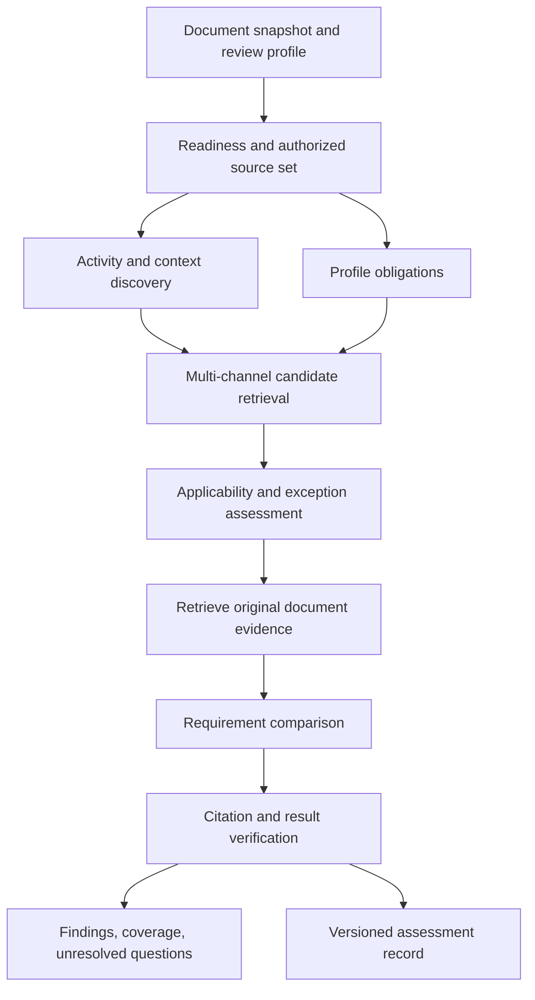

# Compliance reviewer — research, current implementation, and proposed design

**Date:** 2026-11-11 (America/Chicago) \
**Status:** Research and design proposal; the proposed reviewer is not implemented. Formerly filed as `devdocs/202611/2026111103-devdoc-compliance-reviewer-research.md`. \
**Scope:** Reviewing a document against applicable laws, regulations, standards, contracts, and organizational policies, including obligations the document never names. \
**First iteration:** Ground sources are limited to the existing knowledge base, which is mostly Chinese standards, searched through the hybrid search engine. Other source types come in later iterations (decided 2026-11-11). \
**Code roots:** `ChenWeb/server/api/doc-reviews`, `ChenWeb/server/api/doc-processing`, `ChenWeb/server/api/searchengine`, `ChenWeb/server/api/kbsearch`.

## 1. Summary

A useful compliance reviewer must discover which rules might govern the activities described in a document, establish which rules actually apply, and compare their requirements with evidence in that document. Finding similar sentences is only one part of that work. A design sentence such as “Log user activities in a database table” can raise questions about auditability, personal information, access, retention, and deletion without naming a law or standard.

The recommendation is a shared, evidence-grounded assessment engine, initially exposed as one new optional **Compliance Review** aspect. It should search in both directions: from described activities to potentially applicable requirements, and from a selected set of applicable requirements back into the document. The second direction catches omissions that sentence-by-sentence review cannot find.

Every assessment should distinguish applicability, document evidence, and execution completeness. “No contradiction found,” “requirement not documented,” “applicability unknown,” and “search failed” are different outcomes. The engine should report scoped document assessments, with source versions and evidence, rather than declare that an organization or deployed system is compliant.

The first iteration grounds every source-side conclusion in one place: the existing knowledge base, which is mostly Chinese standards, searched through the server’s hybrid search engine (`searchengine`). Laws, regulations, company policies, contracts, and externally acquired sources come in later iterations. §5.1 sets out what that decision changes: binding force is read from a standard’s type and its adoption, modal wording separates requirements from recommendations, editions are selected by identity and date, and the logging example remains an illustration rather than the first profile.

The inspection also found two defects in the existing reviewers that make their results misleading today and do not depend on the new engine (§2.2): a failed model call becomes an empty, successful result, and the reference documents a user selects never reach the reviewers. Delivery phase 0 (§12) fixes them first.

This document records a source-code inspection and primary-source research. Existing behavior is described in §2; everything from §5 onward is proposed unless explicitly identified as an existing integration. Nothing was deployed for this research; §13 lists what it did not check.

### 1.1 Decisions needed before delivery phase 1

The design deliberately leaves these choices to the profile owner. Work on a profile cannot start until they are made.

| Decision | Why it blocks | Current position |
|---|---|---|
| Source scope | Applicability, retrieval, and gold labels all depend on it | **Decided 2026-11-11:** the existing knowledge base, which is mostly Chinese standards, searched through the hybrid search engine; other source types in later iterations (§5.1) |
| Subject of the first profile | A profile can only be checked against standards the knowledge base holds | Open. Pick a subject the production knowledge base covers densely, ideally a chain of a product or enterprise standard, the mandatory standard it must meet, and related industry or group standards (§5.1) |
| Organization role and products or services in scope | Decides which standards govern, for example a manufacturer versus a service provider | Not supplied; must come from the owner |
| Adopted recommended standards | Recommended, group, and enterprise standards bind only through adoption; the reviewed document’s normative references supply part of this | Not supplied; company policies are deferred to a later iteration |
| Profile owner | Approved obligations need an accountable reviewer | Not decided |
| Annotation budget | Sets the size of the gold set, and therefore which release gates in §11.3 can be measured | Not estimated |

The first piece of work is an inventory of the production knowledge base, which is cheap. Count standards by type (mandatory, recommended, group, enterprise, local, industry), subject, and edition. Count how many are search-ready, with indexed provisions and original chunks, and how many have extracted references. Almost every production record carries a document number (over 99%), so the count can be made from identifiers. This research looked only at a development database, which is not representative of production. §7 explains why source coverage limits everything downstream.

### 1.2 Terms used in this document

| Term | Meaning here |
|---|---|
| Aspect | One checkbox in the document-review UI; each aspect runs one reviewer |
| Capsule | The doc-processor orientation file, `KnowledgeStore/Capsules/coding-capsules/doc-processor/+CAPSULE.md` |
| Chunk, page block | The units reviewers send to the model: chunks come from the chunking processor; page blocks are fixed-size groups of lines |
| P5 | The internal group name of the legal, regulatory, internal-policy, and standards reviewers |
| Doc-processor Phase B, Phase C | Pipeline stages, not delivery phases: Phase B runs extraction processors concurrently; Phase C (post-process) indexes their output |
| Lexical search, BM25 | Keyword search; BM25 is the ranking formula it uses |
| Semantic search, cosine | Search by embedding similarity; cosine is the similarity score |
| Recall@K | The share of relevant items that appear in the top K results |
| Mandatory, recommended standard | Chinese standard types: a mandatory standard (such as `GB`) must be implemented; a recommended one (such as `GB/T`) binds only when adopted |
| Normative references | The list of documents a standard declares indispensable for applying it (规范性引用文件) |
| Obligation | One assessable requirement taken from a governing source |
| Profile | An approved, versioned set of obligations for one jurisdiction, organization role, and document type |
| Evidence boundary | The documents a review may look in: the reviewed document alone, or it plus named supporting documents |
| ePHI | Electronic protected health information under the US HIPAA rules |
| OSCAL | NIST's machine-readable format for security assessment records |

## 2. What exists today

### 2.1 What was inspected

The starting point was the [doc-processor capsule](../../../Capsules/coding-capsules/doc-processor/+CAPSULE.md), followed by actual Go implementations, prompts, reviewer configuration, module records, and related devdocs. It describes the working-tree snapshot on the date above, including unrelated uncommitted changes in the local repositories.

Important source locations, relative to the workspace root:

| Source | What it establishes |
|---|---|
| `ChenWeb/server/api/doc-reviews/aspects.go` | Existing aspect names, labels, groups, and tool-use flags |
| `ChenWeb/server/api/doc-reviews/review-document.go` | Reviewer runtime resolution and dispatch |
| `ChenWeb/server/api/doc-reviews/review-legal-compliance.go` | Legal reviewer’s chunk implementation, fallback page-block entry point, tool loop, and errors |
| `ChenWeb/server/api/doc-reviews/review_cache_scheduler.go` | Effective configured chunk versus document dispatch |
| `ChenWeb/server/api/doc-reviews/review-regulatory-compliance.go` | Corresponding regulatory reviewer |
| `ChenWeb/server/api/doc-reviews/review-internal-policy.go` | Internal policy reviewer |
| `ChenWeb/server/api/doc-reviews/review-standards-compliance.go` | Existing standards compliance aspect, additional to the four highlighted in the request |
| `ChenWeb/server/api/doc-reviews/review-provisions.go` | Cross-document provision matching and comparison |
| `ChenWeb/server/api/doc-reviews/review-tools.go` | Record-scoped tools and explicitly selected cross-record context tools |
| `ChenWeb/server/api/doc-reviews/review-artifact-window.go` | Context assembly, scheduling, and heuristic authority classification |
| `ChenWeb/server/api/doc-reviews/review-p5_test.go` | Mock-based normalization/default tests for the compliance reviewers |
| `ChenWeb/doc-review.local.toml` | Local reviewer configuration; settings are not evidence of deployment |
| `ChenWeb/prompts/prompt-review-{legal-compliance,regulatory-compliance,internal-policy,standards-compliance}.md` | The existing review rubrics |
| `ChenWeb/server/api/searchengine/{types,engine,filters}.go` | Server-side hybrid retrieval interface and filters |

### 2.2 Existing reviewers and their limits

| Reviewer | Existing mechanism | Consequence for the proposed work |
|---|---|---|
| `legal_compliance` | Locally configured `per-chunk`; the normal scheduler calls `processChunk` directly. Its `StrategyDocument`/`ReviewDocument` fallback builds page blocks. Optional tool loop or one JSON extraction per unit. | Neither independent chunks nor fallback blocks establish complete-document legal assessment. Missing context outside a unit remains a problem. |
| `regulatory_compliance` | Similar prompt-driven checking, normally per chunk under local configuration, with optional tools. | Needs a verified source corpus and explicit applicability decisions, not only a more detailed rubric. |
| `internal_policy` | Prompt asks for deviations from explicitly stated or referenced policies and tells the model not to invent policies. | This restraint is useful, but unreferenced company policies will not reliably be discovered. |
| `standards_compliance` | Separate existing aspect for standards. | Include standards as a source category in the common engine; avoid creating a competing retrieval stack. |
| `provisions` / Provision Consistency | Loads extracted `kb.provisions`, retrieves peers from other documents, adds original context, and asks the model to compare. | Useful comparison infrastructure, but its starting population is extracted provisions, not all activities or all applicable obligations. |

The local TOML selects `per-chunk` for legal/regulatory/standards and `per-block` for internal policy. `PostProcessIndex` uses `runReviewersPromptCacheOptimized`; `buildPromptCacheReviewTasks` directly schedules `processChunk` for configured chunk reviewers. The legal reviewer implements that interface, so its page-block `ReviewDocument` is the fallback entry point rather than the normal configured path. Preserve both paths in dispatch tests when introducing the new strategy.

The legal rubric asks the model to infer legal context and covers potentially missing disclosures, privacy requirements, and contractual terms. It also mixes legally required terms with customary terms. This can produce useful concerns, but custom and legal obligation must become different categories in a rigorous assessment. A missing copyright notice or disclaimer is not automatically a legal violation merely because it is commonly seen.

**Defect: failed model calls disappear on both paths.** On the normal configured path, the chunk reviewer interface in `review-document.go` is `processChunk(ctx, recordID, index, cfg, input) []ReviewFinding`. It has no error return, so no chunk reviewer can report a failure. The legal reviewer’s `processChunk` logs a failed JSON extraction and returns no findings; a failed tool loop is logged and whatever partial findings it produced are returned as if complete. The page-block fallback behaves the same way: `processBlock` returns no findings on failure, and the concurrent callback in `ReviewDocument` wraps that result with a nil error. An empty or short finding list therefore cannot establish that all units were reviewed. Twenty reviewers implement `processChunk`, so the fix is an interface change across all of them, not a patch to one reviewer. The artifact reviewers, including Provision Consistency, follow the same pattern: `runArtifactUnitsChunkGrouped` in `review-artifact-window.go` documents that each unit handles its own model errors by returning no findings. It is independent of the model’s reasoning accuracy.

**Defect: selected reference documents are dropped.** The request’s selected `reference_docs` are accepted, stored, and printed in reports, but `controller.go::RunReview` does not pass that selection into `ReviewProcessor`. It sets run IDs, depth, requested aspects, and stores before calling `PostProcessIndex`. A user who selects reference documents today gets a report that lists them, although no reviewer received them. The future reviewer also needs explicit, tested propagation of the selected authority/evidence set.

Both defects affect the current reviewers now. Delivery phase 0 (§12) fixes them before any new engine work.

### 2.3 What Provision Consistency already does well

The [provisions reviewer devdoc](../../devdocs/202611/2026111002-devdoc-provisions-reviewer.md) describes the current implementation in detail. The inspected code confirms these useful seams:

* Similarity search calls `searchengine.Search` using an indexed provision reference, excludes the document under review, and combines lexical and vector results. Object-anchor peers provide another candidate route.
* Matches carry source documents, original line context, and identifiers. The reviewed provision is shown with its extraction chunk.
* A provision with no matches finishes without a model call. That means “no comparison candidates,” not “compliant.”
* `ARTIFACT_CONNECT_MIN_COSINE` defaults to 0.75 for this path. Its minimum-cosine condition can remove lexical matches. Copying that condition into authority discovery would risk losing exact clause identifiers or semantically distant obligations. The value is also out of date: the code comment in `searchengine/similar.go` says 0.75 was tuned for text-embedding-3-small and needs recalibrating for bge-m3, the embedding model the workspace now uses.
* `docAuthorityClass` uses document numbers, titles, and filenames to classify standards, regulations, and peers. It is explicitly heuristic. It does not establish legal force, authentic publication, jurisdiction, effective edition, or applicability.
* The similarity lookup supplies exclusion/type filters but no knowledge-store or document-group boundary in that call. The new assessment engine must provide explicit authorization filtering; retrieval capability alone is not an access policy.

Keep this reviewer for cross-document consistency. A peer document may supply useful comparison evidence without being a governing authority. Its agreement with the reviewed document does not prove compliance.

### 2.4 Available document processors

The capsule lists enough existing building blocks to avoid starting a second parsing pipeline:

| Existing processor or artifact | Proposed use | Limitation |
|---|---|---|
| Blocking, structure analysis, chunking, canonical line file | Stable passages, headings, tables, source positions | A chunk boundary is not a legal scope boundary; include parent definitions and exceptions. |
| `extract_metadata`, document facets, `classify_document` | Seed issuer, domain, document type, jurisdiction hypotheses | Document jurisdiction is not necessarily the operating organization’s jurisdiction; inferred facts need provenance. |
| `extract_provisions` | Seed explicit obligations and prohibitions | Does not replace discovery of activities, declarative claims, or omitted obligations. |
| `extract_references` | Resolve explicit citations and identify held source editions | Citation resolution is not legal applicability; provision-family artifact resolution is not implemented in this layer. |
| `extract_metrics`, test methods | Numeric thresholds, periods, measurement and verification details | Units, triggers, exceptions, and whether a requirement is binding still need assessment. |
| Entities, relations, inventory items, products | Identify actors, processes, systems, materials, and regulated objects | Mentioning a regulated object does not establish the organization’s regulated role. |
| Semantic projections, topics, scene blocks, summaries | Candidate discovery, query expansion, navigation | Derived text is a retrieval aid; findings cite original source passages. |
| Ontology normalization/association/projection | Optional concept alignment and relationships | Feature-gated; do not make it a prerequisite for the first useful reviewer. |
| `review_document` | Existing on-demand review controller and reporting path | New dependencies, result states, and evidence storage still need explicit implementation. |

The [reference processor orientation](../../../Capsules/coding-capsules/doc-processor/extract-references-spec.md) documents access-aware holding resolution and its current metric resolver. Reuse the resource/version model; do not assume it already resolves governing provisions.

`ApplicabilityResolver.ResolveReviewFacts`, `semrules.FactSet`, and the adapter in `ChenWeb/server/api/kbhandler/ontology_review_document_facts.go` already support provenance-bearing facts and conditional ontology review scopes. They are not currently connected to the document-review pipeline and do not establish legal applicability. Reuse that fact machinery where suitable, extending its vocabulary and context rather than writing another generic fact evaluator.

### 2.5 What the existing tests establish

`TestStandardsComplianceReviewerProcessBlockDefaults`, `TestLegalComplianceReviewerProcessBlockDefaults`, `TestRegulatoryComplianceReviewerProcessBlockDefaults`, and `TestInternalPolicyReviewerProcessBlockDefaults` (all in `review-p5_test.go`) use fake model outputs and check fields such as aspect, severity, and finding type. They establish output plumbing, not correct law discovery or legal reasoning. Other review tests exercise tools and scheduling. No representative, expert-adjudicated end-to-end compliance benchmark exists, so no accuracy figure can be justified from these tests.

## 3. Why the problem is larger than provision matching

### 3.1 Five separate questions

1. **What activity does the document describe?** Identify actions, actors, data, affected people, products, location, timing, and conditions—even without “shall” or “must.”
2. **Which authorities could govern it?** Discover candidate sources, including unmentioned requirements and company rules.
3. **Which candidate obligations actually apply?** Resolve territory, regulated role, effective date, scope, thresholds, adoption, exceptions, and unknown facts.
4. **What does the document establish?** Compare statements and referenced evidence with each applicable obligation; check the whole declared review boundary before asserting an omission.
5. **What was successfully assessed?** Report source coverage, incomplete searches, missing inputs, processing failures, and unresolved questions.

A relevant rule can be inapplicable. An applicable rule can be unmentioned. A requirement can be documented without being implemented. The result model must preserve those distinctions.

### 3.2 Document compliance and implementation compliance

A product specification can promise access controls without proving those controls exist. A procedure may reference an approved retention schedule instead of restating it. A law may require an organization to maintain records without requiring every architecture note to discuss those records.

The initial product should assess **documented alignment within a stated evidence boundary**. Each review records its document role: for example, detailed security design, employee procedure, public privacy notice, contract, or informal proposal. Whether a missing topic is a documentation gap depends on that role and on the governing document requirements.

Implementation evidence—configuration, source code, audit events, test reports, interviews—can be a later evidence class. A document-only assessment must leave implementation unverified.

### 3.3 Two directions of assessment

The activity-led direction finds “logging” and asks which obligations could matter. The obligation-led direction starts from a curated, applicable control profile and asks where the document addresses each requirement. Without the second direction, a document that never mentions deletion might never be checked for a required deletion policy.

Both directions feed one assessment graph. Deduplicate at obligation and evidence scope, not by similar finding titles.

## 4. Research findings and technology choices

### 4.1 How the field’s building blocks developed

Structured legal document identifiers address the identity problem: a law, a language/version expression, and a particular file are different things. [Akoma Ntoso’s naming convention](https://docs.oasis-open.org/legaldocml/akn-nc/v1.0/akn-nc-v1.0.html) provides a useful model for retaining those differences. Adopt the distinction in the resource model without requiring an XML conversion project.

[LegalRuleML 1.0](https://docs.oasis-open.org/legalruleml/legalruleml-core-spec/v1.0/os/legalruleml-core-spec-v1.0-os.html), standardized in 2021, provides vocabulary for normative rules, including conditions, temporal information, jurisdiction, exceptions, provenance, and competing interpretations. Its practical lesson here is that a rule needs more structure than a sentence and an embedding. It is a representation standard, not an automatic source of correct legal judgments.

Also in 2021, [ContractNLI](https://aclanthology.org/2021.findings-emnlp.164/) framed document inference as entailment, contradiction, or not mentioned, with supporting evidence spans. Its contract setting is narrower than this product, but the separation is useful: failure to find support is not proof of contradiction. Its discussion of long context and exceptions also supports retrieving surrounding definitions and qualifying clauses.

[LegalBench](https://arxiv.org/abs/2308.11462) expanded evaluation across legal reasoning tasks in 2023. [LegalBench-RAG](https://arxiv.org/html/2408.10343v1) subsequently focused on retrieval of precise supporting passages. Neither provides a ready-made gold set for this workspace’s company policies, Chinese standards, or selected jurisdictions. Their value is methodological: assess retrieval and reasoning separately and score actual evidence, not only whether the right document appeared somewhere in the results.

[A Reasoning-Focused Legal Retrieval Benchmark](https://arxiv.org/html/2505.03970v1), published in 2025, directly studies fact-pattern-to-rule retrieval when the wording overlaps poorly. It evaluates structured legal query expansion. This supports testing an intermediate issue-discovery step for ordinary activity sentences. Generated issues remain search hypotheses, and results from that benchmark do not predict this reviewer’s accuracy.

This progression suggests a design combining stable source identity, explicit applicability, broad retrieval, and constrained evidence assessment. It does not justify delegating the whole process to a single prompt.

### 4.2 Compare the practical approaches

| Approach | Strength | Main failure | Decision |
|---|---|---|---|
| Larger one-shot compliance prompt | Small implementation change; broad initial issue suggestions | Model memory substitutes for authority; unclear scope, versions, and coverage | Retain as a baseline and optional discovery assistant. |
| Existing provision similarity | Already integrated; source-grounded peer comparison | Misses unextracted activities and unmentioned obligations; similar peers may not bind | Reuse context and comparison infrastructure, retain its separate purpose. |
| Explicit citations only | Precise when document names an accessible source | Misses implicit obligations and undeclared frameworks | Make it one high-priority retrieval channel. |
| Curated checklist/profile | Predictable source boundary and omission coverage | Maintenance cost; incomplete profiles can hide unknown rules | Foundation for the first release. |
| Unrestricted web-search agent | Broad discovery and potentially current sources | Unstable evidence, wrong editions, confidentiality and authorization problems | Separate source-acquisition workflow; not the default assessment runtime. |
| Hybrid retrieval plus applicability and evidence assessment | Combines existing search with explicit decision stages | Needs source governance, annotations, and stage-level diagnostics | Recommended architecture. |
| Fully formal legal rule engine | Reproducible reasoning for curated conditions and priorities | Expensive encoding; broad interpretation still requires judgment | Use deterministic rules for selected predicates and thresholds, expand only where justified. |

“Graph retrieval” is an optional enhancement, not the core requirement. A small approved graph of control-to-activity relationships can help discovery. A large automatically extracted graph can also spread an incorrect source interpretation. Start with relational records and explicit edges; measure recall before adding graph infrastructure.

### 4.3 Useful assessment representation

[NIST OSCAL Assessment Results](https://pages.nist.gov/OSCAL/learn/concepts/layer/assessment/assessment-results/) separates assessment scope, reviewed controls, observations, evidence, risks, and findings. Borrow that separation rather than storing only prose findings. An OSCAL-compatible export can be considered later; adopting its entire schema is not a prerequisite.

The local engine should retain its native IDs and records. If an export format needs UUIDs, treat them as external identifiers mapped to local IDs, not as a reason to bypass workspace ID allocation rules.

## 5. Proposed scope and product behavior

### 5.1 Initial scope and ground sources

**Decision (2026-11-11).** The first iteration grounds every source-side conclusion in the existing knowledge base, which is mostly Chinese standards, and retrieves those sources only through the hybrid search engine (`ChenWeb/server/api/searchengine`). Laws, regulations, company policies, contracts, and externally acquired sources are added in later iterations. Until then, a requirement that would need one of them becomes an unresolved question naming the missing source, never a finding.

That decision changes the design in seven ways.

1. **The first profile comes from what the knowledge base covers.** The logging sentence remains this document’s running example because it exercises discovery, applicability, numeric retention, and conflicting purposes. Its governing sources (§8.3) are laws and foreign standards, outside the first iteration. Pick the first profile from a subject the production inventory (§1.1) shows is densely covered. A good shape is a chain the knowledge base already holds: a product or enterprise standard, the mandatory standard it must meet, and related industry or group standards. The development data, for example, contains an enterprise standard for automatic blood-pressure monitors alongside the medical electrical equipment standard for automatic non-invasive sphygmomanometers (YY 9706.230—2023). The profile must name its subject, organization role, document types, approved source standards, and effective editions.

2. **Binding force comes from the standard’s type, then from adoption.** Article 2 of the Standardization Law (2017 revision) divides national standards into mandatory and recommended ones, makes industry and local standards recommended, requires mandatory standards to be implemented, and encourages adoption of recommended ones. Group and enterprise standards bind only through adoption, such as a contract or a product’s declared standard. The document number gives a first signal: `GB` (mandatory national), `GB/T` (recommended national), `GB/Z` (guidance), `T/` (group), `Q/` (enterprise), `DB` (local), and industry codes with or without `/T`. That signal proposes binding force; it does not decide it. Sector rules can override the default: published medical-device standard lists from the National Medical Products Administration mark many unsuffixed `YY` standards as mandatory, a legal basis this research did not verify. Record binding force per source together with its basis. Do not reuse `docAuthorityClass` for this decision: its pattern `GB/?T?` puts `GB` and `GB/T` in one class and does not recognise `GB/Z`, group, enterprise, or most industry prefixes.

3. **Normative references are the main adoption signal.** A recommended standard that the reviewed document lists under normative references (规范性引用文件) is adopted by that document for the clauses that cite it. `extract_references` already produces these lists and resolves them to held editions where it can. Its coverage of the production knowledge base belongs in the inventory.

4. **Modal wording separates requirements from advice.** Chinese standards distinguish requirements (应, 不应: shall, shall not), recommendations (宜, 不宜), permissions (可, 不必), and capability or possibility (能, 可能). Only a requirement can ground an adverse finding; a 宜 clause produces advice. This follows the national drafting rules, GB/T 1.1-2020, whose exact clause was not consulted in this research; pin the mapping against an authorized copy before encoding it.

5. **Editions are selected by identity and date.** Almost every production record carries a document number (over 99%), and the number includes the edition year, so retrieval results can be grouped by standard identity. When several editions are held, select the one in force on the assessment date, using the replacement statement (代替) in the foreword and the publication and implementation dates (发布, 实施). A superseded edition that ranks above the current one stays a candidate, never the governing text.

6. **The reviewed document is often a standard too.** In a standards knowledge base, other standards are both peers and candidate authorities. Exclude the reviewed record from source results, and treat another standard as governing only when its binding force or adoption is established; otherwise it remains comparison material for Provision Consistency.

7. **All source retrieval goes through `searchengine.Search`.**
   * Bound the source set with `Filters.KnowledgeStoreID` and `Filters.DocumentGroup`, which apply before ranking, and exclude the reviewed record with `Filters.ExcludeRecordIDs`.
   * Request both `provision` and `chunk` artifacts, so a rule that provision extraction missed can still be found in the original text.
   * Leave `Criteria.MinCosine` unset for authority discovery (§2.3); use the per-list ranks the response reports instead.
   * Record the engine’s limits in the retrieval trace: the fused score is not comparable between queries, `total` counts keyword matches only, and each list returns at most 200 candidates. Treat that cap as truncation in coverage reports.
   * Readiness requires the source set to be indexed: chunk search rows exist only after the [chunk backfill](../../devdocs/202611/2026111102-devdoc-chunk-hybrid-search.md) has run for those records, and provision rows only after `extract_provisions` and indexing. The inventory counts both.

Most first-iteration sources are Chinese. Support English and Chinese source text and findings from the outset. Keep original quotes unchanged; translated queries and explanations are derived artifacts. An English benchmark does not establish Chinese-language performance.

The first release should support curated sources from the knowledge base, activity extraction from all source passages, profile-led omission checks, deterministic citation validation, and explicit uncertainty. Defer autonomous legal corpus crawling, broad case-law analysis, company-wide implementation certification, and automatic document corrections.

### 5.2 User workflow

1. Select a document and **Compliance Review**.
2. Select an approved profile and an assessment date. Confirm organization facts already known to the system; leave unavailable facts explicitly unknown.
3. Select the evidence boundary: the document alone, or the document plus named accessible supporting documents.
4. Run the assessment. Show progress by discovery, applicability, retrieval, evidence assessment, and verification.
5. Read findings alongside coverage and unresolved questions. Open both the reviewed passage and governing passage.
6. Accept, reject, or escalate a finding with a reason. Human disposition is versioned separately from the machine result.

The summary should say, for example, “12 obligations assessed against profile X, version Y; 3 documented gaps; 2 applicability questions; 1 source unavailable.” It should not offer a green “compliant” badge merely because no findings were emitted.

### 5.3 Relationship to existing checkboxes

Initially run the new aspect alongside existing reviewers for comparison. Tag sources as law, regulation, standard, contract, company policy, guidance, or peer material. Existing legal/regulatory/policy/standards views can eventually become filters over a common assessment, avoiding repeated discovery and inconsistent answers. Provision Consistency stays a comparison view with different semantics.

Do not remove existing options until benchmark evidence and compatibility decisions support migration. Deduplicate shared findings by obligation version and assessment subject while retaining all contributing authorities. If two sources genuinely impose distinct requirements, preserve both.

## 6. Proposed architecture



### 6.1 Freeze the review context

Create an immutable run manifest: reviewed input ID, canonical file hash and generation, supporting-document versions, actor and authorized source scope, profile version, assessment date, model/prompt/parser versions, budgets, and available processors. Record both the legal effective date being assessed and the time the source was acquired; these answer different questions. Readiness also records image-only pages, OCR uncertainty, unparsed diagrams/tables, and broken references. The compact renderer omits image-path lines; their absence from a model payload is not evidence that those regions contain no relevant requirements.

Use organization facts with provenance: operating territories, legal entities, regulated role, sectors, data categories, affected individuals, deployment region, contracts, and adopted standards. Each fact is asserted, inferred, disputed, or unknown. A document’s publication country is not an adequate substitute for these facts.

An unknown can trigger candidate discovery without triggering a definitive compliance finding. For example, possible health data can produce a question about regulated-entity status rather than an assertion that HIPAA governs the system.

### 6.2 Discover activities without a modal-word gate

Process every substantive passage, including tables and declarative statements. Use lightweight lexical/concept triggers to prioritize work, then a constrained model extraction for activity candidates. Explicit provisions are additional seeds, not a prerequisite.

An activity record should contain source spans, actor, action, object, purpose, data categories, affected people, destination, geography, duration, conditions, and uncertainty. All inferred fields identify their basis. The logging example yields a logging activity and database destination; identity fields, retention, geography, and sensitive data remain unknown unless surrounding text establishes them.

Normalize synonyms such as “activity history,” “audit trail,” “access record,” “操作日志,” and “审计记录,” while preserving the original phrase. Add neighboring concerns—record integrity, record access, minimization, retention—as candidate issues, not as statements that a particular statute applies.

Do not silently drop low-scoring passages. Record which were screened out and sample them during evaluation. Otherwise the system can look precise simply because it never considered difficult sentences.

### 6.3 Discover candidate authorities through multiple channels

In the first iteration every channel below runs through the hybrid search engine over the knowledge base (§5.1). Use a bounded union of:

* Exact citations, document numbers, clause identifiers, and explicit policy references.
* BM25/lexical queries over original chunks and extracted provisions.
* Semantic queries based on the source passage and separate activity/issue expansions.
* Approved activity-to-control mappings and selected profile obligations.
* Governed entity/object links and access-aware reference holdings.

Keep lexical and semantic candidates independently eligible. An exact clause identifier should survive a low cosine score. Preserve retrieval channel, query, rank, and exclusion reason. Fused rank is a ranking signal, not a probability of relevance or legal applicability.

Retrieve both provisions and original chunks. A failed provision extraction must not erase a governing rule that is present in the corpus. Summaries and semantic projections can suggest locations; the final evidence comes from source text.

Apply access and permitted-source filters before candidate ranking. When the source set is large, enforce authorization inside retrieval rather than retrieving globally and discarding inaccessible results afterward. Recheck access during context loading and report generation.

### 6.4 Decide applicability before alleging a violation

For each candidate obligation, resolve:

| Dimension | Required decision |
|---|---|
| Source authority | Authentic authority, internal owner, adopted standard, contract, guidance, or peer |
| Legal force | Why it binds this subject: law, regulation, incorporation, contract, internal adoption, or none established |
| Territory and role | Which entities, operations, people, places, and regulated roles are in scope |
| Time | Effective edition, transitional period, triggering event, repeal/amendment, and assessment date |
| Conditions | Thresholds, purposes, exceptions, exemptions, definitions, and dependencies |
| Document responsibility | Whether this document must state the requirement or may reference another controlled artifact |
| Unknowns | Which missing facts prevent a decision and who can supply them |

Use deterministic predicates for facts that have clear representations, such as effective intervals, approved profile membership, and numeric thresholds. Use models to propose interpretations of text, with evidence. Rules that need expert judgment remain unresolved or require human confirmation.

Do not hard-code a universal “law > regulation > standard > policy” conflict resolver. Instrument relationships depend on jurisdiction, incorporation, scope, and legal interpretation. An internal policy cannot simply authorize disregarding a legal duty, but the engine still needs a verified relationship before automatically resolving the concrete case.

Applicability is three-valued: `applicable`, `not_applicable`, or `unknown`. Every decision stores its rationale and evidence; unknown is an actionable state rather than a low numeric confidence disguised as a decision.

### 6.5 Retrieve complete evidence and assess each requirement

Decompose a governing clause into independently assessable requirements when it combines different duties. Retain the link to the original clause. Conversely, allow one obligation to require several passages: definitions, general rule, exception, annex, and referenced schedule.

For each applicable obligation, search the entire declared evidence boundary for supporting, contradictory, or qualifying material. Retrieve definitions and parent sections. Resolve references such as “according to the retention policy” before reporting omission; inaccessible or ambiguous references remain evidence gaps.

A successful top-K search with no support cannot establish absence. Before emitting `not_documented`, require a logged whole-boundary screening pass for that obligation or a justified requirement family, covering all relevant readable sections and referenced evidence. Record examined and unexamined passages, unreadable regions, query/candidate truncation, and budget exhaustion. If a complete screening pass is unaffordable or source readiness is inadequate, return `insufficient_evidence`. Screening is still fallible semantic work; evaluate omission recall against the gold set rather than equating traversal with guaranteed understanding.

Compare concrete dimensions: required actor/action/object, conditions, timing, numeric values and units, record contents, approvals, prohibitions, and evidence required. Numeric comparison must retain calendar versus elapsed duration, minimum versus maximum, triggering event, rounding, and exceptions. “Six months” is not automatically interchangeable with a fixed number of days.

Evaluate the document’s statements, not facts invented to complete the design. A database table could support a secure audit mechanism, but its existence does not establish restricted modification, event coverage, review, or retention. Equally, the mere choice of a table is not evidence of a violation.

### 6.6 Verify before publication

Perform mechanical validation after model reasoning:

* Source and target quotes exactly match the pinned original versions; line, page, and table-row anchors exist.
* The cited source is accessible and approved for this assessment, with a valid edition and obligation ID.
* A conclusive adverse result structurally links an applicability decision and evidence; a similarity score alone is insufficient.
* Claims of omission include the screening ledger, searched document boundary, references checked, and completeness status.
* Numeric deadlines, authorities, and exceptions link to supporting evidence records.
* Duplicate comparison keys merge without erasing distinct obligation identities.

Then perform substantive verification: does the cited text actually support the claimed duty, does an exception alter applicability, does evidence establish the alleged conflict, and is the numeric interpretation justified? These are semantic questions, not guaranteed deterministic checks. A validated citation can still support an incorrect legal interpretation.

A second model or adversarial pass may inspect high-risk conclusions, but model agreement is not independent legal validation. Unsupported conclusions become questions or rejected draft findings. Keep a concise decision rationale and evidence trace; do not depend on storing private model reasoning.

## 7. Authority corpus and version governance

Source quality is a product capability. A better reasoner cannot retrieve a rule that is missing from the accessible corpus.

Maintain approved source sets with an owner, jurisdiction/domain, coverage statement, acquisition method, update schedule, licensing, and effective editions. Official publications establish source authenticity; company policy owners establish internal approval and applicable organization scope. A source’s title or domain name alone is insufficient.

In the first iteration the approved source set is a declared subset of the existing knowledge base, bounded by knowledge store and document group (§5.1). External acquisition waits for a later iteration.

Reuse `kb.ref_resources` and `kb.ref_resource_versions` for identity where their actual interfaces fit. Add assessment-specific metadata or links rather than create a competing resource catalog. Distinguish publish date, effective date, applicability interval, retrieval time, language, translation status, and superseded edition. Preserve immutable source content or hashes plus retrievable snapshots.

Normalized obligations need actor, modality, action, object, conditions, exceptions, parameters, temporal rules, source fragments, and approval state. Machine-extracted obligations begin as candidates. Approved profiles use reviewed obligations. A profile can intentionally include guidance, but labels it as advisory and prevents advice from becoming a statutory violation.

Crosswalks between standards are candidate links, not equivalence proofs. NIST’s [SP 800-53 publication page](https://csrc.nist.gov/pubs/sp/800/53/r5/upd1/final) explicitly cautions about treating mapped controls as equivalent. Retain the particular source requirement even when a shared control concept groups it with others.

On a source update, calculate affected obligation/profile versions and mark dependent assessments as needing reassessment. Keep historical results reproducible under their original manifest. Do not silently replace an old citation with the latest source text.

External acquisition should be a separate, logged workflow that approves and versions sources before assessment use. Send public search queries containing generalized issues, never private document passages by default. Licensed standards require authorized holdings; a public abstract is insufficient for clause-level conclusions.

## 8. Worked example: “Log user activities in a database table”

This example illustrates the general method. Its governing sources in §8.3 are laws and foreign standards, which are outside the first iteration’s ground sources (§5.1). In the first iteration they would appear as unresolved questions naming the missing source, not as findings.

### 8.1 What can be concluded immediately

The statement describes recording activity and a storage choice. It does not identify event types, actors, identities, fields, purpose, legal entity, operating territory, retention, access rules, or controls against modification. Some facts may exist elsewhere in the document or in a referenced policy.

The immediate output is an activity candidate and context questions, not a legal violation. Whether more detail is required also depends on whether this is a detailed security design or a brief high-level proposal.

### 8.2 Candidate concerns and their evidence requirements

| Concern | Discovery route | Facts and evidence needed before a conclusion |
|---|---|---|
| Audit-event coverage and record contents | “log user activities” → audit logging, event records, actor/action/time/outcome | Adopted logging requirements; actual event list and documented fields |
| Integrity and access restrictions | Database storage → modification, deletion, unauthorized reading | Applicable control text; roles, write paths, administration, and protection design |
| Personal-information processing | User-linked records → identification, purposes, minimization | Whether data identifies people; applicable territory/role; fields and purposes |
| Retention and deletion | Persistent records → retention schedule and disposal | Applicable source, category of record, duration trigger, minimum/maximum, holds, exceptions |
| Health-sector audit controls | Access activity → possible ePHI access auditing | Regulated-entity role and whether the system contains or uses ePHI |
| Company policy | Activity → approved security/retention policies | Policy owner, organization scope, approved edition, actual requirements and exceptions |

### 8.3 Conditional authority examples

For EU personal-data processing, [GDPR](https://eur-lex.europa.eu/eli/reg/2016/679/oj/eng) Articles 2–3 establish scope; Articles 5–6 concern processing principles and lawfulness; Article 32 concerns security. These are candidate requirements only after the activity and organization facts establish applicability. The sentence does not establish a GDPR breach or a universal logging-retention period.

For an adopted security-control profile, the [NIST SP 800-53 Rev. 5 control catalog](https://nvlpubs.nist.gov/nistpubs/SpecialPublications/NIST.SP.800-53r5.pdf) supplies separate candidate controls: AU-2 event logging, AU-3 record content, AU-9 protection, AU-11 retention, and AU-12 generation. AU-11 uses an organization-defined retention period. The applicable profile and assigned parameters must be known before the reviewer can assess a specific period.

For a qualifying network operator and relevant network logs, China’s amended [Cybersecurity Law](https://www.cac.gov.cn/2025-12/29/c_1768735112911946.htm) Article **23(3)** supplies a minimum six-month retention requirement. The [2025 amendment](https://www.cac.gov.cn/2025-10/29/c_1763461514768457.htm) took effect on 2026-01-01; older editions place this provision in Article 21(3). Do not apply this duration to every user-activity row merely because it is called a log. This is also a concrete regression case: source identity must survive renumbering while citations remain correct for the assessment date. A second trap sits in the same source: the official amended text still ends with the original clause “本法自2017年6月1日起施行” (in force from 2017-06-01), while the amending decision takes effect on 2026-01-01. An engine that reads the effective date from the law’s own final article picks the wrong date for the amended edition.

China’s [Personal Information Protection Law](https://www.cac.gov.cn/2021-08/20/c_1631050028355286.htm) supplies another conditional branch: Articles 3–4 address scope and personal information/processing; Articles 6 and 13 address minimization and processing grounds; Article 19 addresses necessary retention with exceptions for laws and administrative regulations. A security-retention duty and a privacy constraint are not automatically inconsistent. Compare the same record category, purpose, required period, and exception before declaring a conflict.

In the US health context, [45 CFR 164.312(b)](https://www.ecfr.gov/current/title-45/subtitle-A/subchapter-C/part-164/subpart-C/section-164.312) concerns recording and examining activity in systems containing or using electronic protected health information, within the rule’s regulated scope. [164.316(b)](https://www.ecfr.gov/current/title-45/subtitle-A/subchapter-C/part-164/subpart-C/section-164.316) sets six-year retention for the documentation it defines. That is not an unconditional six-year mandate for every raw audit event. An evaluator should test this distinction explicitly.

For standards, [ISO’s explanation of their voluntary status and normative language](https://www.iso.org/foreword-supplementary-information.html) and [standards in regulation](https://www.iso.org/sites/ConsumersStandards/1_standards.html) illustrate another boundary: “shall” inside a standard does not by itself prove that this organization is legally bound. Record the incorporation, contract, certification scope, or internal adoption that makes the particular standard relevant.

The important pattern is conditional branching: “If this logging activity falls within approved profile P, assess its selected obligations; if essential facts are missing, ask for those facts.” Do not attach every logging-related law in the corpus to every use of the word “log.”

### 8.4 Example result without enough context

```json
{
  "activity": "record_user_activity",
  "applicability": "unknown",
  "evidence_status": "insufficient_evidence",
  "execution_status": "completed",
  "source_text": "Log user activities in a database table",
  "questions": [
    "Which organization and operating territories are in scope?",
    "Which events and personal information will be recorded?",
    "Which approved logging and retention policies govern this design?"
  ],
  "conclusion": "The sentence alone does not establish compliance or noncompliance."
}
```

Illustrative only, not the existing API schema; a production payload adds real source anchors and the run manifest.

### 8.5 Example after a company profile is supplied

Assume a **hypothetical** approved company policy requires actor, action, timestamp, result, restricted modification, and a defined retention schedule. If a complete detailed design contains only the example sentence, report those missing specifications as documentary gaps against that policy. If the design references a controlled logging specification that supplies them, include that evidence and avoid duplicate gaps.

Do not prescribe “append-only database table” as the sole legal solution unless the governing requirement actually mandates it. Suggest an outcome—document permitted modification paths and protection against unauthorized changes—and allow alternative implementations that satisfy the requirement.

## 9. Proposed result and storage model

### 9.1 Separate three axes

| Axis | Values | Meaning |
|---|---|---|
| Applicability | `applicable`, `not_applicable`, `unknown` | Whether this obligation governs this subject in this context |
| Document evidence | `supported`, `contradicted`, `partially_supported`, `not_documented`, `insufficient_evidence`, `not_assessed` | What the reviewed evidence establishes; `supported` remains documentary support, not implementation certification |
| Execution | `completed`, `partial`, `failed`, `stopped`, `skipped` | Whether the required assessment work ran successfully |

`not_documented` requires a completed search over the declared boundary and a reason the document should cover the requirement. Use `insufficient_evidence` when sources, references, or context are missing. Never map `not_applicable`, `unknown`, and tool failures to the same empty finding list.

Severity is a separate judgment about the consequence of a substantiated gap. Keep materiality, applicability certainty, and evidence confidence separate. Calibrate confidence on held-out annotations before using it to suppress findings; model-supplied decimals are not calibrated probabilities.

### 9.2 Records to retain

Proposed logical records, with physical names deliberately left to implementation:

| Record | Important content |
|---|---|
| Assessment run | Manifest, scope, profile version, execution state, stage counts, budgets, requester |
| Activity candidate | Original spans, normalized activity, extracted facts, uncertainty |
| Authority/obligation link | Existing resource/version IDs, source fragments, approved normalized obligation |
| Applicability decision | Subject, facts used, predicate results, exceptions, unresolved questions, disposition |
| Retrieval trace | Queries/channels, candidate IDs/ranks, filters, reasons for exclusions, truncation |
| Obligation assessment | Applicability/evidence/execution axes, evidence references, rationale, verifier results |
| Finding | User-facing concern, source and target evidence, severity, remedy, stable assessment link |
| Human disposition | Reviewer, time, accepted/rejected/escalated state, reason, source/result version |

Reuse `kb.doc_review_findings` for presentation where appropriate, but retain the full assessment and coverage records separately. JSON metadata alone is a poor long-term home for queryable source/version and obligation relationships. An informational analysis or unknown applicability must not inflate the adverse-finding count.

Use table-owned identity primary keys and `shared/go/api/idmanager` for run/correlation IDs shared across tables. Any eventual schema work uses goose and normal startup migration paths, centralized connection pools, parameterized queries, indexes on run/source/obligation versions, and explicit lifecycle/retention rules.

### 9.3 Coverage report

Track total substantive passages, screened passages, unreadable/image-only regions, activity candidates, profile obligations, retrieved candidates, applicability decisions, assessed obligations, unresolved cases, unavailable sources, truncated contexts, failed units, and skipped units. Keep denominators: “18/24 selected obligations assessed” is meaningful; “18 checks passed” can hide six missing checks. State parsing/OCR limitations in document coverage instead of counting only successfully extracted text.

Report two kinds of coverage: **declared profile coverage**, which can be counted, and **open-ended discovery coverage**, which cannot honestly be declared exhaustive. The profile itself also has a documented source and jurisdiction coverage statement.

## 10. Integration and reuse plan

### 10.1 Reusable-module search

The reusable-module skill was used to list capabilities and search `search review reference`, followed by module inspection and code searches. Two catalogued modules fit:

* [Artifact Search, `20261111-01`](../../modules/module-artifact-search.md): reuse indexed chunks/provisions, source spans, and hybrid retrieval. The lower-level `searchengine.Search` package is an existing code seam; its `Filters` include record IDs, exclusions, store, group, and structural filters. The caller still has to enforce authorization and legal source selection.
* [Compact Document Lines, `20261110-01`](../../modules/module-compact-document-lines.md): reuse artifact-review rendering and source chunk loading. It preserves line numbers but omits page numbers and overlap flags in rendered text; keep those separately in evidence references.

The compact loader can rebuild chunks when saved artifacts are absent. For a reproducible assessment, treat rebuilds as an explicit new input generation or refuse the run; never silently claim the rebuilt passages are the original extraction snapshot. Original chunk indexing already has stricter generation/source validation that should inform this check.

Existing code candidates also include the review scheduler/tool loop, finding translation/reporting, explicit reference catalog, facets, object anchors, and processor run isolation. Reuse them within ChenWeb where interfaces fit; do not move project-specific legal logic into `shared/`.

Specifically evaluate the existing applicability fact types and reducer before adding new fact storage. They already carry observation method, evidence, confidence, source fingerprint, invocation, and vocabulary release. Missing deployment facts must stay missing; a document classifier cannot reliably supply the actual operating organization’s deployment context.

No new reusable code was created or registered. During implementation, register any newly reused uncatalogued module or new reusable module using the catalogue workflow.

### 10.2 Add an aspect before adding a processor

The first integration should be a new on-demand reviewer within `review_document`, not another automatic doc-processor Phase B processor. Authority discovery and applicability depend on review context and user scope; they are not universal extraction properties of a document.

Ordinary submissions already use the request/run lifecycle and `kb.doc-review.start`; the controller directly invokes `ReviewProcessor.PostProcessIndex`. Its `HandleEvent` is a no-op. Reuse this lifecycle, adding frozen context and readiness at the controller seam, rather than interpreting the doc-processor Phase C method name (`PostProcessIndex`) as evidence that all preprocessing has run.

Its readiness check requires a pinned canonical document and approved profile/source versions. Provision, entity, metric, reference, and semantic artifacts are optional accelerators unless the selected profile explicitly requires them. If missing, either run the authorized preprocessing step or use direct chunk discovery and record the limitation. Do not silently initiate all extraction processors or treat their absence as no obligations.

If repeated activity discovery proves expensive, later propose a configurable activity-extraction processor using shared chunk batching. Only then add its processor spec, runtime registration, dependencies, status, indexing, deployment prompts, and capsule entry. This is a measured optimization, not a prerequisite.

### 10.3 Extend tools with explicit boundaries

The nine core review tools in `review-tools.go` are document-intrinsic. `search_provisions` searches the current record, so it is not an authority discovery tool. Cross-record `get_artifact_context` and `get_document_metadata` are explicitly selected additions. Their mere presence does not supply a complete source authorization or applicability layer.

`review-tools_test.go` explicitly excludes the old names `search_reference_docs`, `get_reference_roster`, and `check_entity_in_reference` from the registry; a standards-reviewer comment naming them is stale. The cross-record context implementation does not itself check document authorization; an outer check may exist, but the new path must supply its own enforceable boundary and test it.

The reference store’s `accessibleHoldings` provides a useful precedent: same user, same knowledge store, or an active grant. Its subject is the citing record’s owner. A review must explicitly decide whether access is evaluated for the initiating user, document owner, or approved service identity; never substitute one for another implicitly.

Introduce narrow authorized operations: search approved authorities, retrieve a pinned clause with context, inspect applicability facts, and search the evidence boundary. Tools accept run-bound source scope rather than arbitrary store/record arguments chosen by the model. Validate authorization again when dereferencing results. Treat source text and tool content as untrusted data; instructions embedded in a document cannot change tool permissions or the review rubric.

Use the current scheduler, cancellation, budgets, and usage accounting where possible. Delivery phase 0 gives `processChunk` an error return and makes the block path propagate unit errors (§2.2); the new reviewer builds on that so failures cannot disappear into a successful empty result. Budget exhaustion should preserve completed assessments and mark unassessed obligations; finding caps must not masquerade as full coverage.

Current status progression can mark a fully progressed aspect successful even when output limits caused work to be skipped. `GetRequestWithFindings` also exposes findings through completed effective runs. Design partial-run retrieval and reporting explicitly so an overall failure neither hides valid completed assessments nor presents them as complete coverage.

### 10.4 Prompts, UI, and reports

Keep prompts in versioned files following current ChenWeb naming rules, with separate discovery, applicability, comparison, and verification contracts. Resolve models through operator configuration and environment/profile references; do not hard-code a concrete model or assume that a more expensive model solves source coverage.

Apply Paraglide to English/Chinese UI copy. Server-generated findings and reports use the existing language-aware paths, preserving original evidence text. Existing prompts’ Chinese-output behavior is a compatibility consideration, not a reason to hard-code the new product to one language.

Extend the report to show the assessment profile, date, evidence boundary, unknowns, and coverage alongside findings. Reports must not reveal an inaccessible company policy through snippets, metadata, or existence leaks.

## 11. Evaluation: establish accuracy before expanding scope

### 11.1 Build a local gold set

Create an independently annotated corpus of document snapshots, organization contexts, approved authority editions, and expected assessments. Two annotators label applicability, obligations, target/source evidence, and outcomes; adjudicate disagreements and record genuine ambiguity. Legal/policy interpretation requires qualified domain owners. Existing provision extraction gold sets can help with source spans, but do not substitute for compliance labels.

Include at least these slices:

* Explicit references versus implicit activities; ordinary declarative statements without modal words.
* Mandatory, recommended, group, enterprise, and local standards; requirement (应) versus recommendation (宜) clauses.
* Standards the reviewed document lists as normative references versus related standards it does not cite.
* Missing obligations with no triggering sentence.
* Applicable and deliberately inapplicable near-neighbor authorities.
* Correct and superseded editions, future effective dates, transition periods, and historical review dates.
* Definitions, exceptions, cross-references, tables, numeric boundaries, and multi-section support.
* Policies requiring a document statement versus duties performed elsewhere.
* Supporting-document references that resolve, fail, or are inaccessible.
* English, Chinese, mixed-language sources, and translation disagreements.
* Prompt-injection text, corrupted source spans, missing index rows, embedding outages, and budget exhaustion.
* Real contradictions, partial coverage, correct statements, and harmless high-level omissions.

Split by document family, organization/policy family, and source edition lineage, not random overlapping chunks. Keep templates and near duplicates together. Freeze a held-out set before prompt tuning; version all annotations and source snapshots.

### 11.2 Measure the stages separately

| Stage | Metric or test | Why it matters |
|---|---|---|
| Activity discovery | Recall/precision of activity spans and issue families | Establishes whether the example sentence is even considered |
| Authority retrieval | Recall@K at obligation and source-span level; ranking by channel | Separates missing candidates from reasoning errors |
| Applicability | Per-class precision/recall and unknown handling | Finds false application of unrelated law |
| Evidence retrieval | Supporting and qualifying span recall; exception coverage | Measures whether reasoning saw the necessary context |
| Assessment | Confusion matrix over evidence states; per-obligation precision/recall | Prevents “not documented” from collapsing into “contradicted” |
| Citations | Exact-span validity, edition correctness, source entailment | A valid URL alone is insufficient |
| End to end | Expert-adjudicated finding precision/recall by severity and domain | Measures the actual product outcome |
| Abstention | Error rate versus fraction conclusively assessed | Tests whether confident answers become reliable as coverage narrows |
| Operations | Partial/failure detection, p50/p95 latency, tokens, cost, reproducibility | Establishes practical limits and honest completion reporting |

For a gold set with no relevant obligation, retrieval recall has no denominator; score false positives and correct abstention instead. Label sets may be incomplete for open-ended discovery, so adjudicate novel findings rather than automatically calling every unlabelled finding false.

Use paired comparisons on the same cases: current legal/policy prompts; current provision reviewer; curated profile only; proposed combined engine. Ablate activity expansion, chunk fallback, exact citations, applicability filtering, and exception retrieval. This identifies which additional complexity pays for itself.

### 11.3 Proposed release gates

These are proposed engineering gates, not measured results or legal assurance thresholds:

* Every published adverse finding has valid target/source anchors, a pinned source edition, and an applicability rationale.
* No access-boundary leak in adversarial tests; no failed or skipped unit reported as a completed assessment.
* Candidate obligation recall@50 at least 95% on the selected profile’s held-out set, reported separately by language and implicit/explicit cases.
* Expert-adjudicated precision at least 95% for high-severity findings in the pilot, with confidence intervals and denominators. Recall and abstention must be reported alongside precision.
* No known error in edition selection or applicability in the release’s mandatory critical regression cases.

A handful of successful examples cannot establish the statistical precision gate. Choose sample size from the desired uncertainty interval and expected error rate. For scale: if the gate means the point estimate must reach 95% with an interval of about ±5 points, roughly 75 adjudicated high-severity findings are needed when true precision is near 95%. If it means the lower bound of a one-sided 95% interval must reach 95%, even a run with zero errors needs about 60 findings, and each error raises that number substantially. Every finding is labelled twice and adjudicated (§11.1), so the OpenSpec proposal must say which reading applies and budget annotation accordingly. If a gate is missed, narrow the approved profile, improve the deficient stage, or expose the result as assisted triage with unresolved conclusions; do not hide hard cases by raising a model confidence cutoff.

## 12. Delivery sequence and decisions

Delivery phases are numbered to keep them distinct from the doc-processor’s Phase A–D pipeline stages.

| Delivery phase | Concrete output | Exit evidence |
|---|---|---|
| 0: fix current defects | `processChunk` gains an error return across all twenty implementing reviewers; block-path and artifact-review unit errors propagate; a failed or partial unit marks the aspect partial or failed. Selected reference documents reach `ReviewProcessor`, or the UI stops offering the selection until they do. Correct the stale standards-reviewer tool comment. | Tests showing a failed model call yields a failed unit, not an empty success; a test showing selected references reach the reviewer |
| 1: corpus inventory and thin slice | The decisions in §1.1; the production knowledge-base inventory; chunk backfill and provision indexing for the chosen source standards; one hand-curated profile of about 20 obligations drawn from held standards; profile-led omission checks on 10–15 documents, judged by the profile owner | Evidence that omission checks find gaps the current reviewers miss, at acceptable cost; a go/no-go decision for the full gold set |
| 2: baseline and gold set | Snapshot current reviewers; approve the first profile’s source standards and organization context; annotate gold cases | Reproducible baseline, known source coverage, adjudicated labels |
| 3: discovery and applicability | Activity records, multi-channel retrieval, source/version records, applicability decisions, questions | Retrieval/applicability metrics and adversarial access tests |
| 4: assessment | Profile-led omission search, source-grounded comparisons, deterministic verifier, coverage records | Stage metrics, failure propagation, golden example cases |
| 5: pilot | Optional new aspect, bilingual views/reporting, human dispositions; compare with existing reviewers | Held-out evaluation, precision/recall/abstention, operating cost |
| 6: expansion | Additional source types (laws, regulations, company policies, contracts, external acquisition), organization/jurisdiction profiles, corpus change impact, selected formal predicates | New profile-specific evaluation; no assumed transfer from pilot |

Phase 0 is ordinary bug fixing and needs no proposal. Phase 1 is small enough to run before the full annotation effort and shows whether that effort is worth funding. From phase 2 onward, implementation should begin with an OpenSpec proposal defining applicability, evidence states, source authorization, versioning, and failure semantics. This research is input to that proposal, not its approved contract. Estimates need a corpus inventory and annotation budget; a credible schedule cannot be inferred from the number of existing reviewer files.

Key decisions recommended now:

1. Fix the two current reviewer defects (§2.2) before new engine work.
2. Make the §1.1 decisions and run the corpus inventory before annotating a gold set.
3. Build one common assessment engine and one initial optional aspect.
4. Combine activity-led discovery with profile-led omission checks.
5. Ground the first iteration in the existing knowledge base through the hybrid search engine (decided 2026-11-11); add other source types and external acquisition later.
6. Keep applicability, evidence, and execution as distinct states.
7. Treat existing artifacts as accelerators, with original chunks as evidence fallback.
8. Require measured local performance before broad legal or cross-jurisdiction claims.

## 13. Known limitations and outstanding choices

The first iteration’s source scope is decided (§5.1), but no profile subject, organization role, product or service scope, or adopted standard list was supplied. The architecture accommodates them; the initial operational profile still needs its owner to select them, and §1.1 lists them as the decisions needed before delivery phase 1. The logging examples deliberately do not choose these facts for the user.

This inspection describes the working-tree code, not a production deployment. It did not inventory the production knowledge base (§1.1 makes that the first piece of work; the development database is not representative), verify deployed prompt versions, run model-backed compliance tests, measure the deployed system, or inspect licensed standard clauses. It identifies code-level limits and proposes measurable remedies. Research examples are not a complete legal analysis of logging in every jurisdiction.

EUR-Lex exposed relevant GDPR material through search, but direct full-text retrieval encountered a JavaScript verification page. The linked official act is supplied for traceability; no complete new GDPR source snapshot was captured in this task. An implementation must acquire and verify its approved edition before using it as a run’s governing text. The official Chinese law pages and eCFR provisions were readable; a successful read still does not replace edition pinning in an operational assessment.

Legal force, exceptions, and conflicts can remain ambiguous after retrieval. The engine must preserve uncertainty and support expert review. Human dispositions also need governance: acceptance of one finding is not automatically permission to rewrite the governing rule or retrain the model.

Implementation choices still needing an explicit contract include profile ownership, supported jurisdictions, legal source update service levels, retention of assessment evidence, handling of revoked access to historical reports, and whether any external acquisition is permitted for confidential reviews.

## 14. Documentation impact

**Knowledge added:** Current compliance reviewers assess independent chunks or blocks; provision comparison is source-grounded but begins from extracted provisions. Reliable compliance review requires separate discovery, applicability, evidence assessment, source governance, and coverage accounting. The first iteration grounds sources only in the existing Chinese standards-heavy knowledge base through the hybrid search engine (decided 2026-11-11), which makes standard type, adoption through normative references, modal wording, and edition selection central to applicability.

**Documents/specs/tests affected by a future implementation:** The doc-processor capsule and document-review spec, existing document-review ADRs, reviewer configuration documentation, the provision reviewer’s boundary description, source/version and authorization contracts, report schema, user manual, module catalog, and stage/end-to-end tests described above.

**Documents updated in this task:** This research document only. It was first filed as a devdoc and moved to `research/` on 2026-11-11, because it proposes a design rather than recording built behavior. Existing runtime specs were not changed to imply the proposed reviewer exists. No application code or module interfaces changed.

**Known documentation drift:** The capsule’s line-array requirement is appropriate to extraction/per-chunk paths but should be read alongside the compact-line module’s documented artifact-review exception. The capsule also explicitly labels its dashboard-addition checklist as stale. The new implementation should reconcile relevant guidance in its own change rather than copy stale steps.

The standards-reviewer source comment also names obsolete reference tools that the current registry deliberately excludes. Delivery phase 0 should correct that comment and test the actual selected-reference contract.

The capsule also links a missing `doc-processor/document-review-spec.md`; the existing [document-review specification](../../specs/202606/2026062104-spec-document-review.md) is filed under `doc-repo/specs/202606/`. Its older service paths and summary claims need reconciliation against current code. The [compliance ADR draft](../../adrs/202606/2026063006-adr-doc-reviewer-compliance.md) contains placeholder sections and should not be treated as an implemented compliance contract.

**Intentionally left undocumented as a contract:** Final table/endpoint names, exact model choices, prompt text, and deployment settings. They do not exist yet and should be established by OpenSpec and implementation. The proposed payload and thresholds are clearly identified as illustrative or provisional.

## 15. Primary research sources

Sources below were consulted for this research on 2026-11-11. Dates refer to the cited publication/edition, not an assertion that every possible later amendment has been exhaustively inventoried. Technical recommendations in this document are design inferences unless explicitly attributed as source facts.

| Source | Contribution and boundary |
|---|---|
| [OASIS Akoma Ntoso Naming Convention 1.0](https://docs.oasis-open.org/legaldocml/akn-nc/v1.0/akn-nc-v1.0.html) | Identity and version distinctions; not a legal reasoning engine |
| [OASIS LegalRuleML Core 1.0, 2021](https://docs.oasis-open.org/legalruleml/legalruleml-core-spec/v1.0/os/legalruleml-core-spec-v1.0-os.html) | Norm representation and applicability dimensions; not automatic correctness |
| [ContractNLI, EMNLP Findings 2021](https://aclanthology.org/2021.findings-emnlp.164/) | Evidence-bearing inference with a not-mentioned class; contract domain |
| [LegalBench, 2023](https://arxiv.org/abs/2308.11462) | Component legal reasoning evaluation; not this product’s compliance benchmark |
| [LegalBench-RAG, 2024](https://arxiv.org/html/2408.10343v1) | Passage-level retrieval evaluation; limited source families |
| [A Reasoning-Focused Legal Retrieval Benchmark, 2025](https://arxiv.org/html/2505.03970v1) | Fact-to-rule retrieval and issue expansion; transfer requires measurement |
| [NIST OSCAL Assessment Results](https://pages.nist.gov/OSCAL/learn/concepts/layer/assessment/assessment-results/) | Scoped assessment records, observations, evidence, and findings |
| [NIST SP 800-53 Rev. 5 publication and update page](https://csrc.nist.gov/pubs/sp/800/53/r5/upd1/final) | Version selection and limits of crosswalk equivalence |
| [NIST SP 800-53 Rev. 5 control text](https://nvlpubs.nist.gov/nistpubs/SpecialPublications/NIST.SP.800-53r5.pdf) | Conditional logging control examples; adoption and parameters still required |
| [GDPR official text, Regulation (EU) 2016/679](https://eur-lex.europa.eu/eli/reg/2016/679/oj/eng) | Conditional personal-data scope, processing, and security examples |
| [PRC Cybersecurity Law, amended text](https://www.cac.gov.cn/2025-12/29/c_1768735112911946.htm), [effective-date decision](https://www.cac.gov.cn/2025-10/29/c_1763461514768457.htm) | Conditional network-log retention and article renumbering |
| [PRC Personal Information Protection Law](https://www.cac.gov.cn/2021-08/20/c_1631050028355286.htm) | Scope, minimization, processing grounds, and retention exceptions |
| [45 CFR 164.312](https://www.ecfr.gov/current/title-45/subtitle-A/subchapter-C/part-164/subpart-C/section-164.312), [164.316](https://www.ecfr.gov/current/title-45/subtitle-A/subchapter-C/part-164/subpart-C/section-164.316) | Audit mechanisms versus defined documentation-retention duties |
| [ISO normative expressions/status](https://www.iso.org/foreword-supplementary-information.html), [regulatory incorporation](https://www.iso.org/sites/ConsumersStandards/1_standards.html) | Standard wording versus the reason a requirement binds the subject |
| [PRC Standardization Law, 2017 revision (CNIPA reprint)](https://www.cnipa.gov.cn/art/2019/7/29/art_104_67809.html) | Article 2: mandatory versus recommended standards, industry and local standards recommended; checked against government reprints, not the NPC gazette |

Local orientation: [doc-processor capsule](../../../Capsules/coding-capsules/doc-processor/+CAPSULE.md), [document-review spec](../../specs/202606/2026062104-spec-document-review.md), [provisions reviewer](../../devdocs/202611/2026111002-devdoc-provisions-reviewer.md), [chunk hybrid search](../../devdocs/202611/2026111102-devdoc-chunk-hybrid-search.md), [Artifact Search module](../../modules/module-artifact-search.md), and [Compact Document Lines module](../../modules/module-compact-document-lines.md).
